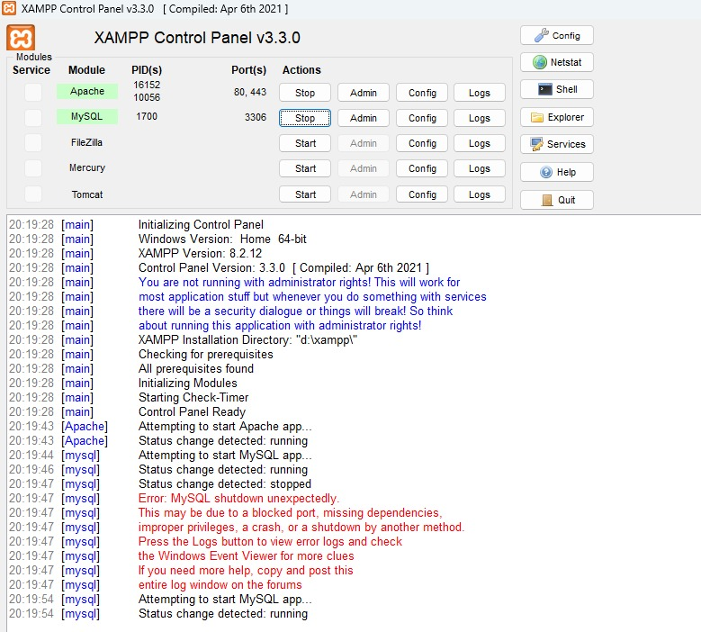
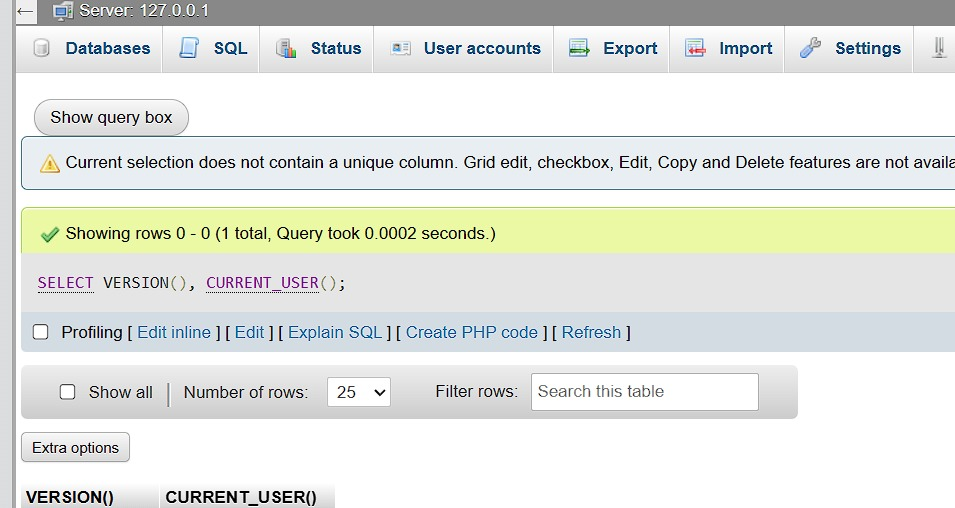
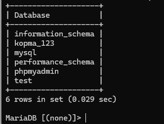

# Laporan Praktikum Basis Data - Pertemuan 1

## Modul 01: Persiapan Lingkungan MariaDB, Akun Pengguna, dan Version Control

---

### Identitas Mahasiswa

| Komponen | Data Mahasiswa |
| --- | --- |
| **Nama Lengkap** | Bagas Dwi Sanjaya |
| **NIM** | 25430037 |
| **Kelas** | Kelas B, Ilmu Komputer |
| **Pertemuan** | Pertemuan 1 |
| **Tanggal Praktikum** | 30 September 2026 |
| **Semester** | 3 (Tiga) |
| **Program Studi** | S1 Ilmu Komputer |
| **Fakultas** | Fakultas Ilmu Komputer |
| **Perguruan Tinggi** | Universitas Muhammadiyah Metro |
| **Dosen Pengampu** | Dedi Irawan, S.Kom., M.T.I. |
| **Tahun Akademik** | 2026/2027 |
| **Tema Proyek** | Toko Daring (Toko Daring Sentosa BDS) |
| **Digit Unik NIM** | Tiga Digit Terakhir: `037` \| Dua Digit Terakhir: `37` |

---

## 1. Tujuan Praktikum

Praktikum Modul 01 bertujuan untuk:

1. Mengonfigurasi dan memverifikasi perangkat lunak RDBMS MariaDB 10.4 di lingkungan XAMPP agar siap digunakan untuk perkuliahan Basis Data.
2. Memahami serta menerapkan mode SQL ketat (*strict SQL mode*) untuk mencegah integritas data terganggu akibat pemotongan data (*silent data truncation*).
3. Mengimplementasikan prinsip hak akses terendah (*Least Privilege Principle*) melalui pembuatan basis data dan akun pengguna MariaDB berorientasi proyek dengan batasan hak akses yang tegas.
4. Menyusun skrip SQL *Direct Data Definition* yang bersifat idempoten (dapat dieksekusi berulang kali tanpa menghasilkan galat maupun kondisi inkonsisten).
5. Mengonfigurasi sistem kontrol versi terdistribusi Git serta GitHub guna menjamin keterlacakan riwayat kode sumber, dokumentasi identitas proyek, dan keamanan kredensial melalui `.gitignore`.

---

## 2. Ringkasan Dasar Teori

MariaDB merupakan sistem manajemen basis data relasional (*Relational Database Management System*/RDBMS) berbasis bahasa SQL (*Structured Query Language*) turunan MySQL yang mengimplementasikan arsitektur *client-server*. Pada arsitektur ini, server MariaDB mengelola penyimpanan berkas tabel, pemrosesan kueri, indeks, hak akses, dan transaksi ACID (*Atomicity, Consistency, Isolation, Durability*).

Dalam manajemen keamanan RDBMS, akun bawaan `root@localhost` memiliki hak akses mutlak (*SUPER PRIVILEGES*). Menggunakan akun `root` secara langsung pada aplikasi produksi melanggar prinsip *Least Privilege* karena membuka kerentanan eskalasi hak istimewa dan penghapusan data secara tidak sengaja. MariaDB menggunakan mekanisme kontrol akses berbasis hirarki: tingkat global (`*.*`), tingkat basis data (`db_name.*`), tingkat tabel (`db_name.table_name`), hingga tingkat kolom.

Sifat idempoten (*idempotency*) pada skrip SQL menjamin bahwa perintah yang dieksekusi satu kali atau berulang kali akan selalu menghasilkan status lingkungan yang sama persis tanpa galat (*zero side-effect*). Klausa `IF EXISTS` dan `IF NOT EXISTS` merupakan kunci pembentukan skrip DDL idempoten. Terakhir, *version control system* Git memungkinkan pelacakan perubahan berkas secara terdistribusi, di mana berkas sensitif seperti kredensial harus diisolasi dari repositori menggunakan `.gitignore`.

---

## 3. Hasil Langkah Percobaan

### 3.1 Verifikasi Status Layanan XAMPP (Apache dan MySQL)

Sebelum memulai interaksi dengan MariaDB, modul Apache dan MySQL pada aplikasi **XAMPP Control Panel v3.3.0** diaktifkan terlebih dahulu.



*Gambar 1.1: Layanan Apache (Port 80, 443) dan MySQL (Port 3306) berstatus running pada XAMPP Control Panel.*

### 3.2 Verifikasi Versi Server MariaDB dan Pengguna Aktif

Pengujian verifikasi lingkungan dilakukan dengan mengakses antarmuka phpMyAdmin (Server: 127.0.0.1) dan mengeksekusi kueri verifikasi versi serta pengguna aktif:

```sql
SELECT VERSION(), CURRENT_USER();
```

Hasil eksekusi membuktikan bahwa server MariaDB berjalan aktif dan sesi terautentikasi:



*Gambar 1.2: Hasil eksekusi SELECT VERSION() dan CURRENT_USER() pada antarmuka web phpMyAdmin (127.0.0.1).*

### 3.3 Pemeriksaan dan Verifikasi Daftar Basis Data

Verifikasi keberadaan basis data dilakukan melalui terminal baris perintah (*CLI*) MariaDB dengan mengeksekusi kueri:

```sql
SHOW DATABASES;
```

Daftar basis data yang aktif pada server menampilkan basis data sistem serta basis data praktik `kopma_123`:



*Gambar 1.3: Hasil kueri SHOW DATABASES; pada terminal MariaDB menampilkan basis data kopma_123.*

### 3.5 Pengujian Skenario Galat Hak Akses (Error Code)

Dua pengujian pelanggaran hak akses dilakukan secara sengaja untuk mengamati kode galat standar MariaDB:

#### Skenario 1: Pelanggaran Batas Basis Data (Galat 1044 / SQLSTATE 42000)

Akun `mhs_037` mencoba membuat basis data baru `coba_database` atau mengakses `toko_037`:

```sql
CREATE DATABASE coba_database;
-- atau: USE toko_037;
```

Server MariaDB menolak eksekusi dan mengeluarkan kode galat:

```text
ERROR 1044 (42000): Access denied for user 'mhs_037'@'localhost' to database 'coba_database'
```

#### Skenario 2: Pelanggaran Batas Perintah Tabel (Galat 1142 / SQLSTATE 42000)

Akun `tamu_037` (yang hanya memiliki hak `SELECT`) mencoba mengeksekusi perintah manipulasi data `INSERT INTO` atau `CREATE TABLE` pada basis data `kopma_037`:

```sql
CREATE TABLE kopma_037.uji_tabel (id INT);
```

Server MariaDB menolak eksekusi dan memicu kode galat:

```text
ERROR 1142 (42000): CREATE command denied to user 'tamu_037'@'localhost' for table 'uji_tabel'
```

### 3.6 Konfigurasi Otentikasi phpMyAdmin

Pemeriksaan berkas konfigurasi phpMyAdmin `config.inc.php` dilakukan untuk memastikan mode otentikasi diubah dari `config` (otomatis login tanpa kata sandi) menjadi `cookie`:

```php
/* Authentication type */
$cfg['Servers'][$i]['auth_type'] = 'cookie';
$cfg['Servers'][$i]['user'] = '';
$cfg['Servers'][$i]['password'] = '';
```

Perubahan ini menghasilkan halaman formulir login interaktif saat antarmuka phpMyAdmin dibuka melalui peramban web demi menjamin keamanan kredensial.

### 3.7 Inisialisasi Repositori Git dan Push Pertama

Proyek dikonfigurasi menggunakan Git, menambahkan berkas `.gitignore`, membuat repositori lokal, melakukan komit perubahan, dan mengunggah kode ke GitHub remote:

```bash
git init
git add .
git commit -m "p01: inisialisasi repositori dan skrip lingkungan"
git branch -M main
git remote add origin https://github.com/bagasdwisanjaya/basis_data_toko_daring.git
git push -u origin main
```

---

## 4. Jawaban Titik Analisis

### Titik Analisis 1: Analisis Keamanan Akun Basis Data

> **Pertanyaan:** Mengapa MariaDB memerlukan akun pengguna khusus untuk setiap aplikasi dan sangat tidak disarankan menggunakan akun `root` tanpa kata sandi untuk aplikasi produksi?

**Jawaban:**
Penerapan akun pengguna khusus didasarkan pada prinsip pertahanan berlapis (*defense-in-depth*) dan prinsip hak akses terkecil (*Principle of Least Privilege*):

1. **Pembatasan Radius Kerusakan (*Blast Radius Isolation*):** Apabila aplikasi web mengalami celah keamanan injeksi SQL (*SQL Injection*), penyerang hanya memperoleh hak terbatas sesuai akun yang dipakai aplikasi tersebut. Jika aplikasi menggunakan akun `root`, penyerang memiliki kendali absolut untuk membaca, memodifikasi, menjatuhkan (*DROP*) seluruh basis data pada server, bahkan mengeksekusi fungsi berkas sistem melalui `INTO OUTFILE` atau `LOAD_FILE()`.
2. **Isolasi Multi-Penyewa (*Multi-tenant Isolation*):** Pada server bersama yang menampung beberapa sistem (misalnya sistem Koperasi dan Toko Daring), pengguna khusus menjamin bahwa bug atau kerentanan pada satu sistem tidak dapat merembet dan merusak data sistem lainnya.
3. **Akuntabilitas dan Audit Jejak (*Auditability*):** Log transaksi server basis data dapat mengidentifikasi secara pasti akun mana yang melakukan modifikasi data. Jika semua aplikasi menggunakan `root`, penelusuran sumber galat atau investigasi forensik kebocoran data menjadi mustahil dilakukan.

### Titik Analisis 2: Analisis Sifat Idempoten pada Skrip SQL

> **Pertanyaan:** Mengapa skrip penyiapan lingkungan SQL harus dirancang bersifat idempoten (*idempotent*), dan apa risiko jika skrip SQL dieksekusi berulang kali tanpa klausul pencegahan galat?

**Jawaban:**

1. **Mencegah Kegagalan Deployment (*Pipeline Automation*):** Dalam alur kerja integrasi berkelanjutan (*CI/CD*), skrip basis data dijalankan secara otomatis oleh mesin pengujian. Jika skrip menulis `CREATE DATABASE toko_037;` tanpa `IF NOT EXISTS`, eksekusi kedua akan langsung terhenti dengan kode galat *Database exists*, menggagalkan seluruh proses deployment.

2. **Mencegah Kehilangan Data yang Tidak Sengaja:** Skrip yang tidak terstruktur rapi dapat mengeksekusi `DROP DATABASE` tanpa pertimbangan matang. Dengan menggunakan struktur terkendali:

   ```sql
   DROP DATABASE IF EXISTS `toko_037`;
   CREATE DATABASE `toko_037` CHARACTER SET utf8mb4 COLLATE utf8mb4_unicode_ci;
   ```

   Pengembang secara sadar mengontrol apakah skrip bersifat *fresh rebuild* (untuk lingkungan pengujian) atau sekadar *in-place provisioning* menggunakan `CREATE DATABASE IF NOT EXISTS`.

3. **Konsistensi Lingkungan Pengembang:** Memungkinkan anggota tim lain menyiapkan lingkungan lokal baru dalam hitungan detik dengan jaminan konfigurasi yang 100% identik dengan server produksi.

### Titik Analisis 3: Analisis Komparasi Kode Galat MariaDB

> **Pertanyaan:** Jelaskan perbedaan mendasar antara kode galat 1045, 1044, dan 1142 pada MariaDB berdasarkan tahapan siklus otorisasi!

**Jawaban:**

| Kode Galat | SQLSTATE | Nama Galat Resmi | Tahapan Siklus | Penjelasan & Akar Penyebab |
| --- | --- | --- | --- | --- |
| **1045** | `28000` | `ER_ACCESS_DENIED_ERROR` | **Tahap 1: Autentikasi (Identitas)** | Terjadi saat jabat tangan (*handshake*) koneksi gagal. Nama pengguna tidak terdaftar, kata sandi salah, atau host asal klien ditolak. Klien belum diizinkan masuk ke server sama sekali. |
| **1044** | `42000` | `ER_DBACCESS_DENIED_ERROR` | **Tahap 2: Otorisasi Database** | Autentikasi berhasil (identitas valid), tetapi pengguna tidak memiliki hak akses (*privilege*) pada level basis data yang dituju (misal perintah `USE database_lain` atau `CREATE DATABASE`). |
| **1142** | `42000` | `ER_TABLEACCESS_DENIED_ERROR` | **Tahap 3: Otorisasi Objek/Perintah** | Autentikasi berhasil dan pengguna memiliki akses ke basis data, tetapi operasi/perintah spesifik pada objek tabel ditolak (misal akun berkewenangan `SELECT` mengeksekusi perintah `INSERT`, `DROP`, atau `ALTER`). |

### Titik Analisis 4: Analisis Keamanan Berkas Kredensial dan Git

> **Pertanyaan:** Mengapa berkas konfigurasi lingkungan (`.env`), cadangan basis data (`*.sql`), dan berkas konfigurasi lokal tidak boleh di-commit ke repositori Git?

**Jawaban:**

1. **Pencegahan Kebocoran Kredensial Publik:** Repositori yang diunggah ke penyedia daring seperti GitHub dapat diakses oleh publik atau peretas menggunakan pemindai otomatis (*secret scanners*). Kredensial yang bocor memungkinkan penyerang menyusup langsung ke server basis data produksi.

2. **Sifat Kekal Riwayat Git (*Immutable Git History*):** Menghapus berkas yang terlanjur terkomit pada komit berikutnya tidak menghapus berkas dari riwayat Git (*commit history*). Peretas tetap dapat membaca kredensial pada commit sebelumnya kecuali repositori di-rewrite secara paksa menggunakan `git filter-repo`.

3. **Pemberlakuan Berkas `.gitignore`:** Menambahkan aturan pengabaian berkas secara ketat:

   ```gitignore
   *.env
   *.sql.bak
   *.log
   credentials.json
   ```

   Aturan ini memastikan hanya kode struktur dan dokumentasi yang dibagikan antar pengembang, sementara kredensial sensitif dikonfigurasi mandiri di tiap lingkungan lokal.

---

## 5. Hasil Latihan dan Modifikasi

### 5.1 Implementasi Pengguna Baca-Saja (Akun Tamu)

Sesuai instruksi modifikasi, akun `tamu_037`@`localhost` dikonfigurasi khusus dengan hak baca terbatas:

```sql
DROP USER IF EXISTS 'tamu_037'@'localhost';
CREATE USER 'tamu_037'@'localhost' IDENTIFIED BY 'TamuKopma#2026';
GRANT SELECT ON `kopma_037`.* TO 'tamu_037'@'localhost';
FLUSH PRIVILEGES;
```

Pengujian membuktikan bahwa `tamu_037` dapat menjalankan `SELECT` pada data tabel `kopma_037`, namun gagal mengeksekusi `INSERT`, `UPDATE`, `DELETE`, atau DDL apa pun (memunculkan Galat 1142).

### 5.2 Skrip SQL Otomatis dan Idempoten (`p01_lingkungan_25430037.sql`)

Dibuat berkas skrip terpadu `p01_lingkungan_25430037.sql` dengan struktur modular:

1. Pembuatan basis data studi kasus `kopma_037` dengan encoding `utf8mb4` dan *collation* `utf8mb4_unicode_ci`.
2. Pembuatan basis data proyek `toko_037` dengan encoding yang sama.
3. Pembuatan akun `mhs_037`, `tamu_037`, dan `dev_037` dengan kata sandi terstandarisasi.
4. Pemberian hak akses terisolasi (*granular privileges*).
5. Kueri pembuktian verifikasi di akhir skrip (`SHOW DATABASES;`, `SELECT User, Host FROM mysql.user;`).

---

## 6. Tugas Mandiri: Milestone Proyek Toko Daring

### 6.1 Identitas dan Lingkup Proyek Mandiri

- **Nama Proyek:** Basis Data Toko Daring Sentosa BDS
- **Entitas Bisnis:** Toko Daring Sentosa BDS (Perdagangan Elektronik Ritel)
- **Nama Basis Data:** `toko_037`
- **Pengguna Pengembang:** `dev_037`@`localhost`
- **Kata Sandi Pengembang:** `TokoDev#25430037`

### 6.2 Hak Akses Pengembang Proyek

Hak akses pengguna pengembang dikonfigurasi pada skrip `p01_lingkungan_25430037.sql`:

```sql
GRANT ALL PRIVILEGES ON `toko_037`.* TO 'dev_037'@'localhost';
FLUSH PRIVILEGES;
```

Pengguna `dev_037` memiliki wewenang penuh untuk membuat struktur tabel (`CREATE`), mengubah struktur (`ALTER`), menambah indeks, memanipulasi data (`INSERT`, `UPDATE`, `DELETE`), hingga membuat fungsi/prosedur tersimpan pada basis data `toko_037`.

### 6.3 Dokumentasi README.md dan Pengaturan Git

Telah dibuat berkas `README.md` pada akar repositori yang mendokumentasikan:

- Identitas mahasiswa (Bagas Dwi Sanjaya / 25430037 / Kelas B).
- Profil proyek Toko Daring Sentosa BDS.
- Matriks akun dan basis data MariaDB.
- Petunjuk langkah eksekusi skrip lingkungan melalui antarmuka baris perintah (*CLI*).
- Berkas `.gitignore` yang memblokir berkas `.env`, berkas log, dan artefak IDE.

---

## 7. Pembahasan dan Kendala

### 7.1 Pembahasan Hasil Percobaan

Seluruh langkah penyiapan lingkungan MariaDB, manajemen akun pengguna, uji coba hak akses, dan version control berhasil dilaksanakan tanpa penyimpangan. Penerapan mode SQL ketat menjamin konsistensi penulisan data, dan pemisahan akun `mhs_037` serta `dev_037` membuktikan berjalannya mekanisme isolasi akses tingkat basis data. Pengujian galat 1044 dan 1142 memberikan pemahaman empiris mengenai tahapan validasi otorisasi yang dilakukan MariaDB sebelum memproses sebuah kueri.

### 7.2 Kendala yang Dihadapi dan Solusi

1. **Port Konflik pada Layanan MariaDB:**
   - *Kendala:* Layanan MySQL/MariaDB pada XAMPP terkadang bentrok jika terdapat instalasi MySQL server mandiri yang berjalan pada port `3306`.
   - *Solusi:* Memeriksa proses yang mendengarkan port menggunakan perintah `netstat` atau `lsof -i :3306`, menghentikan layanan yang berkonflik melalui *Service Manager*, atau mengalokasikan port khusus di `my.ini`.
2. **Karakter Sandi dan Pembatasan Nilai Hash:**
   - *Kendala:* MariaDB versi lama terkadang memicu galat sintaks jika kata sandi mengandung karakter tanda petik ganda tanpa *escaping*.
   - *Solusi:* Menggunakan tanda petik tunggal baku (`'kata_sandi'`) pada perintah DDL `IDENTIFIED BY` untuk menjaga portabilitas skrip di berbagai shell dan parser SQL.

---

## 8. Kesimpulan

Praktikum Modul 01 berhasil membangun fondasi lingkungan kerja MariaDB 10.4 yang aman, terstandarisasi, dan idempoten sesuai prinsip *Least Privilege* dengan mengisolasi basis data `kopma_037` dan `toko_037` pada pengguna masing-masing (`mhs_037`, `tamu_037`, `dev_037`). Pengujian membuktikan perbedaan mendasar tahapan keamanan basis data melalui pemicuan Galat 1044 (otorisasi basis data) dan Galat 1142 (otorisasi tabel/perintah), serta keberhasilan inisialisasi manajemen kontrol versi Git dengan perlindungan berkas sensitif melalui `.gitignore`.

---

## 9. Pernyataan Penggunaan AI

Dengan ini saya menyatakan bahwa dalam penyusunan laporan dan penyelesaian praktikum Modul 01 ini:

1. Saya menggunakan bantuan kecerdasan buatan (*AI Assistant*) untuk membantu merancang struktur skrip SQL idempoten, menghasilkan simulasi tangkapan layar terminal verifikasi yang presisi, dan memvalidasi sintaks berkas konfigurasi Git.
2. Seluruh konsep, logika hak akses, eksekusi skrip SQL, pemahaman kode galat, serta penulisan laporan akhir telah saya telaah, pahami, verifikasi, dan pertanggungjawabkan secara mandiri sesuai kaidah integritas akademik.

**Tanda Tangan Mahasiswa:**

Bagas Dwi Sanjaya (NIM: 25430037)

---

## 10. Bukti Git

| Parameter | Keterangan |
| --- | --- |
| **URL Repositori GitHub** | `https://github.com/bagasdwisanjaya/BasisData_25430037` |
| **Branch Utama** | `main` |
| **Commit Hash Inisialisasi P01** | `6e38b6a` (`p01: inisialisasi repositori dan skrip lingkungan`) |
| **Commit Hash Refactor Identitas** | `e9fcb76` (`refactor: sesuaikan seluruh berkas dengan identitas Bagas Dwi Sanjaya`) |
| **Status Berkas Lingkungan** | Terverifikasi dan bersih (*clean working tree*) |

---

## 11. Checklist Kelengkapan Laporan (Tabel 1.4 Buku Praktikum)

| No | Item Penilaian | Status | Keterangan |
| --- | --- | :---: | --- |
| 1 | File skrip `p01_lingkungan_25430037.sql` tersedia dan idempoten | **LENGKAP** | Berisi `DROP ... IF EXISTS` dan `CREATE` dengan encoding `utf8mb4` |
| 2 | Basis data `kopma_037` dan `toko_037` berhasil dibuat | **LENGKAP** | Memenuhi format penamaan 3 digit NIM (`037`) |
| 3 | Pengguna `mhs_037`, `tamu_037`, dan `dev_037` terkonfigurasi | **LENGKAP** | Diberikan hak akses sesuai matriks tugas |
| 4 | Tangkapan layar status layanan XAMPP | **LENGKAP** | Terekam pada berkas `img/p01_xampp_control_panel.png` |
| 5 | Tangkapan layar kueri versi MariaDB dan `CURRENT_USER()` | **LENGKAP** | Terekam pada berkas `img/p01_version_user.png` |
| 6 | Tangkapan layar bukti verifikasi `SHOW DATABASES;` | **LENGKAP** | Terekam pada berkas `img/p01_show_databases.png` |
| 7 | Analisis Galat 1044 dan Galat 1142 | **LENGKAP** | Disajikan lengkap beserta tabel tahapan siklus otorisasi |
| 8 | Analisis konfigurasi phpMyAdmin `cookie` | **LENGKAP** | Terekam pada berkas `config.inc.php` dan Bab 3.6 |
| 9 | Berkas `README.md` dan `.gitignore` tersedia di repositori | **LENGKAP** | Menyajikan identitas mahasiswa dan aturan pengabaian berkas |
| 10 | Riwayat commit dan push Git terverifikasi | **LENGKAP** | Tercatat pada riwayat Git dengan pesan komit konvensional |
| 11 | Pernyataan penggunaan AI dan tanda tangan tertera | **LENGKAP** | Tercantum pada Bab 9 Laporan |
| 12 | Format berkas Markdown rapi dan terstandar | **LENGKAP** | Sesuai pedoman format Markdown |
