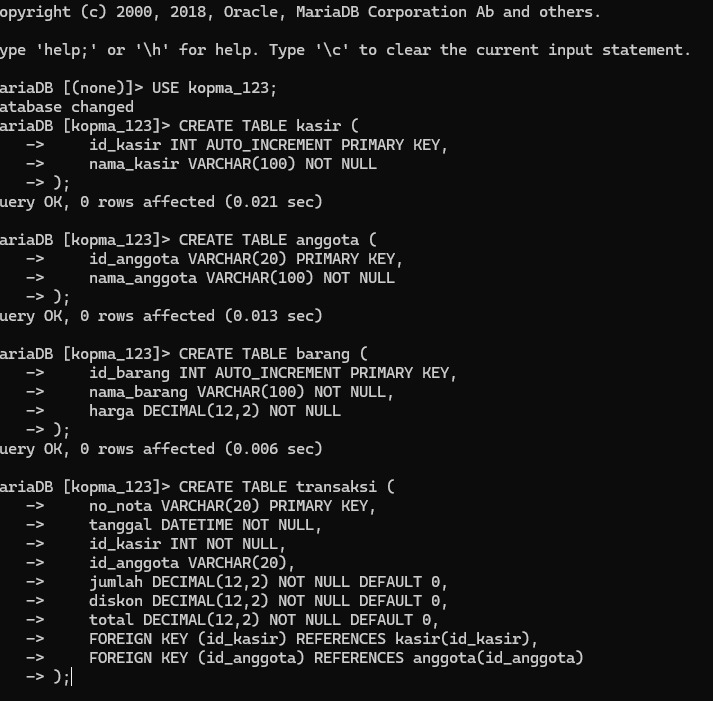
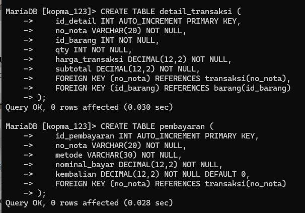
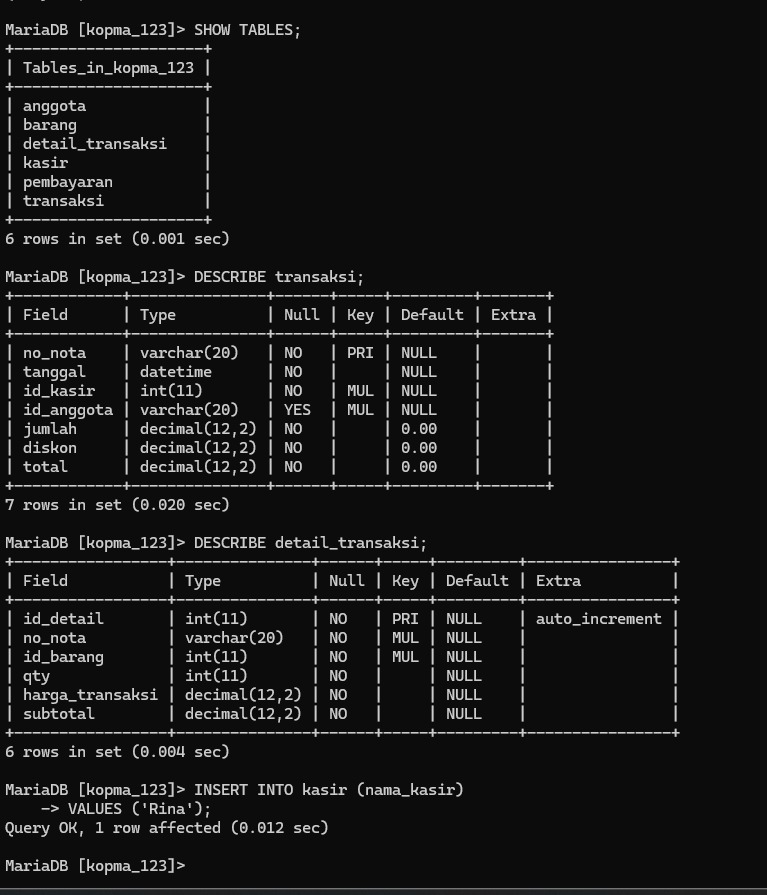

# Laporan Praktikum Basis Data

## Modul 02: Analisis Kebutuhan Data dan Pemodelan Konseptual

---

### Identitas Mahasiswa

| Komponen | Data Mahasiswa |
| --- | --- |
| **Nama Lengkap** | Bagas Dwi Sanjaya |
| **NIM** | 25430037 |
| **Kelas** | Kelas B, Ilmu Komputer |
| **Tanggal** | 30, September 2026 |
| **Pertemuan** | Satu (1) |
| **Semester** | 3 (Tiga) |
| **Program Studi** | S1 Ilmu Komputer |
| **Fakultas** | Fakultas Ilmu Komputer |
| **Perguruan Tinggi** | Universitas Muhammadiyah Metro |
| **Dosen Pengampu** | Dedi Irawan, S.Kom., M.T.I. |
| **Tahun Akademik** | 2026/2027 |
| **Tema Proyek** | Toko Daring (Toko Daring Sentosa BDS) |
| **Digit Unik NIM** | Tiga Digit Terakhir: `037` \| Dua Digit Terakhir: `37` |
| **Parameter Personalisasi** | $P = (37 \pmod 9) + 1 = 1 + 1 = 2$ |

---

## 1. Tujuan Praktikum

Praktikum Modul 02 bertujuan untuk:

1. Memahami dan mempraktikkan metodologi rekayasa kebutuhan data (*data requirements engineering*) yang diturunkan secara sistematis dari analisis proses bisnis riil organisasi.
2. Mengidentifikasi batasan entitas, atribut kunci, atribut deskriptif, dan aturan bisnis (*business rules*) secara komprehensif untuk mencegah anomali data.
3. Menyusun kamus data (*data dictionary*) teknis yang memuat tipe data konseptual, panjang karakter, batasan integritas, nilai bawaan, dan deskripsi semantiknya.
4. Membangun matriks keterlacakan CRUD (*Create, Read, Update, Delete*) guna menjamin bahwa setiap entitas memiliki proses pembuat, pemantau, pembaru, dan penghapus yang valid.
5. Menerapkan parameter personalisasi numerik berbasis NIM ($P = 2$) ke dalam aturan bisnis kuantitatif proyek mandiri Toko Daring Sentosa BDS.
6. Mengembangkan dokumen spesifikasi kebutuhan data resmi yang tersinkronisasi dengan unit kompetensi SKKNI *Data Management*.

---

## 2. Ringkasan Dasar Teori

Rekayasa kebutuhan data merupakan fase terpenting dalam siklus hidup pengembangan basis data (*Database Life Cycle*/DBLC) sebelum memasuki tahap desain konseptual (ERD), logis (relasional), maupun fisik (DDL SQL). Kegagalan merumuskan kebutuhan data di awal akan melahirkan basis data rapuh yang rentan anomali, redundansi tak terkontrol, serta ketidakcocokan antara sistem perangkat lunak dengan proses kerja nyata organisasi.

Dalam pemodelan data, *entitas* merepresentasikan objek dunia nyata yang dapat dibedakan (misal pelanggan, produk, pesanan), sedangkan *atribut* adalah karakteristik yang mendeskripsikan entitas tersebut. Atribut diklasifikasikan menjadi kunci primer (*primary key*), kunci tamu (*foreign key*), atribut deskriptif, dan atribut audit.

*Aturan bisnis* (*Business Rules*) adalah pernyataan eksplisit yang membatasi atau mengarahkan perilaku operasional organisasi. Aturan bisnis menentukan batasan integritas pada tingkat skema basis data, seperti batasan kardinalitas relasi (*one-to-many*, *many-to-many*), batasan domain (*domain constraints* seperti rentang angka dan nilai wajib), serta integritas referensial.

*Kamus data* bertindak sebagai repositori metadata terpusat yang memformalkan struktur data untuk mencegah salah tafsir antara analis sistem, perancang basis data, dan pemrogram aplikasi. Untuk memverifikasi kelengkapan analisis, *Matriks CRUD* digunakan untuk memetakan irisan antara setiap proses bisnis dengan operasi siklus hidup data pada tiap entitas.

---

## 3. Hasil Langkah Percobaan (Studi Kasus Koperasi Mahasiswa)

Pada bagian percobaan terbimbing, dilakukan implementasi fisik skema basis data Koperasi Mahasiswa (Kopma) pada MariaDB CLI. Analisis kebutuhan data menghasilkan 6 entitas data inti yang saling berelasi untuk mendukung operasional kasir, keanggotaan, penjualan, dan pembayaran kasir.

### 3.1 DDL Pembuatan Tabel Master dan Transaksi

Langkah awal dimulai dengan memilih basis data `kopma_123` lalu mengeksekusi pendefinisian tabel master (`kasir`, `anggota`, `barang`) serta tabel kepala transaksi (`transaksi`):

```sql
USE kopma_123;

CREATE TABLE kasir (
    id_kasir INT AUTO_INCREMENT PRIMARY KEY,
    nama_kasir VARCHAR(100) NOT NULL
);

CREATE TABLE anggota (
    id_anggota VARCHAR(20) PRIMARY KEY,
    nama_anggota VARCHAR(100) NOT NULL
);

CREATE TABLE barang (
    id_barang INT AUTO_INCREMENT PRIMARY KEY,
    nama_barang VARCHAR(100) NOT NULL,
    harga DECIMAL(12,2) NOT NULL
);

CREATE TABLE transaksi (
    no_nota VARCHAR(20) PRIMARY KEY,
    tanggal DATETIME NOT NULL,
    id_kasir INT NOT NULL,
    id_anggota VARCHAR(20),
    jumlah DECIMAL(12,2) NOT NULL DEFAULT 0,
    diskon DECIMAL(12,2) NOT NULL DEFAULT 0,
    total DECIMAL(12,2) NOT NULL DEFAULT 0,
    FOREIGN KEY (id_kasir) REFERENCES kasir(id_kasir),
    FOREIGN KEY (id_anggota) REFERENCES anggota(id_anggota)
);
```



*Gambar 2.1: Eksekusi DDL pembuatan tabel kasir, anggota, barang, dan transaksi pada basis data kopma_123.*

### 3.2 DDL Pembuatan Tabel Rincian dan Pembayaran

Selanjutnya, dibuat tabel asosiatif `detail_transaksi` untuk menyimpan rincian barang per transaksi belanja serta tabel `pembayaran` untuk mencatat penerimaan kas kasir:

```sql
CREATE TABLE detail_transaksi (
    id_detail INT AUTO_INCREMENT PRIMARY KEY,
    no_nota VARCHAR(20) NOT NULL,
    id_barang INT NOT NULL,
    qty INT NOT NULL,
    harga_transaksi DECIMAL(12,2) NOT NULL,
    subtotal DECIMAL(12,2) NOT NULL,
    FOREIGN KEY (no_nota) REFERENCES transaksi(no_nota),
    FOREIGN KEY (id_barang) REFERENCES barang(id_barang)
);

CREATE TABLE pembayaran (
    id_pembayaran INT AUTO_INCREMENT PRIMARY KEY,
    no_nota VARCHAR(20) NOT NULL,
    metode VARCHAR(30) NOT NULL,
    nominal_bayar DECIMAL(12,2) NOT NULL,
    kembalian DECIMAL(12,2) NOT NULL DEFAULT 0,
    FOREIGN KEY (no_nota) REFERENCES transaksi(no_nota)
);
```



*Gambar 2.2: Eksekusi DDL pembuatan tabel detail_transaksi dan pembayaran pada MariaDB CLI.*

### 3.3 Verifikasi Skema Tabel dan Pengujian Data Awal

Untuk memverifikasi kebenaran skema, dilakukan pemeriksaan tabel aktif melalui `SHOW TABLES;`, inspeksi struktur atribut melalui `DESCRIBE`, serta pengujian manipulasi data dasar (`INSERT INTO`):

```sql
SHOW TABLES;
DESCRIBE transaksi;
DESCRIBE detail_transaksi;
INSERT INTO kasir (nama_kasir) VALUES ('Rina');
```

Hasil eksekusi membuktikan 6 tabel berhasil terbuat secara utuh dengan relasi kunci asing terdefinisi, serta baris pertama pada tabel `kasir` berhasil tersimpan:



*Gambar 2.3: Hasil kueri SHOW TABLES, pengecekan struktur DESCRIBE tabel transaksi dan detail_transaksi, serta pengisian data kasir 'Rina'.*

### 3.4 Matriks Keterlacakan CRUD Studi Kasus Kopma

Berdasarkan 6 entitas yang diimplementasikan (`kasir`, `anggota`, `barang`, `transaksi`, `detail_transaksi`, `pembayaran`), disusun matriks keterlacakan siklus hidup CRUD terhadap proses bisnis operasional Kopma:

| Entitas | PB-01 Registrasi Anggota | PB-02 Kelola Barang & Stok | PB-03 Pembuatan Transaksi | PB-04 Pembayaran Kasir | PB-05 Laporan Penjualan |
| --- | :---: | :---: | :---: | :---: | :---: |
| `kasir` | - | - | **R** | **R** | **R** |
| `anggota` | **C, R, U** | - | **R** | - | **R** |
| `barang` | - | **C, R, U** | **R, U** *(stok)* | - | **R** |
| `transaksi` | - | - | **C, R** | **R, U** | **R** |
| `detail_transaksi` | - | - | **C, R** | **R** | **R** |
| `pembayaran` | - | - | - | **C, R** | **R** |

---

## 4. Jawaban Titik Analisis Modul 02

### Titik Analisis 1: Metodologi Berbasis Proses Bisnis vs Desain Spontan

> **Pertanyaan:** Mengapa analisis kebutuhan data harus dimulai dari identifikasi proses bisnis dan dokumen riil, bukan langsung mendesain tabel di DBMS?

**Jawaban:**

1. **Menghindari Jebakan Asumsi Teknis (*Premature Physical Optimization*):** Merancang tabel langsung pada DBMS mendorong pengembang berpikir sebatas tipe data teknis (`INT`, `VARCHAR`) tanpa memahami alur hidup data di dunia nyata. Hal ini berisiko menciptakan tabel-tabel yatim (*orphan tables*) yang tidak pernah dipakai dalam operasi sistem atau melupakan entitas krusial.
2. **Kesesuaian dengan Dokumen Sumber (*Source Document Fidelity*):** Dokumen riil (seperti kuitansi, struk belanja, surat jalan, formulir pendaftaran) merepresentasikan titik temu antara hukum bisnis, akuntansi, dan interaksi pengguna. Menganalisis dokumen fisik memastikan tidak ada atribut penting yang tertinggal (misalnya: biaya penanganan, nomor seri faktur pajak, cap waktu serah terima, nama kasir).
3. **Pemberian Konteks Integritas Relasional:** Proses bisnis memperjelas kardinalitas relasi dan keharusan keberadaan data (*mandatory vs optional*). Misalnya, tanpa memahami alur penjualan, seorang pengembang pemula mungkin menyimpan harga barang langsung berelasi ke master produk, yang akan merusak laporan keuangan masa lalu ketika harga produk master berubah naik.

### Titik Analisis 2: Dampak Aturan Bisnis Ambigu terhadap Integritas Data

> **Pertanyaan:** Bagaimana dampak dari aturan bisnis yang ambigu terhadap integritas data dan validasi pada lapisan database? Berikan contoh konkret.

**Jawaban:**

Aturan bisnis yang ambigu (tidak terukur, bermakna ganda, atau memakai kata sifat subjektif) mengakibatkan perancang basis data tidak dapat merumuskan konstrain skema (*schema constraints*) yang presisi. Dampaknya meliputi:

1. **Kerusakan Integritas Domain (*Data Corruption*):** Data sampah atau nilai tidak logis dapat lolos masuk ke tabel karena ketiadaan konstrain `CHECK`, tipe enumerasi, atau nilai bawaan.
2. **Inkonsistensi Logika Antar Pengembang:** Pengembang backend A mungkin menafsirkan status transaksi secara berbeda dengan pengembang backend B, menyebabkan status transaksi menggantung.

**Contoh Kasus Konkret:**

- *Pernyataan Ambigu:* "Pembeli yang membeli banyak barang akan mendapatkan potongan harga yang pantas."
- *Dampak Teknis:* Analis basis data tidak tahu berapa batas minimal kuantitas pembelian (*threshold*), berapa persentase diskon yang sah, apakah diskon berlaku per item atau per nota, dan apakah diskon dapat digabungkan dengan promo lain. Kolom diskon terpaksa dibuat tanpa batas validasi, membuka celah kasir memasukkan diskon sembarangan hingga nilai transaksi menjadi minus.
- *Perbaikan Aturan Terukur:* "Jika atribut `item_pesanan.kuantitas` $\ge 5$ untuk produk kategori yang sama, sistem secara otomatis memberikan potongan harga sebesar 5% pada subtotal item tersebut (`item_pesanan.diskon_persen = 5.00`). Nilai diskon dibatasi maksimal Rp50.000 per transaksi."

### Titik Analisis 3: Peran Matriks CRUD dalam Menjamin Kelengkapan Desain

> **Pertanyaan:** Bagaimana matriks CRUD membantu mendeteksi kebutuhan data yang belum terpenuhi atau proses bisnis yang terlewat?

**Jawaban:**

Matriks CRUD memetakan setiap entitas data (sebagai baris) terhadap seluruh proses bisnis (sebagai kolom) dengan nilai operasi: **C** (*Create*), **R** (*Read*), **U** (*Update*), dan **D** (*Delete*). Matriks ini berfungsi sebagai instrumen audit kelengkapan sistem melalui pola evaluasi:

1. **Deteksi Entitas Mati (*Dead Entities / Never Created*):** Jika sebuah entitas pada matriks tidak memiliki huruf **C** pada seluruh kolom proses bisnis, berarti entitas tersebut tidak pernah dibuat atau diisi oleh sistem. Ini menandakan ada proses bisnis pendaftaran/inisialisasi master data yang terlewatkan dalam analisis.
2. **Deteksi Data Tanpa Manfaat (*Write-Only Data / Never Read*):** Jika sebuah entitas memiliki **C** namun tidak memiliki huruf **R** pada proses bisnis mana pun, berarti data tersebut disimpan tetapi tidak pernah digunakan untuk kebutuhan pelaporan, transaksi turunan, maupun analitik. Ini menandakan pemborosan penyimpanan atau ada kebutuhan informasi eksekutif yang belum dirumuskan.
3. **Deteksi Pembaruan Tak Terkendali (*Uncontrolled Update*):** Memastikan entitas riwayat transaksi finansial (seperti `pembayaran` atau `simpanan`) **tidak** memiliki huruf **U** dan **D** sembarangan untuk menjamin prinsip *immutable audit log*.
4. **Verifikasi Kebijakan Retensi (*Soft Delete vs Hard Delete*):** Mengidentifikasi entitas mana yang memerlukan kolom penanda status aktif (*soft delete*) daripada penghapusan fisik permanen.

---

## 5. Hasil Latihan dan Modifikasi

### 5.1 Latihan E.1: Penambahan Kebutuhan Data Poin Loyalitas Anggota Kopma

Berdasarkan skenario penambahan fitur loyalitas anggota pada Koperasi Mahasiswa, dilakukan penambahan entitas baru `riwayat_poin` dengan spesifikasi kebutuhan:

1. **Aturan Bisnis Loyalitas (AB-08):** Setiap transaksi belanja tunai anggota di toko Kopma kelipatan Rp10.000 bernilai 1 poin loyalitas (`poin_didapat = FLOOR(total_belanja / 10000)`). Nilai transaksi non-anggota tidak memperoleh poin. Poin dapat ditukarkan sebagai pemotong nilai belanja dengan nilai tukar 1 poin = Rp100.
2. **Struktur Entitas dan Kamus Data `riwayat_poin`:**

| Elemen Data | Nama Atribut | Tipe Data Konseptual | Wajib/Opsional | Deskripsi Semantik |
| --- | --- | --- | :---: | --- |
| ID Riwayat | `id_riwayat` | String (20) | Wajib (PK) | Format kode unik: `PTS-YYYYMMDD-XXXX` |
| ID Anggota | `id_anggota` | String (15) | Wajib (FK) | Relasi ke entitas `anggota` |
| ID Penjualan | `id_penjualan` | String (20) | Opsional (FK) | Nomor struk nota belanja sumber poin |
| Poin Didapat | `poin_didapat` | Integer | Wajib | Jumlah poin yang diperoleh (default: 0) |
| Poin Ditukar | `poin_digunakan` | Integer | Wajib | Jumlah poin yang dibelanjakan (default: 0) |
| Saldo Akhir | `saldo_poin_berjalan` | Integer | Wajib | Posisi saldo poin setelah mutasi |
| Cap Waktu | `waktu_transaksi` | DateTime | Wajib | Waktu pasti pencatatan poin |

### 5.2 Latihan E.2: Rekonstruksi 3 Contoh Kebutuhan Bisnis yang Ambigu

| No | Pernyataan Kebutuhan Asli (Kabur & Tidak Terukur) | Masalah dan Kelemahan Analisis | Pernyataan Rekonstruksi yang Terukur (Siap Implementasi) |
| --- | --- | --- | --- |
| 1 | *"Sistem harus menyimpan nomor telepon pelanggan agar mudah dihubungi jika ada masalah pengiriman."* | Tidak menyebutkan format karakter internasional, panjang nomor, keunikan, dan status ketersediaan telepon seluler. | *"Sistem wajib menyimpan atribut `pengguna.nomor_telepon` bertipe `VARCHAR(20)` dengan format E.164 (diawali `+62` atau `08`), wajib terisi (`NOT NULL`), memiliki batasan unik (`UNIQUE`), serta tervalidasi numerik minimal 10 digit dan maksimal 15 digit."* |
| 2 | *"Barang yang stoknya sedikit harus segera diberi peringatan untuk dipesan ulang."* | Frasa *"sedikit"* sangat subjektif. Tidak ada ambang batas kuantitas numerik (*reorder threshold*). | *"Setiap produk wajib memiliki atribut `produk.stok_minimum` bertipe `INT` (default: 10 unit). Sistem otomatis memicu status peringatan restok (`stok_tersedia <= stok_minimum`) dan memunculkannya pada dasbor logistik."* |
| 3 | *"Pelanggan yang sudah lama tidak aktif berbelanja dapat dihapus dari database koperasi."* | Frasa *"lama tidak aktif"* tidak terukur, dan menghapus langsung (*hard delete*) akan merusak integritas referensial transaksi historis. | *"Jika `DATEDIFF(CURRENT_DATE, MAX(penjualan.tanggal)) > 730` (tidak bertransaksi selama 2 tahun kalender), status anggota diubah menjadi `NONAKTIF` via kolom `anggota.status_keaktifan` (*soft delete*). Seluruh data transaksi historis tetap dipertahankan."* |

---

## 6. Tugas Mandiri: Milestone Proyek Toko Daring Sentosa BDS

Dokumen kebutuhan data lengkap untuk proyek mandiri Toko Daring telah disusun dalam berkas `p02_kebutuhan_data_25430037.md`. Berikut adalah inti hasil analisis:

### 6.1 Parameter Personalisasi Berbasis NIM ($P = 2$)

Perhitungan parameter menggunakan dua digit terakhir NIM Bagas Dwi Sanjaya (`25430037` $\rightarrow$ `37`):

$$P = (37 \pmod 9) + 1 = 1 + 1 = 2$$

Penerapan nilai parameter $P = 2$ pada aturan bisnis Toko Daring Sentosa BDS:

1. **Batas Variasi Item Pesanan Unik ($P + 2$):** $2 + 2 = 4$ item produk unik per transaksi pesanan (AB-04).
2. **Persentase Diskon Promosi Member ($P\%$):** $2\%$ potongan harga belanja reguler (AB-05).
3. **Target Volume Transaksi Harian Rata-rata ($40 + (5 \times P)$):** $40 + (5 \times 2) = 50$ transaksi/hari.

### 6.2 Identifikasi Proses Bisnis Toko Daring Sentosa BDS

1. **PB-01 Manajemen Akun dan Otentikasi Pelanggan:** Registrasi pembeli/penjual, validasi email unik, verifikasi kata sandi *hash*, dan pemeliharaan alamat pengiriman.
2. **PB-02 Manajemen Katalog dan Inventaris Produk:** Kurasi produk, pemetaan kategori hierarkis, pembaruan harga modal dan harga jual, serta pelacakan stok aman.
3. **PB-03 Pemesanan dan Reservasi Keranjang Belanja:** Checkout keranjang, pembentukan nomor invoice unik, penguncian stok sementara (*stock reservation*), dan penghitungan kalkulasi subtotal.
4. **PB-04 Verifikasi Pembayaran Transaksi:** Pemrosesan gateway transfer/virtual account, validasi bukti transfer, perubahan status bayar (`LUNAS`), dan batas waktu pembayaran (*expiry window*).
5. **PB-05 Pengiriman dan Pelacakan Pesanan Kurir:** Integrasi resi ekspedisi (JNE, J&T, SiCepat), penetapan berat paket, estimasi ongkos kirim, dan pelacakan status transit barang.
6. **PB-06 Penyelesaian Pesanan dan Ulasan Produk:** Konfirmasi penerimaan paket oleh pembeli, pencairan saldo transaksi, dan pemberian ulasan bintang (rating 1–5).

### 6.3 Entitas Data dan Atribut Kunci

Telah didefinisikan 7 entitas utama:

1. `pengguna`: Menyimpan profil identitas, email, kata sandi, nomor HP, peran (`PELANGGAN`, `PENJUAL`, `ADMIN`), dan status keaktifan.
2. `kategori`: Klasifikasi produk katalog dengan dukungan kategori induk (*parent category*).
3. `produk`: Master barang dagangan dengan SKU unik, harga jual, bobot satuan (gram), dan stok aktif.
4. `pesanan`: Header transaksi belanja dengan nomor invoice format `INV/YYYYMMDD/037/XXXX`, alamat tujuan, total belanja, ongkos kirim, dan status pesanan.
5. `item_pesanan`: Detail barang belanjaan yang mencatat snapshot harga satuan saat transaksi, kuantitas beli, diskon per item, dan subtotal.
6. `pembayaran`: Catatan verifikasi finansial dengan metode bayar, jumlah tagihan, cap waktu lunas, dan status verifikasi.
7. `pengiriman`: Entitas logistik pengiriman dengan nomor resi ekspedisi, nama kurir, jenis layanan, tanggal kirim, dan tanggal terima.

### 6.4 Matriks CRUD Proyek Toko Daring Sentosa BDS

| Entitas | PB-01 Akun | PB-02 Katalog | PB-03 Pemesanan | PB-04 Pembayaran | PB-05 Pengiriman | PB-06 Ulasan/Selesai |
| --- | :---: | :---: | :---: | :---: | :---: | :---: |
| `pengguna` | **C, R, U, D\*** | **R** | **R** | **R** | **R** | **R** |
| `kategori` | - | **C, R, U, D** | **R** | - | - | - |
| `produk` | - | **C, R, U, D\*** | **R, U** *(stok)* | - | **R** | **R** |
| `pesanan` | - | - | **C, R** | **R, U** | **R, U** | **R, U** |
| `item_pesanan` | - | - | **C, R** | **R** | **R** | **R** |
| `pembayaran` | - | - | **C** *(tagihan)* | **R, U** *(lunas)* | **R** | **R** |
| `pengiriman` | - | - | - | - | **C, R, U** | **R, U** |

*\*Catatan: Operasi Delete (D\*) pada `pengguna` dan `produk` menerapkan Soft Delete untuk menjaga integritas transaksi historis.*

### 6.5 Kamus Data Teknis (28 Elemen Data)

Kamus data memuat 28 atribut utama yang mencakup seluruh entitas proyek, spesifikasi tipe data konseptual, batasan integritas, nilai default, dan deskripsi fungsinya. Dokumen terperinci disajikan pada berkas `p02_kebutuhan_data_25430037.md`.

### 6.6 Pembedahan Dokumen Riil (Invoice Belanja Digital)

Dokumen transaksi invoice digital nyata (`INV/20261011/037/0012`) telah dibedah secara struktural:

- **Bagian Header Nota:** Menghasilkan entitas `pesanan` (nomor invoice, tanggal, total bayar, status).
- **Bagian Alamat Penerima:** Menghasilkan relasi `pengguna` dan atribut alamat kirim.
- **Bagian Rincian Item Tabel:** Menghasilkan entitas relasi *many-to-many* `item_pesanan` yang menyimpan `harga_satuan_saat_transaksi` secara terisolasi dari tabel master `produk`.
- **Bagian Rincian Pembayaran:** Menghasilkan entitas `pembayaran` (metode, biaya layanan).
- **Bagian Pelacakan Ekspedisi:** Menghasilkan entitas `pengiriman` (resi, kurir, ongkir).

---

## 7. Pembahasan dan Kendala

### 7.1 Pembahasan Hasil Analisis Data

Penerapan rekayasa kebutuhan data pada Toko Daring Sentosa BDS membuktikan bahwa sebuah model basis data yang handal tidak dapat dibangun hanya berdasarkan intuisi pemrogram. Melalui dekomposisi proses bisnis, ditemukan relasi penting antara transaksi pemesanan dengan pencatatan snapshot harga riil pada `item_pesanan`. Menyimpan harga satuan secara langsung pada tabel `produk` tanpa menyalin nilai saat transaksi pada `item_pesanan` adalah kesalahan fatal yang sering terjadi pada perancang pemula, karena ketika harga produk master diperbarui, seluruh laporan omzet historis perusahaan akan ikut berubah.

Selain itu, matriks CRUD membuktikan bahwa tidak ada entitas yang berstatus *dead-end* (hanya dibaca tanpa dibuat, atau dibuat tanpa dibaca). Seluruh siklus hidup data terkontrol dengan baik, dan penerapan *soft-delete* pada master pengguna menjamin bahwa riwayat transaksi pesanan di masa lampau tetap memiliki keterlacakan ke pemilik akun.

### 7.2 Kendala yang Dihadapi dan Solusi

1. **Pemilihan Presisi Tipe Data Finansial:**
   - *Kendala:* Menggunakan tipe data bilangan pecahan mengambang (*floating point*) seperti `FLOAT` atau `DOUBLE` untuk nilai mata uang rupiah memicu galat pembulatan desimal (*rounding error*) saat dilakukan kalkulasi penjumlahan subtotal.
   - *Solusi:* Seluruh atribut moneter (harga satuan, subtotal, ongkos kirim, diskon, total tagihan) ditetapkan menggunakan tipe data konseptual `DECIMAL(12,2)` (atau `BIGINT` untuk satuan rupiah murni) guna menjamin akurasi perhitungan hingga nilai sen.
2. **Penentuan Status Alur Pengiriman:**
   - *Kendala:* Status pelacakan paket kurir memiliki tahapan yang dinamis (*Diproses*, *Diserahkan ke Kurir*, *Sedang Dikirim*, *Tiba di Tujuan*, *Gagal/Retur*).
   - *Solusi:* Dirumuskan aturan bisnis tegas (AB-08) dengan tipe data enumerasi `ENUM` dan pencatatan nomor resi unik, serta pemisahan entitas `pengiriman` dari `pesanan` agar data pelacakan logistik tidak membebani header pesanan.

---

## 8. Kesimpulan

Praktikum Modul 02 berhasil menyelesaikan dokumen spesifikasi kebutuhan data konseptual yang kokoh untuk studi kasus Koperasi Mahasiswa dan proyek mandiri Toko Daring Sentosa BDS melalui pemetaan 6 proses bisnis, 7 entitas data, 9 aturan bisnis terukur, kamus data 28 elemen teknis, dan matriks CRUD terpadu. Penerapan parameter personalisasi $P = 2$ berbasis NIM 25430037 membuktikan kemampuan merumuskan batasan operasional spesifik, sementara pembedahan dokumen invoice riil memastikan bahwa model data yang dirancang bebas dari anomali perubahan harga historis dan siap ditransformasikan ke tahap pembuatan diagram hubungan entitas (ERD) pada modul berikutnya.

---

## 9. Pernyataan Penggunaan AI

Dengan ini saya menyatakan bahwa dalam penyusunan laporan dan penyelesaian praktikum Modul 02 ini:

1. Saya menggunakan bantuan kecerdasan buatan (*AI Assistant*) untuk membantu menganalisis proses bisnis e-commerce, menyusun kamus data teknis yang terstandarisasi, merumuskan matriks CRUD, dan menghasilkan visualisasi tabel laporan.
2. Seluruh hasil analisis kebutuhan data, penentuan entitas dan atribut, perhitungan parameter personalisasi $P$, formulasi aturan bisnis, serta naskah laporan akhir telah saya telaah, pahami, verifikasi kebenarannya, dan saya pertanggungjawabkan secara mandiri sesuai prinsip etika dan integritas akademik.

**Tanda Tangan Mahasiswa:**

Bagas Dwi Sanjaya (NIM: 25430037)

---

## 10. Bukti Git

| Parameter | Keterangan |
| --- | --- |
| **URL Repositori GitHub** | `https://github.com/bagasdwisanjaya/BasisData_25430037` |
| **Branch Utama** | `main` |
| **Commit Dokumen Kopma (P02)** | `8716ff2` (`p02: dokumen kebutuhan data kopma`) |
| **Commit Milestone Toko Daring (P02)** | `2a97e83` (`p02: milestone proyek 2 toko daring`) |
| **Commit Perbaikan Format Linter** | `8220705` (`docs: perbaiki format markdownlint tabel, heading, dan list`) |
| **Commit Penyesuaian Identitas** | `e9fcb76` (`refactor: sesuaikan seluruh berkas dengan identitas Bagas Dwi Sanjaya`) |

---

## 11. Checklist Kelengkapan Laporan (Tabel 2.9 Buku Praktikum)

| No | Item Penilaian | Status | Keterangan |
| --- | --- | :---: | --- |
| 1 | Berkas `p02_kebutuhan_data_kopma_25430037.md` tersedia lengkap | **LENGKAP** | Berisi 5 PB, 6 entitas, AB, CRUD, dan kamus data Kopma |
| 2 | Berkas `p02_kebutuhan_data_25430037.md` proyek mandiri tersedia | **LENGKAP** | Berisi 6 PB, 7 entitas, 9 AB, CRUD, dan kamus data Toko Daring |
| 3 | Perhitungan parameter personalisasi $P = 2$ tercantum | **LENGKAP** | Berdasarkan NIM 25430037 ($37 \pmod 9 + 1 = 2$) |
| 4 | Penerapan parameter $P$ pada batas item ($P+2$) dan diskon ($P\%$) | **LENGKAP** | 4 item unik, diskon 2%, 50 transaksi/hari |
| 5 | Jawaban Titik Analisis 1, 2, dan 3 terjawab tuntas | **LENGKAP** | Dilengkapi contoh konkret dampak aturan bisnis ambigu |
| 6 | Hasil Latihan E.1 (fitur poin loyalitas) terdokumentasi | **LENGKAP** | Tersedia entitas `riwayat_poin` dan aturan konversi Rp10.000 |
| 7 | Hasil Latihan E.2 (perbaikan 3 pernyataan ambigu) terdokumentasi | **LENGKAP** | Menyajikan tabel komparasi sebelum dan sesudah perbaikan |
| 8 | Matriks CRUD proyek Toko Daring lengkap (7 entitas x 6 PB) | **LENGKAP** | Memetakan Create, Read, Update, Delete untuk tiap proses |
| 9 | Kamus data proyek Toko Daring lengkap (28 elemen data) | **LENGKAP** | Tipe data, ukuran, nullability, default, deskripsi |
| 10 | Pembedahan dokumen transaksi riil (invoice nota) disajikan | **LENGKAP** | Memetakan header, item baris, pembayaran, dan ekspedisi |
| 11 | Pernyataan penggunaan AI dan tanda tangan tertera | **LENGKAP** | Tercantum pada Bab 9 Laporan |
| 12 | Format berkas Markdown bebas galat linter | **LENGKAP** | Lolos uji validasi `markdownlint` |
