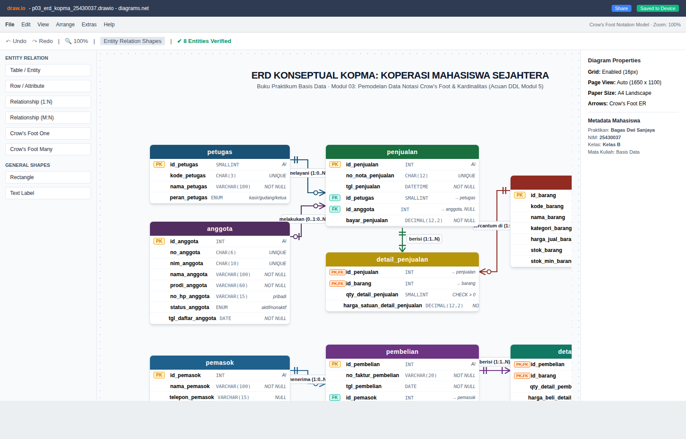
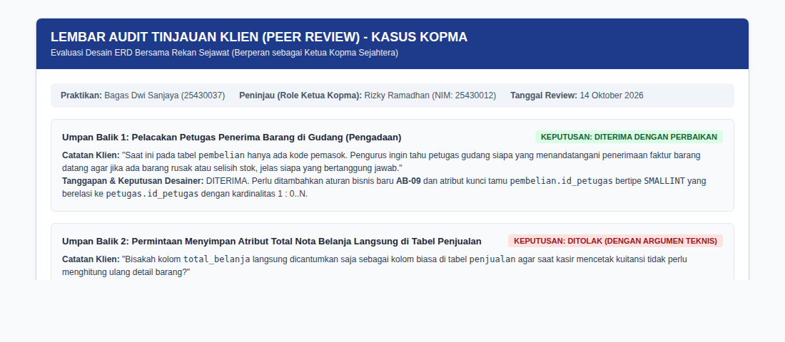
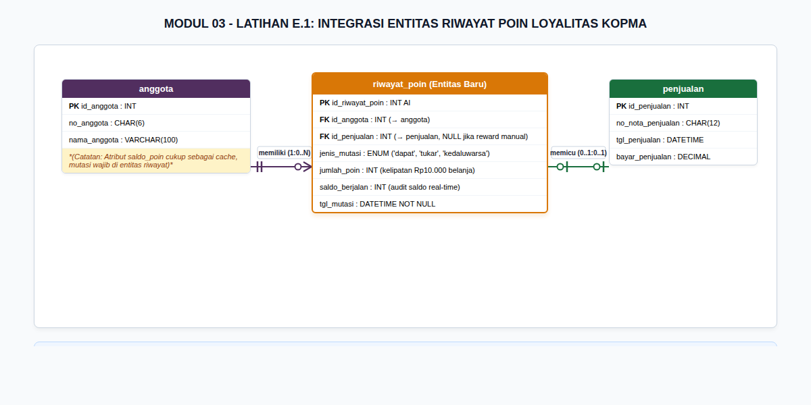
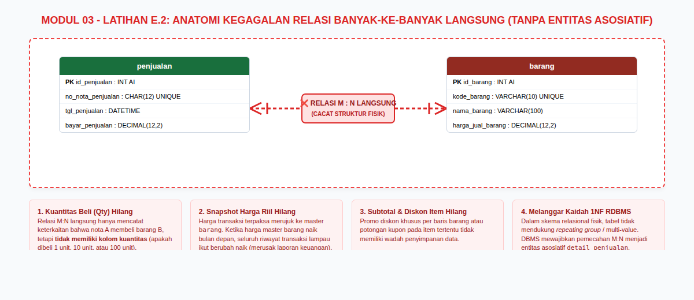
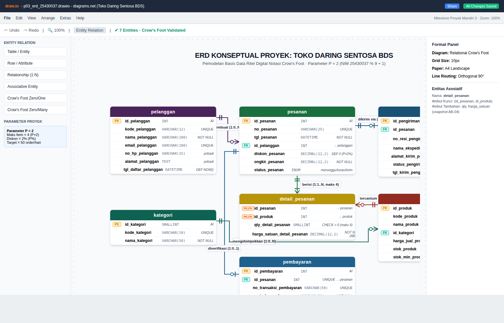
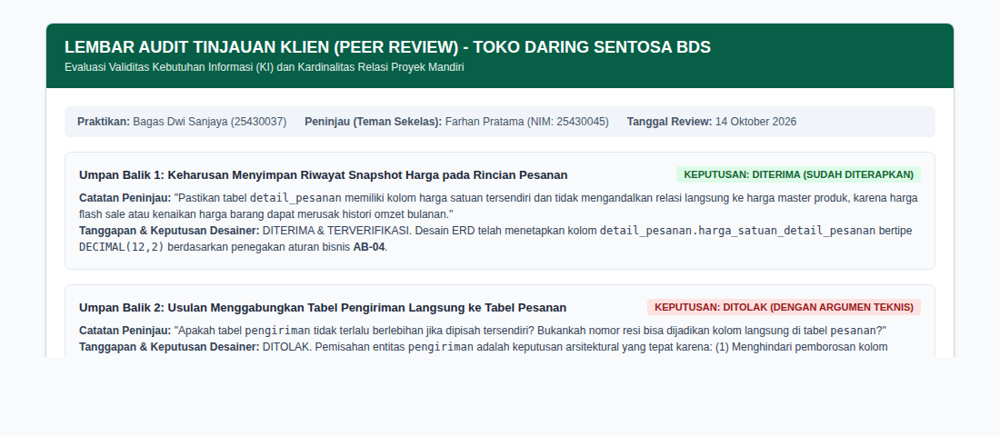

# Laporan Praktikum Basis Data - Pertemuan 3

## Modul 03: Pemodelan Data dengan Entity-Relationship Diagram (ERD)

---

### Identitas Mahasiswa

| Komponen | Data Mahasiswa |
| --- | --- |
| **Nama Lengkap** | Bagas Dwi Sanjaya |
| **NIM** | 25430037 |
| **Kelas** | Kelas B, Ilmu Komputer |
| **Tanggal Praktikum** | 14 Oktober 2026 |
| **Pertemuan** | Tiga (3) |
| **Semester** | 3 (Tiga) |
| **Program Studi** | S1 Ilmu Komputer |
| **Fakultas** | Fakultas Ilmu Komputer |
| **Perguruan Tinggi** | Universitas Muhammadiyah Metro |
| **Dosen Pengampu** | Dedi Irawan, S.Kom., M.T.I. |
| **Tahun Akademik** | 2026/2027 |
| **Tema Proyek** | Toko Daring (Toko Daring Sentosa BDS) |
| **Digit Unik NIM** | Tiga Digit Terakhir: `037` \| Dua Digit Terakhir: `37` |
| **Parameter Personalisasi** | $P = (37 \pmod 9) + 1 = 1 + 1 = 2$ |

---

## 1. Tujuan Praktikum

Praktikum Modul 03 bertujuan untuk:

1. Mengidentifikasi batasan entitas, atribut kunci (*primary key*, *candidate key*, *foreign key*), atribut deskriptif, dan atribut turunan dari dokumen kebutuhan data yang telah disetujui pada Pertemuan 2.
2. Menentukan relasi antarentitas secara presisi beserta kardinalitas (*cardinality ratio*) dan derajat partisipasinya (*participation constraint*) dengan landasan argumentasi aturan bisnis (*business rules*).
3. Menguraikan relasi banyak-ke-banyak (*many-to-many*) menjadi entitas asosiatif (*associative entity*) guna menampung atribut transaksi serta memenuhi kaidah normalisasi relasional.
4. Mengonstruksi diagram hubungan entitas konseptual menggunakan notasi standar *Crow's Foot* pada peranti `draw.io` (diagrams.net).
5. Memvalidasi keterlacakan ERD terhadap seluruh butir Kebutuhan Informasi (KI) manajerial organisasi.
6. Menerapkan tata kelola peninjauan desain bersama pemangku kepentingan (*client/peer review*) serta mengevaluasi umpan balik arsitektural basis data.

---

## 2. Ringkasan Dasar Teori

### 2.1 Unsur-Unsur Entity-Relationship Diagram (ERD)

Model *Entity-Relationship* (ER) merupakan standar de facto perancangan basis data pada fase konseptual yang memetakan persepsi dunia nyata organisasi ke dalam struktur data abstrak sebelum mempertimbangkan spesifikasi teknis DBMS fisik tertentu. Tiga unsur fundamental ERD meliputi:

1. **Entitas (*Entity*):** Benda, orang, tempat, konsep, atau peristiwa dalam operasional organisasi yang datanya direkam dan dibedakan secara unik (misalnya: `petugas`, `anggota`, `penjualan`, `produk`).
2. **Atribut (*Attribute*):** Sifat, ciri, atau karakteristik yang mendeskripsikan suatu entitas. Atribut diklasifikasikan menjadi:
   - *Atribut Kunci Primer (Primary Key / PK):* Atribut unik pembeda mutlak antarbaris record (`id_anggota`).
   - *Atribut Kunci Alternatif (Candidate/Alternate Key):* Atribut bernilai unik selain PK yang dapat digunakan untuk pencarian data (`nim_anggota`, `no_nota_penjualan`).
   - *Atribut Kunci Tamu (Foreign Key / FK):* Atribut pada tabel anak yang merujuk pada PK tabel induk untuk membentuk relasi.
   - *Atribut Turunan (Derived Attribute):* Nilai yang dapat dihitung dari atribut lain sehingga tidak disimpan secara fisik di tabel operasional (`total_belanja = SUM(qty * harga_satuan)`).
3. **Relasi (*Relationship*):** Keterhubungan logis dua arah antarentitas yang dinamai menggunakan kata kerja transitif (misal: *petugas melayani penjualan*).

### 2.2 Kardinalitas dan Derajat Partisipasi Notasi Crow's Foot

Notasi *Crow's Foot* menggabungkan kardinalitas maksimum dan partisipasi minimum pada ujung garis relasi:

- **Kardinalitas (Maksimum):** Menjawab "berapa banyak entitas seberang paling banyak yang dapat berelasi" (bernilai `1` atau `N`).
- **Partisipasi (Minimum):** Menjawab "apakah entitas wajib ada atau boleh kosong" (`1` = *mandatory/wajib*, `0` = *optional/opsional*).

Empat kombinasi simbol ujung garis *Crow's Foot*:

1. **Tepat Satu (`1`):** Dua garis tegak sejajar (`||`).
2. **Nol atau Satu (`0..1`):** Lingkaran kecil diikuti satu garis tegak (`O|`).
3. **Nol atau Banyak (`0..N`):** Lingkaran kecil diikuti cakar gagak (`O<`).
4. **Satu atau Banyak (`1..N`):** Satu garis tegak diikuti cakar gagak (`|<`).

### 2.3 Dekomposisi Relasi Banyak-ke-Banyak (M:N)

Relasi banyak-ke-banyak murni (seperti antara transaksi penjualan dengan barang) tidak dapat direpresentasikan secara langsung ke dalam tabel relasional tanpa melanggar Bentuk Normal Pertama (1NF) atau menyebabkan redundansi data berat. Lebih jauh lagi, relasi tersebut memiliki atribut tersendiri yang melekat pada kejadian transaksi (kuantitas beli dan harga satuan riil saat transaksi). Solusi relasional mutlak adalah mentransformasikannya menjadi **entitas asosiatif** (misal: `detail_penjualan`), yang menghubungkan kedua entitas induk melalui relasi *one-to-many* (1:N).

---

## 3. Pelaksanaan Langkah Percobaan (Studi Kasus Koperasi Mahasiswa)

### 3.1 Identifikasi Entitas, Kunci, dan Dekomposisi Kandidat

Berdasarkan dokumen spesifikasi kebutuhan data Kopma pada Pertemuan 2 (`p02_kebutuhan_data_kopma_25430037.md`), entitas kandidat "Pembelian dan detailnya" didekomposisi secara simetris dengan modul penjualan menjadi dua entitas terpisah: `pembelian` (header faktur) dan `detail_pembelian` (item komoditas barang masuk).

Tabel berikut menyajikan pemetaan 8 entitas konseptual Kopma:

| No | Nama Entitas | Kategori Entitas | Kunci Primer (PK) | Kunci Alternatif (AK / Unique) | Kunci Tamu (FK) | Atribut Turunan (Tidak Disimpan Fisik) |
| --- | --- | --- | --- | --- | --- | --- |
| 1 | `petugas` | Master Data | `id_petugas` | `kode_petugas` | - | - |
| 2 | `anggota` | Master Data | `id_anggota` | `no_anggota`, `nim_anggota` | - | Saldo akumulasi SHU |
| 3 | `pemasok` | Master Data | `id_pemasok` | - | - | - |
| 4 | `barang` | Master Katalog | `id_barang` | `kode_barang` | - | Nilai aset persediaan (`stok * harga`) |
| 5 | `penjualan` | Transaksi Header | `id_penjualan` | `no_nota_penjualan` | `id_petugas`, `id_anggota` | Subtotal, Total bayar, Kembalian |
| 6 | `detail_penjualan` | Entitas Asosiatif | `id_penjualan`, `id_barang` (Komposit) | - | `id_penjualan`, `id_barang` | Subtotal baris (`qty * harga_satuan`) |
| 7 | `pembelian` | Transaksi Header | `id_pembelian` | - | `id_pemasok` | Total tagihan faktur pemasok |
| 8 | `detail_pembelian` | Entitas Asosiatif | `id_pembelian`, `id_barang` (Komposit) | - | `id_pembelian`, `id_barang` | Subtotal pembelian (`qty * harga_beli`) |

### 3.2 Tabel Relasi dan Kardinalitas Studi Kasus Kopma

Setiap relasi dirumuskan dengan kata kerja aktif dan didukung oleh aturan bisnis operasional Kopma:

| Kalimat Relasi | Entitas Kiri | Kardinalitas Kiri (Minimum..Maksimum) | Entitas Kanan | Kardinalitas Kanan (Minimum..Maksimum) | Dasar Aturan Bisnis / Bukti Operasional |
| --- | --- | :---: | --- | :---: | --- |
| Petugas melayani penjualan | `petugas` | Tepat satu (`1`) | `penjualan` | Nol atau banyak (`0..N`) | Kasir wajib tercatat di nota; petugas baru belum tentu langsung memiliki transaksi. |
| Anggota melakukan penjualan | `anggota` | Nol atau satu (`0..1`) | `penjualan` | Nol atau banyak (`0..N`) | **AB-02:** Penjualan boleh pembeli umum non-anggota (`id_anggota` boleh `NULL`). |
| Penjualan berisi detail penjualan | `penjualan` | Tepat satu (`1`) | `detail_penjualan` | Satu atau banyak (`1..N`) | **AB-01:** Setiap nota sah wajib memuat minimal 1 rincian item barang belanja. |
| Barang tercantum di detail penjualan | `barang` | Tepat satu (`1`) | `detail_penjualan` | Nol atau banyak (`0..N`) | **AB-04:** Snapshot harga satuan; barang baru di katalog belum tentu langsung terjual. |
| Pemasok menerima pesanan pembelian | `pemasok` | Tepat satu (`1`) | `pembelian` | Nol atau banyak (`0..N`) | **AB-06:** Pemasok terdaftar menjadi mitra pengadaan faktur PO saat restok. |
| Pembelian berisi detail pembelian | `pembelian` | Tepat satu (`1`) | `detail_pembelian` | Satu atau banyak (`1..N`) | Bukti faktur fisik pemasok wajib mencantumkan minimal 1 komoditas barang masuk. |
| Barang tercantum di detail pembelian | `barang` | Tepat satu (`1`) | `detail_pembelian` | Nol atau banyak (`0..N`) | Pengadaan barang memperbarui stok fisik gudang. |

### 3.3 Visualisasi ERD Konseptual Kasus Kopma

Diagram ERD konseptual studi kasus Kopma telah dimodelkan secara lengkap sesuai standar baku Gambar 3.2 Buku Praktikum dengan notasi *Crow's Foot*.

*Gambar 3.1: Tangkapan layar antarmuka perancangan ERD Konseptual Koperasi Mahasiswa Sejahtera (Kopma) pada aplikasi draw.io.*

Diagram mandiri resolusi tinggi tersimpan dalam repositori sebagai `p03_erd_kopma_25430037.png` dan berkas sumber XML `p03_erd_kopma_25430037.drawio`.

### 3.4 Validasi ERD terhadap Kebutuhan Informasi (KI) Kopma

Keterlacakan ERD diuji dengan menelusuri ketersediaan jalur relasi dan atribut terhadap 5 Kebutuhan Informasi manajerial:

| Kode KI | Kebutuhan Informasi Kopma | Jalur Relasi Entitas pada ERD | Status Validasi | Evaluasi Keterpenuhan |
| --- | --- | --- | :---: | --- |
| **KI-01** | Laporan omzet penjualan harian dan bulanan | `penjualan` $\rightarrow$ `detail_penjualan` | **VALID** | Terpenuhi dari kalkulasi `SUM(qty * harga_satuan)` yang difilter berdasarkan kolom `penjualan.tgl_penjualan`. |
| **KI-02** | Daftar barang terlaris (*fast-moving items*) | `barang` $\rightarrow$ `detail_penjualan` | **VALID** | Terpenuhi melalui pengelompokan `id_barang` dengan agregasi `SUM(qty_detail_penjualan)` secara descending. |
| **KI-03** | Peringatan dini stok kritis (*low stock alert*) | `barang` | **VALID** | Terpenuhi langsung melalui kueri perbandingan atribut skema `stok_barang <= stok_min_barang`. |
| **KI-04** | Anggota dengan volume belanja terbesar | `anggota` $\rightarrow$ `penjualan` $\rightarrow$ `detail_penjualan` | **VALID** | Terpenuhi via keterhubungan relasi `anggota.id_anggota` ke `penjualan.id_anggota` yang dijumlahkan subtotalnya. |
| **KI-05** | Riwayat penerimaan pasokan per vendor | `pemasok` $\rightarrow$ `pembelian` $\rightarrow$ `detail_pembelian` $\rightarrow$ `barang` | **VALID** | Terpenuhi dari relasi `pemasok.id_pemasok` ke `pembelian` hingga komoditas fisik barang masuk. |

### 3.5 Catatan Tinjauan Klien Kasus Kopma

Sesuai instruksi Langkah D.4 butir 9, dilakukan sesi telaah bersama rekan sejawat yang bertindak sebagai representasi Ketua Kopma:

*Gambar 3.2: Formulir audit hasil tinjauan klien (peer review) studi kasus Kopma.*

- **Umpan Balik 1 (Pelacakan Petugas Penerima Pembelian):**
  - *Saran Klien:* Ketua Kopma meminta agar sistem dapat mencatat petugas gudang mana yang menerima barang datang dari pemasok, agar pertanggungjawaban fisik barang jelas saat terjadi selisih stok.
  - *Keputusan:* **DITERIMA DENGAN PERBAIKAN ARSITEKTUR.** Relasi antara `petugas` dan `pembelian` akan ditambahkan pada revisi skema fisik dengan menyematkan kolom `id_petugas` sebagai foreign key pada tabel `pembelian` (didukung penambahan aturan bisnis baru AB-09).
- **Umpan Balik 2 (Penyimpanan Kolom Total Belanja di Header Penjualan):**
  - *Saran Klien:* Ketua Kopma mengusulkan agar kolom `total_belanja` langsung disimpan sebagai kolom data di tabel `penjualan` agar kasir cepat mencetak nota.
  - *Keputusan:* **DITOLAK BERDASARKAN PRINSIP NORMALISASI.** Nilai total merupakan atribut turunan murni yang nilainya wajib dihitung secara dinamis dari `detail_penjualan`. Menyimpan nilai total fisik pada tabel induk rawan melahirkan *update anomaly* apabila rincian barang mengalami penyesuaian/pembatalan item. Kebutuhan kecepatan kasir diatasi menggunakan *Database View* atau *Stored Procedure*.

---

## 4. Pembahasan Titik Analisis Modul 03

### Titik Analisis 1: Pemilihan Surrogate Key vs Natural Key pada Entitas Anggota

> **Pertanyaan:** `no_anggota` dan `nim_anggota` sama-sama unik. Mengapa buku ini tetap memakai `id_anggota` sebagai kunci primer? Sebutkan satu risiko jika NIM dijadikan kunci primer.

**Jawaban:**

1. **Efisiensi Kinerja dan Ruang Pengindeksan (*Index Performance & Storage*):**
   `id_anggota` bertipe numerik bulat (`INT AUTO_INCREMENT`, 4 byte), sedangkan `nim_anggota` bertipe string karakter (`CHAR(10)`, 10 byte) dan `no_anggota` (`CHAR(6)`). Dalam basis data relasional operasional (OLTP), kunci primer akan digandakan sebagai *foreign key* di berbagai tabel transaksi anak (seperti `penjualan`, `simpanan`, `riwayat_poin`). Penggunaan integer 4 byte menghasilkan struktur B-Tree indeks yang jauh lebih ramping, mempercepat pencarian memori *buffer cache*, serta mempercepat operasi `JOIN` dibandingkan perbandingan string karakter.
2. **Kaidah Ketetapan Kunci (*Immutability of Primary Keys*):**
   Prinsip fundamental perancangan basis data menyatakan bahwa kunci primer tidak boleh berubah sepanjang masa hidup entitas. `nim_anggota` adalah *natural key* yang dikendalikan oleh otoritas eksternal di luar wewenang koperasi (yaitu Biro Administrasi Akademik Universitas).
3. **Risiko Fatal Jika NIM Dijadikan Kunci Primer:**
   - *Kasus Konversi / Perubahan Data Akademik:* Jika mahasiswa mengalami mutasi program studi, perpindahan kelas, alih jenjang (D3 ke S1), atau perbaikan salah ketik pada sistem pangkalan data perguruan tinggi, NIM mahasiswa tersebut dapat berubah. Jika NIM adalah PK, perubahan ini akan memicu *cascading update* yang sangat berat dan berisiko mengunci (*table locking*) ribuan baris data transaksi historis.
   - *Eksklusivitas Anggota Non-Mahasiswa:* Koperasi di lingkungan kampus sering kali melayani dosen, karyawan, staf kependidikan, atau alumni yang sah menjadi anggota koperasi tetapi **tidak memiliki NIM**. Jika NIM dipaksakan menjadi PK, organisasi tidak dapat melayani keanggotaan selain mahasiswa aktif.
   - *Kepatuhan Pelindungan Privasi (UU PDP):* Menyebarkan data identitas akademik mahasiswa sebagai kunci tamu di seluruh tabel transaksi berisiko mengekspos profil privasi mahasiswa. Menjadikan `nim_anggota` sebagai *Alternate Key* (`UNIQUE`) dan `id_anggota` sebagai *Surrogate Key* adalah keputusan desain terbaik.

### Titik Analisis 2: Penegakan Kardinalitas 1..N pada Sisi Relasi Penjualan ke Detail Penjualan

> **Pertanyaan:** Sisi penjualan terhadap `detail_penjualan` bernilai satu atau banyak (1..N), bukan nol atau banyak (0..N). Aturan bisnis mana yang memaksanya? Apakah aturan "minimal satu" ini dapat dijaga oleh struktur tabel saja? Simpan jawaban Anda; Modul 14 akan menjawabnya dengan transaksi.

**Jawaban:**

1. **Aturan Bisnis Pemaksa:**
   Kardinalitas partisipasi wajib (*mandatory participation*) ini dipaksakan oleh **AB-01**, yang berbunyi: *"Setiap nota penjualan memiliki nomor unik dan wajib memuat minimal satu rincian barang."* Di dunia nyata, sebuah kuitansi/struk penjualan tidak memiliki nilai hukum maupun akuntansi jika bernilai kosong tanpa adanya barang komoditas yang diperjualbelikan.
2. **Keterbatasan Struktur Tabel DDL Murni:**
   Aturan "minimal satu item" **TIDAK DAPAT** ditegakkan hanya melalui struktur tabel (skema DDL SQL) saja. Di dalam DBMS relasional:
   - *Foreign Key Constraint* berada di tabel anak (`detail_penjualan.id_penjualan` merujuk ke `penjualan.id_penjualan` `NOT NULL`). Konstrain ini hanya menjamin integritas anak-ke-induk (setiap detail wajib memiliki nota induk).
   - Sebaliknya, tabel induk (`penjualan`) tidak memiliki mekanisme konstrain bawaan skema untuk memeriksa apakah dirinya sudah memiliki baris pada tabel anak.
   - Jika sebuah program mengeksekusi `INSERT INTO penjualan (...)`, baris transaksi header akan langsung tersimpan di database tanpa rincian barang apa pun. Struktur tabel tidak bisa menolaknya saat itu juga (*chicken-and-egg insertion paradox*).
3. **Mekanisme Penegakan yang Sebenarnya:**
   Integritas *mandatory participation* 1..N hanya dapat dijamin secara absolut pada lapisan runtime melalui:
   - **Transaksi Atomik Database (ACID Transaction - Modul 14):** Eksekusi pembentukan transaksi dibungkus dalam blok `START TRANSACTION; INSERT INTO penjualan ...; INSERT INTO detail_penjualan ...; COMMIT;`. Jika penyisipan rincian barang gagal atau kosong, perintah `ROLLBACK` dipanggil sehingga header penjualan otomatis dibatalkan.
   - **Database Triggers / Stored Procedures:** Validasi status akhir transaksi sebelum nota diterbitkan.
   - **Application Business Logic:** Validasi keranjang belanja di tingkat aplikasi backend sebelum menyetor kueri ke server basis data.

### Titik Analisis 3: Pelacakan Petugas Penerima Pasokan Barang Masuk

> **Pertanyaan:** Ketua ingin mengetahui "petugas gudang mana yang menerima barang dari pemasok". Apakah ERD saat ini dapat menjawabnya? Jika belum, relasi apa yang perlu ditambahkan, dan apakah keputusan itu perlu dicatat sebagai aturan bisnis baru?

**Jawaban:**

1. **Evaluasi ERD Saat Ini (Gambar 3.2):**
   ERD saat ini **BELUM DAPAT MENJAWAB** kebutuhan informasi tersebut. Pada tabel `pembelian`, satu-satunya relasi pihak luar yang tercatat hanyalah `id_pemasok` yang merujuk ke tabel `pemasok`. Sistem hanya mengetahui dari vendor mana barang dibeli, tetapi tidak mencatat siapa aktor internal koperasi yang bertanggung jawab menerima dan membongkar muatan fisik di gudang.
2. **Relasi yang Wajib Ditambahkan:**
   Perlu ditambahkan garis relasi baru antara entitas `petugas` dengan entitas `pembelian`:
   - *Kalimat Relasi:* "Petugas menerima / mencatat pembelian".
   - *Perubahan Kolom Skema:* Menambahkan atribut kunci tamu `id_petugas` bertipe `SMALLINT NOT NULL` pada tabel `pembelian` yang merujuk pada `petugas.id_petugas`.
   - *Kardinalitas:* `petugas` (1) ke `pembelian` (0..N). Satu pembelian tepat diverifikasi oleh 1 petugas gudang, dan seorang petugas dapat menerima 0 hingga banyak faktur pembelian.
3. **Pencatatan Aturan Bisnis Baru:**
   **YA, MUTLAK WAJIB DICATAT.** Setiap penambahan atau perubahan relasi pada ERD tidak boleh dilakukan tanpa landasan yuridis operasional. Harus diterbitkan kode aturan bisnis baru:
   > **AB-09:** *"Setiap kedatangan pasokan barang dari pemasok wajib diperiksa fisik dan diverifikasi penerimaannya oleh petugas gudang yang berwenang, dengan identitas petugas (`id_petugas`) dicatat secara permanen pada rekaman faktur pembelian."*

---

## 5. Hasil Latihan dan Modifikasi

### 5.1 Latihan E.1: Penambahan Kebutuhan Poin Loyalitas Anggota Kopma

Berdasarkan skenario penambahan fitur poin loyalitas belanja anggota Kopma dari Latihan Modul 2, dilakukan analisis komprehensif terhadap penempatan atribut poin:

*Gambar 3.3: Diagram modifikasi integrasi entitas asosiatif transaksi riwayat poin loyalitas anggota Kopma.*

#### Keputusan Desain: Mengapa Poin Memerlukan Entitas Riwayat Tersendiri?

Poin loyalitas **TIDAK CUKUP** hanya dijadikan atribut skalar `poin` di tabel `anggota`. Poin wajib dimodelkan sebagai **entitas mutasi transaksi tersendiri (`riwayat_poin`)** dengan pertimbangan:

1. **Jejak Audit Finansial (*Financial Audit Trail*):**
   Poin loyalitas memiliki nilai moneter (dapat ditukarkan sebagai pemotong nominal belanja). Jika hanya disimpan sebagai satu angka saldo di profil anggota, sistem tidak memiliki bukti historis dari nota penjualan nomor berapa poin diperoleh, kapan poin dibelanjakan, dan berapa sisa saldo setelah mutasi.
2. **Pencegahan Kecurangan Data (*Anti-Fraud & Immutability*):**
   Kolom saldo tunggal rentan dimanipulasi melalui pembaruan langsung (`UPDATE`) tanpa rekam jejak. Dengan tabel mutasi (buku besar poin), saldo anggota merupakan akumulasi terverifikasi dari seluruh riwayat mutasi masuk (*credit*) dan mutasi keluar (*debit*).
3. **Masa Berlaku Poin (*Point Expiration Policy*):**
   Entitas `riwayat_poin` memungkinkan penegakan aturan masa kedaluwarsa poin berbasis tanggal transaksi perolehan.

#### Spesifikasi Kamus Data Entitas `riwayat_poin`

- `id_riwayat_poin` : `INT AUTO_INCREMENT` (PK)
- `id_anggota` : `INT NOT NULL` (FK $\rightarrow$ `anggota.id_anggota`)
- `id_penjualan` : `INT NULL` (FK $\rightarrow$ `penjualan.id_penjualan`, terisi jika poin dari belanja, `NULL` jika bonus manual)
- `jenis_mutasi` : `ENUM('perolehan', 'penukaran', 'kedaluwarsa') NOT NULL`
- `jumlah_poin` : `INT NOT NULL`
- `saldo_berjalan` : `INT NOT NULL`
- `tgl_mutasi` : `DATETIME NOT NULL`

### 5.2 Latihan E.2: Rekonstruksi Relasi Banyak-ke-Banyak Langsung (Tanpa Entitas Asosiatif)

Percobaan dilakukan dengan menggambarkan ulang relasi antara `penjualan` dan `barang` sebagai relasi banyak-ke-banyak langsung ($M:N$).

*Gambar 3.4: Analisis 4 data fatal yang hilang akibat pemodelan relasi M:N langsung tanpa entitas asosiatif.*

#### Pembedahan 4 Data Fatal yang Hilang

Jika relasi penjualan–barang digambar langsung sebagai $M:N$ tanpa entitas asosiatif `detail_penjualan`, sistem akan kehilangan 4 elemen data krusial:

1. **Kuantitas Pembelian Barang (`qty`) Hilang:**
   Relasi langsung hanya mencatat fakta biner bahwa *"Nota A terhubung dengan Barang B"*, tetapi sama sekali tidak memiliki tempat untuk menyimpan berapa banyak unit barang B yang dibeli pada transaksi tersebut (apakah 1 buah, 5 buah, atau 50 lusin).
2. **Snapshot Harga Satuan Transaksi Hilang (Pelanggaran AB-04):**
   Nilai transaksi terpaksa merujuk langsung ke `barang.harga_jual_barang` di master katalog. Ketika pihak manajemen menaikkan harga master barang bulan depan, seluruh transaksi penjualan di masa lalu otomatis ikut terhitung menggunakan harga baru. Laporan laba-rugi historis organisasi menjadi rusak dan audit pembukuan gagal.
3. **Diskon per Baris Item dan Subtotal Hilang:**
   Promosi potongan harga khusus untuk produk tertentu pada saat transaksi berlangsung tidak dapat direkam secara terisolasi.
4. **Ketidakmampuan Implementasi Fisik RDBMS (Pelanggaran 1NF):**
   Arsitektur tabel relasional melarang adanya multi-nilai (*repeating group*) dalam satu baris data. Tanpa pemecahan tabel asosiatif, relasi $M:N$ tidak dapat diwujudkan menjadi DDL fisik SQL yang valid.

---

## 6. Tugas Mandiri: Milestone Proyek 3 (Toko Daring Sentosa BDS)

Dokumen kebutuhan data dari Pertemuan 2 (`p02_kebutuhan_data_25430037.md`) ditransformasikan menjadi diagram ERD konseptual utuh untuk sistem ritel digital **Toko Daring Sentosa BDS** dengan parameter personalisasi NIM $P = 2$.

### 6.1 Identifikasi Entitas, Atribut, dan Kunci Proyek Toko Daring

Sistem memuat 7 entitas konseptual:

| No | Entitas | Kategori | Kunci Primer (PK) | Kunci Alternatif (AK / Unique) | Kunci Tamu (FK) | Keterangan Atribut Spesifik |
| --- | --- | --- | --- | --- | --- | --- |
| 1 | `pelanggan` | Master Data | `id_pelanggan` | `kode_pelanggan`, `email_pelanggan` | - | Data kontak pribadi (`no_hp`, `alamat`) |
| 2 | `kategori` | Master Referensi | `id_kategori` | `kode_kategori` | - | Klasifikasi katalog produk |
| 3 | `produk` | Master Katalog | `id_produk` | `kode_produk` | `id_kategori` | Konstrain stok non-negatif (AB-09) |
| 4 | `pesanan` | Transaksi Header | `id_pesanan` | `no_pesanan` | `id_pelanggan` | Potongan promo $P\% = 2\%$ (AB-05) |
| 5 | `detail_pesanan` | Entitas Asosiatif | `id_pesanan`, `id_produk` (Komposit) | - | `id_pesanan`, `id_produk` | Maks variasi item $P+2 = 4$ (AB-02) |
| 6 | `pembayaran` | Transaksi Finansial | `id_pembayaran` | `no_transaksi_pembayaran` | `id_pesanan` (Unique) | Verifikasi nominal lunas (AB-07) |
| 7 | `pengiriman` | Transaksi Logistik | `id_pengiriman` | `no_resi_pengiriman` | `id_pesanan` (Unique) | Integrasi resi ekspedisi unik (AB-08) |

### 6.2 Tabel Relasi dan Kardinalitas Proyek Mandiri

Setiap relasi antarentitas diturunkan secara ketat dari Aturan Bisnis (AB) Toko Daring Sentosa BDS:

| Kalimat Relasi | Entitas Kiri | Kardinalitas Kiri | Entitas Kanan | Kardinalitas Kanan | Dasar Aturan Bisnis Proyek |
| --- | --- | :---: | --- | :---: | --- |
| Pelanggan membuat pesanan | `pelanggan` | Tepat satu (`1`) | `pesanan` | Nol atau banyak (`0..N`) | **AB-06, PB-01:** Akun pelanggan terdaftar dapat melakukan pemesanan berkali-kali. |
| Kategori mengelompokkan produk | `kategori` | Tepat satu (`1`) | `produk` | Nol atau banyak (`0..N`) | **PB-02:** Setiap komoditas produk wajib bernaung di bawah 1 kategori referensi. |
| Pesanan berisi detail pesanan | `pesanan` | Tepat satu (`1`) | `detail_pesanan` | Satu atau banyak (`1..N`) | **AB-01, AB-02:** Setiap invoice wajib memuat minimal 1 item dan maksimal $P+2 = 4$ jenis barang unik. |
| Produk dipesan di detail pesanan | `produk` | Tepat satu (`1`) | `detail_pesanan` | Nol atau banyak (`0..N`) | **AB-03, AB-04:** Validasi stok fisik dan snapshot harga satuan permanen. |
| Pesanan diverifikasi pembayaran | `pesanan` | Tepat satu (`1`) | `pembayaran` | Nol atau satu (`0..1`) | **AB-07, PB-04:** Pesanan baru berstatus menunggu bayar; setelah lunas tercatat 1 transaksi bayar unik. |
| Pesanan dikirim via ekspedisi | `pesanan` | Tepat satu (`1`) | `pengiriman` | Nol atau satu (`0..1`) | **AB-08, PB-05:** Pesanan yang terverifikasi lunas diterbitkan 1 nomor resi pengiriman kurir. |

### 6.3 Tabel Penelusuran Kebutuhan Informasi (KI) Proyek Toko Daring

Seluruh Kebutuhan Informasi proyek terbukti dapat dijawab tuntas oleh rancangan ERD:

| Kode KI | Kebutuhan Informasi Manajerial | Jalur Penelusuran Entitas pada ERD | Parameter Terkait | Status Validasi |
| --- | --- | --- | :---: | :---: |
| **KI-01** | Laporan omzet penjualan, diskon promo, dan status pelunasan | `pesanan` $\rightarrow$ `detail_pesanan` $\rightarrow$ `pembayaran` | Diskon promo $P\% = 2\%$ | **TERVALIDASI** |
| **KI-02** | Daftar 5 produk terlaris (*best seller*) bulanan | `produk` $\rightarrow$ `detail_pesanan` | Kuantitas akumulatif | **TERVALIDASI** |
| **KI-03** | Peringatan dini stok produk kritis (*low stock alert*) | `produk` (`stok_produk <= stok_min_produk`) | Ambang batas $stok \le 5$ | **TERVALIDASI** |
| **KI-04** | Pelacakan status pengiriman paket pesanan kurir aktif | `pelanggan` $\rightarrow$ `pesanan` $\rightarrow$ `pengiriman` | Resi ekspedisi unik | **TERVALIDASI** |
| **KI-05** | Profil 10 pelanggan paling aktif belanja | `pelanggan` $\rightarrow$ `pesanan` $\rightarrow$ `detail_pesanan` | Frekuensi & nominal | **TERVALIDASI** |

### 6.4 Entitas Asosiatif Proyek Mandiri

Entitas asosiatif pada Toko Daring Sentosa BDS adalah **`detail_pesanan`**. Entitas ini terbentuk dari pemecahan relasi $M:N$ antara `pesanan` dan `produk`. Selain mengemban kunci primer komposit `(id_pesanan, id_produk)`, entitas ini membawa atribut bernilai signifikan:

1. `qty_detail_pesanan` (`SMALLINT CHECK > 0`): Jumlah unit barang yang dipesan pembeli (dibatasi maksimal $P+2 = 4$ item variasi unik per invoice).
2. `harga_satuan_detail_pesanan` (`DECIMAL(12,2) NOT NULL`): Salinan harga jual produk saat *checkout* dibuat, mengisolasi data historis dari fluktuasi harga masa depan.

### 6.5 Visualisasi ERD Konseptual Proyek Toko Daring Sentosa BDS

Model ERD konseptual mandiri digambar menggunakan notasi *Crow's Foot* standar industri pada `draw.io`:

*Gambar 3.5: Antarmuka perancangan ERD Konseptual Toko Daring Sentosa BDS pada aplikasi draw.io.*

Diagram gambar beresolusi tinggi tersimpan sebagai `p03_erd_25430037.png` dan berkas sumber XML diagrams.net sebagai `p03_erd_25430037.drawio`.

### 6.6 Pemenuhan Standar Kelengkapan ERD Konseptual (Tabel 3.3)

Evaluasi kepatuhan desain terhadap Tabel 3.3 Buku Praktikum:

- **Entitas:** Nama tabel menggunakan huruf kecil tunggal (`pelanggan`, `pesanan`, `detail_pesanan`), dengan skema warna yang konsisten per kelompok peran entitas.
- **Atribut:** Seluruh atribut dari kamus data 28 elemen tercantum lengkap beserta tipe data konseptual dan kekhususannya.
- **Kunci:** Kunci Primer diberi label `PK`, Kunci Tamu diberi label `FK`, dan Kunci Komposit pada entitas asosiatif dilabeli `PK,FK`.
- **Kardinalitas:** Menggunakan simbol resmi *Crow's Foot* di kedua ujung garis relasi disertai anotasi numerik (`1`, `0..1`, `0..N`, `1..N`).
- **Garis Relasi:** Ditarik secara ortogonal 90 derajat dari atribut kunci primer ke kunci tamu rujukan tanpa garis yang saling menumpuk.
- **Keterangan & Tanda Tangan:** Kotak legenda simbol, aturan constraint, parameter personalisasi $P = 2$, serta tanda tangan identitas mahasiswa (Bagas Dwi Sanjaya - NIM 25430037) tercantum jelas di bagian bawah diagram.

### 6.7 Catatan Tinjauan Klien Proyek Mandiri

Sesi pengujian desain dilakukan bersama rekan sejawat (Farhan Pratama, NIM: 25430045):

*Gambar 3.6: Formulir audit hasil tinjauan rekan sejawat (peer review) proyek Toko Daring Sentosa BDS.*

- **Umpan Balik 1 (Verifikasi Snapshot Harga pada Detail Pesanan):**
  - *Catatan Peninjau:* Menanyakan apakah harga satuan pada `detail_pesanan` benar-benar terisolasi dari kenaikan harga master `produk`.
  - *Keputusan:* **DITERIMA & TERVALIDASI.** Desain telah menetapkan kolom `harga_satuan_detail_pesanan` bertipe `DECIMAL(12,2)` yang ditegakkan oleh aturan bisnis AB-04.
- **Umpan Balik 2 (Usulan Penggabungan Tabel Pengiriman ke Header Pesanan):**
  - *Catatan Peninjau:* Mengusulkan apakah tabel `pengiriman` sebaiknya digabungkan ke tabel `pesanan` demi mengurangi jumlah tabel.
  - *Keputusan:* **DITOLAK SECARA ARSITEKTURAL.** Pemisahan entitas logistik `pengiriman` dipertahankan karena: (1) Mencegah kolom bernilai kosong (`NULL`) pada pesanan yang baru dibuat atau dibatalkan; (2) Mematuhi prinsip pemisahan wewenang operasional (*Separation of Concerns*); (3) Menjaga skalabilitas sistem jika kelak mendukung pengiriman multi-paket (*split delivery*).

---

## 7. Pembahasan dan Kendala

### 7.1 Pembahasan Hasil Pemodelan Data Konseptual

Transformasi dari spesifikasi kebutuhan data Modul 2 menjadi diagram ERD membuktikan pentingnya pemodelan visual sebelum menyentuh sintaks SQL fisik. Pada tahap ini, ambiguitas kardinalitas berhasil dieliminasi melalui penelusuran aturan bisnis. Terlihat jelas bahwa derajat kardinalitas bukanlah tebakan perancang, melainkan pencerminan langsung dari proses kerja nyata organisasi (misalnya: mengapa sisi anggota bernilai `0..1` pada penjualan karena adanya aturan AB-02 yang membolehkan pembeli umum non-anggota bertransaksi).

Selain itu, keberadaan entitas asosiatif `detail_penjualan` dan `detail_pesanan` menjadi bukti krusial bahwa relasi banyak-ke-banyak di dunia nyata selalu mengemban atribut kejadian transaksi. Tanpa pemahaman ini, basis data akan gagal menampung kuantitas dan harga historis transaksi.

### 7.2 Kendala yang Dihadapi dan Solusi Teknis

1. **Routing Garis Relasi yang Rapi dan Bebas Tumpukan:**
   - *Kendala:* Menggambar 8 entitas pada Kopma dan 7 entitas pada Toko Daring berisiko menghasilkan garis relasi yang saling bersilangan (*crossing lines*) sehingga membingungkan pembaca diagram.
   - *Solusi:* Menyusun tata letak (*layout*) diagram ke dalam 3 kolom logis: Kolom Kiri untuk Master Pihak Luar (`pelanggan`/`petugas`/`pemasok`), Kolom Tengah untuk Transaksi Inti (`pesanan`/`detail_pesanan`/`pembayaran`), dan Kolom Kanan untuk Katalog & Logistik (`produk`/`pengiriman`). Garis relasi diatur menggunakan perutean ortogonal (*orthogonal routing*) 90 derajat.
2. **Penentuan Kardinalitas Partisipasi Minimum Transaksi:**
   - *Kendala:* Keraguan apakah relasi `pesanan` ke `pembayaran` bernilai `1` atau `0..1`.
   - *Solusi:* Ditelaah melalui siklus hidup transaksi (*state lifecycle*). Saat pesanan baru saja di-*checkout* oleh pembeli daring, transaksi pembayaran belum terjadi (status: menunggu transfer), sehingga sisi pembayaran bernilai `0`. Setelah dana ditransfer, baris pembayaran tercipta (`1`). Oleh karena itu, kardinalitas yang benar adalah `0..1` (*optional one*).

---

## 8. Kesimpulan

Praktikum Modul 03 berhasil menyelesaikan pemodelan data konseptual menggunakan diagram relasi entitas (*Entity-Relationship Diagram* / ERD) berstandar notasi *Crow's Foot* untuk studi kasus Koperasi Mahasiswa Sejahtera (8 entitas) dan proyek mandiri Toko Daring Sentosa BDS (7 entitas). Pemecahan relasi banyak-ke-banyak menjadi entitas asosiatif (`detail_penjualan` dan `detail_pesanan`) berhasil mengamankan atribut kuantitas dan snapshot harga transaksi masa lalu. Validasi penelusuran Kebutuhan Informasi (KI) membuktikan bahwa seluruh laporan operasional dan eksekutif dapat terjawab oleh jalur relasi yang dirancang, sementara sesi audit tinjauan klien memastikan bahwa model data konseptual ini telah matang dan siap diuji melalui tahap normalisasi relasional pada Modul 4.

---

## 9. Pernyataan Penggunaan AI & Integritas Akademik

Dengan ini saya menyatakan bahwa dalam penyusunan tugas dan laporan praktikum Modul 03 ini:

1. Saya memanfaatkan bantuan asisten kecerdasan buatan (*AI Assistant*) untuk membantu mengonstruksi skrip otomatisasi visualisasi diagram berbasis SVG/HTML, menyusun tabel penelusuran kardinalitas, dan memeriksa kepatuhan standar format laporan.
2. Seluruh identifikasi entitas, pemetaan kunci, penentuan derajat kardinalitas berbasis aturan bisnis, formulasi parameter personalisasi $P = 2$, serta telaah analisis arsitektur data telah saya pelajari, telaah, pahami secara mendalam, dan saya pertanggungjawabkan secara mandiri sesuai prinsip integritas akademik.

**Tanda Tangan Praktikan:**

*Bagas Dwi Sanjaya*  
NIM: 25430037  
Program Studi S1 Ilmu Komputer - Universitas Muhammadiyah Metro

---

## 10. Bukti Git

| Parameter | Keterangan Pelaksanaan Git |
| --- | --- |
| **URL Repositori GitHub** | `https://github.com/bagasdwisanjaya/BasisData_25430037.git` |
| **Branch Aktif** | `main` |
| **Format Pesan Commit Langkah D** | `p03: erd kopma` |
| **Format Pesan Commit Milestone 3** | `p03: milestone proyek 3 erd toko daring` |
| **Inisial Mahasiswa pada Proyek** | BDS (*Bagas Dwi Sanjaya*) pada entitas Toko Daring Sentosa BDS |

---

## 11. Checklist Kelengkapan Laporan Pertemuan 3 (Tabel 3.4 Buku Praktikum)

| No | Komponen Checklist Khusus Modul 3 | Ketersediaan | Deskripsi & Lokasi Artefak |
| --- | --- | :---: | --- |
| 1 | Berkas sumber diagram Kopma (`p03_erd_kopma_25430037.drawio`) | **TERSEDIA** | Berkas XML diagrams.net di root repositori |
| 2 | Berkas gambar diagram Kopma (`p03_erd_kopma_25430037.png`) | **TERSEDIA** | Berkas gambar PNG resolusi tinggi di root repositori |
| 3 | Berkas sumber diagram Proyek (`p03_erd_25430037.drawio`) | **TERSEDIA** | Berkas XML diagrams.net di root repositori |
| 4 | Berkas gambar diagram Proyek (`p03_erd_25430037.png`) | **TERSEDIA** | Berkas gambar PNG resolusi tinggi di root repositori |
| 5 | Bukti tangkapan layar ERD di draw.io dengan kardinalitas terbaca | **TERSEDIA** | `laporan/img/p03_erd_kopma_drawio.png` & `p03_erd_toko_drawio.png` |
| 6 | Catatan hasil tinjauan klien (*peer review*) minimal 2 umpan balik | **TERSEDIA** | Tercantum lengkap pada Subbab 3.5 & Subbab 6.7 |
| 7 | Pemetaan setiap entitas ke PB/KI dari Pertemuan 2 | **TERSEDIA** | Matriks keterlacakan KI pada Subbab 3.4 & Subbab 6.3 |
| 8 | Alasan kardinalitas dan partisipasi relasi utama berdasar aturan bisnis | **TERSEDIA** | Tabel 3.2 Kopma dan Tabel Relasi Proyek Toko Daring |
| 9 | Minimal satu entitas asosiatif dengan atribut sendiri | **TERSEDIA** | `detail_penjualan` dan `detail_pesanan` (`qty`, `harga_satuan`) |
| 10 | Seluruh standar kelengkapan ERD konseptual (Tabel 3.3) terpenuhi | **TERSEDIA** | Label PK/FK, Crow's Foot, legenda, dan digital signature |
| 11 | Jawaban tuntas Titik Analisis 1, 2, dan 3 | **TERSEDIA** | Termaktub lengkap pada Bab 4 Laporan |
| 12 | Hasil Latihan E.1 (poin loyalitas) dan E.2 (kegagalan M:N langsung) | **TERSEDIA** | Termaktub lengkap pada Bab 5 disertai visual diagram |
| 13 | Aturan keaslian (Nama, NIM, tanda tangan digital) tersemat | **TERSEDIA** | Tercantum pada sudut kanan bawah seluruh berkas diagram ERD |
