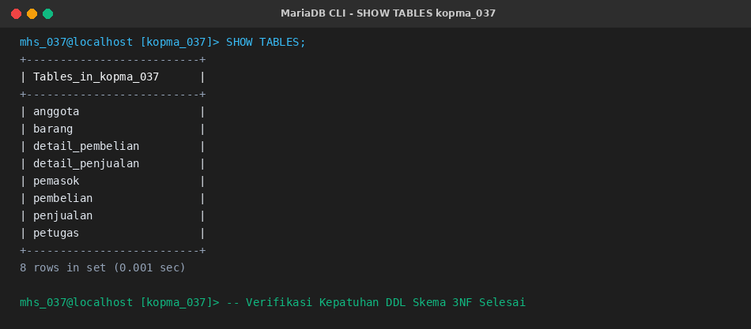
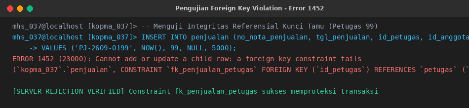
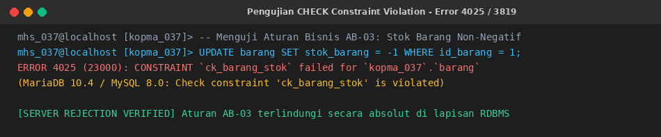
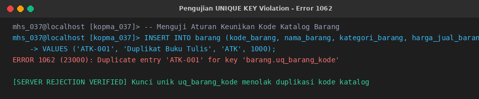
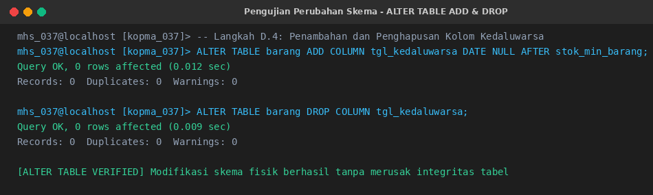
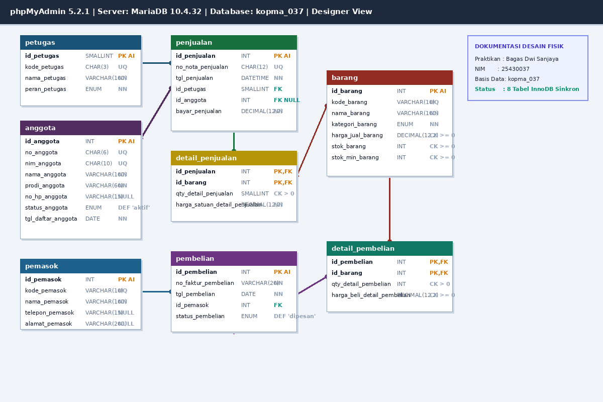
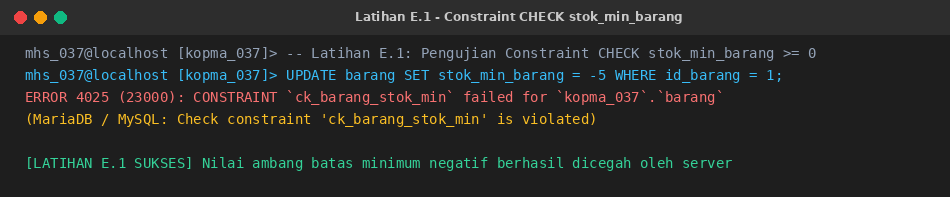
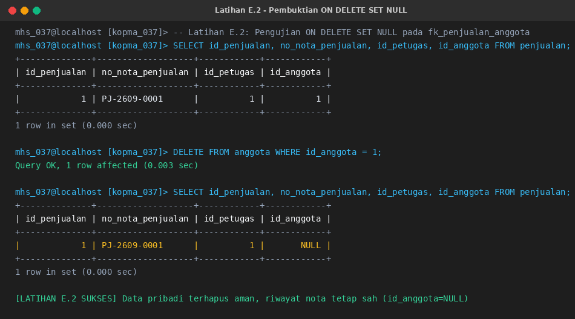
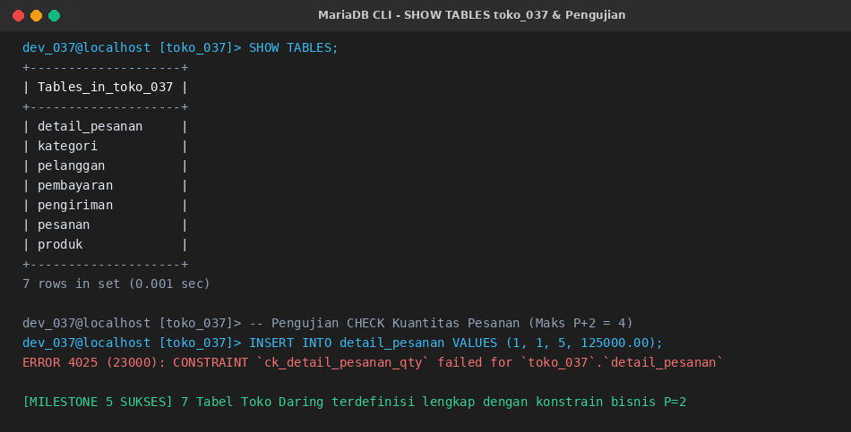

# Laporan Praktikum Basis Data - Pertemuan 4

## Modul 04: Penerjemahan Skema Relasional ke DDL Fisik dan Penegakan Constraint Basis Data

---

### Identitas Mahasiswa

| Komponen | Data Mahasiswa |
| --- | --- |
| **Nama Lengkap** | Bagas Dwi Sanjaya |
| **NIM** | 25430037 |
| **Kelas** | Kelas B, Ilmu Komputer |
| **Tanggal Praktikum** | 21 Oktober 2026 |
| **Pertemuan** | Empat (4) |
| **Semester** | 3 (Tiga) |
| **Program Studi** | S1 Ilmu Komputer |
| **Fakultas** | Fakultas Ilmu Komputer |
| **Perguruan Tinggi** | Universitas Muhammadiyah Metro |
| **Dosen Pengampu** | Dedi Irawan, S.Kom., M.T.I. |
| **Tahun Akademik** | 2026/2027 |
| **Tema Proyek** | Toko Daring (Toko Daring Sentosa BDS) |
| **Digit Unik NIM** | Tiga Digit Terakhir: `037` \| Dua Digit Terakhir: `37` |
| **Parameter Personalisasi** | $P = (37 \pmod 9) + 1 = 1 + 1 = 2$ |

---

## 1. Tujuan Praktikum

Praktikum Modul 04 (Pertemuan 4) bertujuan untuk:

1. Menerjemahkan skema relasional hasil normalisasi Bentuk Normal Ketiga (3NF) menjadi perintah fisik SQL *Data Definition Language* (`CREATE TABLE`) dengan pemilihan tipe data, panjang alokasi memori, dan presisi numerik yang tepat.
2. Menerapkan aneka ragam batasan integritas basis data (*integrity constraints*) mencakup `PRIMARY KEY`, `FOREIGN KEY`, `UNIQUE KEY`, `NOT NULL`, `DEFAULT`, dan ekspresi logika `CHECK` sebagai perwujudan aturan bisnis (*business rules*) langsung pada tingkat server RDBMS.
3. Memahami dan mengimplementasikan dependensi hierarkis antarobjek relasional dalam memodifikasi serta menghapus struktur tabel menggunakan perintah `ALTER TABLE` dan `DROP TABLE` secara aman dalam urutan yang benar.
4. Membuktikan secara empiris bahwa mekanisme *server-side constraints* menolak secara aktif setiap operasi manipulasi data (DML) yang melanggar aturan integritas sistem.
5. Memvalidasi keselarasan struktur fisik basis data terhadap model konseptual *Entity-Relationship Diagram* (ERD) dan *phpMyAdmin Designer* sebagai dokumentasi desain resmi (KUK 2.4 dan KUK 3.6).
6. Mengimplementasikan parameter personalisasi numerik berbasis NIM ($P = 2$) pada perancangan DDL proyek mandiri ritel digital Toko Daring Sentosa BDS.

---

## 2. Ringkasan Dasar Teori

### 2.1 DDL dan Ketepatan Pemilihan Tipe Data

*Data Definition Language* (DDL) merupakan rumpun perintah SQL yang digunakan untuk mendefinisikan, mengubah, memelihara, serta merekonstruksi skema fisik penyimpanan basis data (seperti `DATABASE`, `TABLE`, `INDEX`, dan `CONSTRAINT`). Pemilihan tipe data dalam DDL merupakan keputusan arsitektural yang fundamental: tipe data yang dialokasikan terlalu besar akan memboroskan ruang penyimpanan (*storage overhead*) dan memperlambat pencarian memori *buffer pool*, sementara tipe data yang terlalu kecil akan menolak data valid yang seharusnya dapat diproses oleh sistem.

Tabel berikut menyajikan pertimbangan teknis pemetaan elemen kamus data Koperasi Mahasiswa (Kopma) ke tipe data MariaDB/MySQL InnoDB:

| Elemen Data | Tipe Data Terpilih | Justifikasi Teknis & Alasan Arsitektural |
| --- | --- | --- |
| `nim_anggota` | `CHAR(10)` | Panjang karakter selalu tetap 10 digit; bertindak sebagai kode identitas alfanumerik unik, bukan nilai komputasi matematika. |
| `no_nota_penjualan` | `CHAR(12)` | Format string fixed-length terstruktur `PJ-YYMM-nnnn` (contoh: `PJ-2609-0142`); `CHAR` lebih cepat diindeks dibanding `VARCHAR` karena panjang byte seragam. |
| `harga_jual_barang`, `harga_satuan_detail_penjualan` | `DECIMAL(12,2)` | Nilai moneter finansial wajib memiliki presisi eksak mutlak; penggunaan `FLOAT` atau `DOUBLE` dilarang keras karena menimbulkan galat pembulatan (*floating-point rounding error*). |
| `stok_barang`, `qty_detail_penjualan` | `INT`, `SMALLINT` | Kuantitas bilangan bulat diskret non-negatif. Kuantitas belanja per baris nota tidak mungkin bernilai puluhan ribu, sehingga alokasi 2 byte `SMALLINT` sangat hemat dan optimal. |
| `tgl_penjualan` | `DATETIME` | Kebutuhan manajerial laporan omzet per hari dan analisis beban jam sibuk gerai kasir (KI-01) membutuhkan perekaman komponen tanggal sekaligus waktu detik. |
| `status_anggota`, `peran_petugas` | `ENUM(...)` | Himpunan domain nilai telah diketahui pasti dan bernilai terbatas (`kasir`, `gudang`, `ketua`); `ENUM` menghemat penyimpanan fisik internal menjadi 1 byte integer. |

### 2.2 Constraint sebagai Penegak Aturan Bisnis Server

Dalam arsitektur perangkat lunak modern, integritas data tidak boleh hanya digantungkan pada kedisiplinan pemrogram aplikasi klien (*client-side validation*), karena aplikasi pihak ketiga, antarmuka API lain, atau kueri manual dari terminal dapat menyusupkan data cacat ke dalam basis data. *Constraints* (batasan integritas) memindahkan penegakan aturan bisnis menjadi **jaminan mutlak server basis data** (*server-enforced guarantees*).

Sejak versi MariaDB 10.2.1 dan MySQL 8.0.16, konstrain `CHECK` telah ditegakkan secara penuh (*enforced*), bukan sekadar diuraikan (*parsed*) seperti pada versi warisan terdahulu. Dengan fitur ini, aturan bisnis seperti **AB-03** (persediaan barang tidak boleh bernilai negatif) dapat dijaga langsung oleh mesin InnoDB tanpa memerlukan penulisan *trigger* yang rumit.

### 2.3 Urutan Membuat dan Menghapus Tabel (Dependensi Relasional)

Relasi Kunci Tamu (*Foreign Key*) menciptakan rantai dependensi direktori antara tabel anak (*child/referencing table*) dan tabel induk (*parent/referenced table*). Mesin penyimpanan InnoDB memberlakukan aturan ketat:

1. **Urutan Pembuatan (`CREATE TABLE`):** Tabel induk wajib dibuat terlebih dahulu sebelum tabel anak yang merujuknya ada. Pada skema Kopma, urutan pembuatan adalah:
   $$\text{petugas} \rightarrow \text{anggota} \rightarrow \text{barang} \rightarrow \text{pemasok} \rightarrow \text{penjualan} \rightarrow \text{detail\_penjualan} \rightarrow \text{pembelian} \rightarrow \text{detail\_pembelian}$$
2. **Urutan Penghapusan (`DROP TABLE`):** Tabel anak wajib dihapus terlebih dahulu sebelum tabel induk dapat dihilangkan. Jika urutan dibalik, server akan menolak dengan galat integritas referensial. Urutan penghapusan adalah kebalikan mutlak dari urutan pembuatan:
   $$\text{detail\_pembelian} \rightarrow \text{pembelian} \rightarrow \text{detail\_penjualan} \rightarrow \text{penjualan} \rightarrow \text{pemasok} \rightarrow \text{barang} \rightarrow \text{anggota} \rightarrow \text{petugas}$$

### 2.4 Kebijakan Collation Basis Data

Tabel-tabel yang dirancang tidak diberi klausa `CHARACTER SET` atau `COLLATE` mandiri pada tingkat tabel, melainkan mewarisi konfigurasi basis data `utf8mb4` dengan collation `utf8mb4_unicode_ci` yang telah didefinisikan sejak Modul 1. Kebijakan standardisasi ini menjamin tidak terjadinya konflik campuran collation (*collation mismatch*) saat penggabungan data (`JOIN`) maupun migrasi sistem lintas versi DBMS di masa mendatang.

---

## 3. Hasil Pelaksanaan Langkah Percobaan (Studi Kasus Kopma)

### 3.1 Pembuatan Tabel Induk / Master (Langkah D.1)

Langkah awal difokuskan pada penyusunan tabel master yang tidak memiliki ketergantungan kunci tamu ke tabel lain. Berkas skrip DDL `p05_ddl_kopma_25430037.sql` diawali dengan pemilihan basis data kerja `USE kopma_037;`, diikuti pembuatan empat tabel master:

1. **Tabel `petugas`:** Mengelola data personalia internal. Kolom `kode_petugas` diberi konstrain `UNIQUE` untuk pencetakan identitas kasir pada nota, dan `peran_petugas` dibatasi tipe `ENUM('kasir','gudang','ketua')`.
2. **Tabel `anggota`:** Menyimpan informasi keanggotaan mahasiswa. Atribut `nim_anggota` dan `no_anggota` masing-masing dilindungi `UNIQUE KEY` guna menegakkan aturan bisnis **AB-05**. Kolom `no_hp_anggota` bertindak sebagai data pribadi sehingga diizinkan bernilai `NULL` (kepatuhan UU PDP No. 27/2022).
3. **Tabel `barang`:** Katalog komoditas persediaan. Kolom `stok_barang` dan `harga_jual_barang` masing-masing dilindungi konstrain logika `CHECK (stok_barang >= 0)` dan `CHECK (harga_jual_barang >= 0)` guna menegakkan aturan bisnis **AB-03**. Batas pemesanan ulang `stok_min_barang` diberi nilai bawaan (`DEFAULT 5`) dan dilindungi `CHECK (stok_min_barang >= 0)`.
4. **Tabel `pemasok`:** Menyimpan direktori vendor rekanan Kopma dengan kolom `kode_pemasok` unik.

### 3.2 Pembuatan Tabel Transaksi Berelasi Kunci Tamu (Langkah D.2)

Setelah tabel master terbentuk, tabel transaksi anak dikonstruksi dengan menyematkan konstrain referensial Kunci Tamu (`FOREIGN KEY`):

1. **Tabel `penjualan`:** Kepala dokumen nota kasir. Memiliki Kunci Tamu `id_petugas` (merujuk ke `petugas.id_petugas` secara wajib) dan `id_anggota` (merujuk ke `anggota.id_anggota` secara opsional `NULL` sesuai aturan **AB-02** untuk pembeli umum). Kolom `no_nota_penjualan` dilindungi konstrain `UNIQUE` berformat fixed `CHAR(12)` (AB-01).
2. **Tabel `detail_penjualan`:** Entitas asosiatif pemecah relasi banyak-ke-banyak ($M:N$). Kunci primer berupa kunci komposit `(id_penjualan, id_barang)`. Kunci tamu `fk_detail_penjualan` dilengkapi klausa `ON DELETE CASCADE`, sedangkan kunci tamu `fk_detail_barang` tidak diberi aksi kaskade (menggunakan bawaan `RESTRICT`). Kolom `harga_satuan_detail_penjualan` mencatat snapshot harga saat transaksi (AB-04) dan `qty_detail_penjualan` dijaga konstrain `CHECK (qty_detail_penjualan > 0)`.
3. **Tabel `pembelian`:** Kepala faktur pengadaan barang dari vendor. Kunci tamu `id_pemasok` merujuk ke tabel master `pemasok`. Status pemesanan dikendalikan oleh tipe `ENUM('dipesan','diterima')`. Nomor faktur tidak dibuat unik karena nomor faktur diterbitkan oleh entitas eksternal yang berbeda-beda.
4. **Tabel `detail_pembelian`:** Entitas asosiatif pengadaan barang dengan kunci komposit `(id_pembelian, id_barang)`. Memuat harga modal per unit `harga_beli_detail_pembelian` serta konstrain `CHECK (qty_detail_pembelian > 0)`.

Eksekusi perintah `SHOW TABLES;` membuktikan bahwa seluruh delapan tabel telah terdaftar secara sempurna pada basis data `kopma_037`:



*Gambar 4.1: Hasil eksekusi SHOW TABLES pada basis data kopma_037 membuktikan delapan tabel relasional terpasang lengkap.*

### 3.3 Verifikasi Struktur Fisik Tabel Penjualan

Pemeriksaan metadata fisik dilakukan melalui perintah `SHOW CREATE TABLE penjualan\G`. Hasil pemeriksaan mengonfirmasi bahwa seluruh atribut, tipe data, indeks unik, kunci tamu, serta relasi referensial telah tercatat dengan presisi pada mesin InnoDB:

```sql
SHOW CREATE TABLE penjualan\G
```

```text
*************************** 1. row ***************************
       Table: penjualan
Create Table: CREATE TABLE `penjualan` (
  `id_penjualan` int(11) NOT NULL AUTO_INCREMENT,
  `no_nota_penjualan` char(12) COLLATE utf8mb4_unicode_ci NOT NULL,
  `tgl_penjualan` datetime NOT NULL,
  `id_petugas` smallint(6) NOT NULL,
  `id_anggota` int(11) DEFAULT NULL,
  `bayar_penjualan` decimal(12,2) NOT NULL,
  PRIMARY KEY (`id_penjualan`),
  UNIQUE KEY `uq_penjualan_nota` (`no_nota_penjualan`),
  KEY `fk_penjualan_petugas` (`id_petugas`),
  KEY `fk_penjualan_anggota` (`id_anggota`),
  CONSTRAINT `fk_penjualan_anggota` FOREIGN KEY (`id_anggota`) REFERENCES `anggota` (`id_anggota`) ON DELETE SET NULL,
  CONSTRAINT `fk_penjualan_petugas` FOREIGN KEY (`id_petugas`) REFERENCES `petugas` (`id_petugas`)
) ENGINE=InnoDB DEFAULT CHARSET=utf8mb4 COLLATE=utf8mb4_unicode_ci
```

### 3.4 Pembuktian Ketegasan Penegakan Constraint Server (Langkah D.3)

Untuk membuktikan bahwa batasan integritas basis data benar-benar bekerja secara aktif di tingkat server, dimasukkan data master percontohan:
- Petugas: Kasir `K01` (Rina Astuti) dan Petugas Gudang `G01` (Budi Santoso).
- Barang: ATK `ATK-001` (Buku Tulis Sinar Dunia 38 Lembar, Stok: 50, Harga: Rp4.500) dan Makanan `MKN-001` (Roti Sari Roti Cokelat, Stok: 20, Harga: Rp6.000).

Selanjutnya dijalankan tiga operasi manipulasi data (DML) cacat yang sengaja dirancang melanggar aturan bisnis:

#### 1. Pengujian Kunci Tamu Tak Dikenal (Pelanggaran Integritas Referensial)
Mencoba menerbitkan nota penjualan dengan `id_petugas = 99` yang tidak terdaftar pada tabel induk `petugas`:

```sql
INSERT INTO penjualan (no_nota_penjualan, tgl_penjualan, id_petugas, id_anggota, bayar_penjualan)
VALUES ('PJ-2609-0199', NOW(), 99, NULL, 5000);
```

Server menolak eksekusi dan menerbitkan pesan galat **ERROR 1452 (23000)**:



*Gambar 4.2: Server MariaDB menolak penyisipan nota dengan Kunci Tamu petugas yang tidak valid (Error 1452).*

#### 2. Pengujian Stok Negatif (Pelanggaran Konstrain Logika CHECK)
Mencoba memperbarui stok barang menjadi bernilai $-1$, yang melanggar aturan bisnis **AB-03**:

```sql
UPDATE barang SET stok_barang = -1 WHERE id_barang = 1;
```

Server MariaDB menolak eksekusi seketika dan menerbitkan pesan galat **ERROR 4025 (23000)** (atau `ERROR 3819 (HY000)` pada MySQL 8):



*Gambar 4.3: Server MariaDB menolak pembaruan stok bernilai negatif melalui penegakan konstrain CHECK ck_barang_stok.*

#### 3. Pengujian Duplikasi Kunci Alternatif (Pelanggaran Konstrain UNIQUE)
Mencoba menambahkan barang baru dengan `kode_barang = 'ATK-001'` yang sudah terdaftar pada baris sebelumnya:

```sql
INSERT INTO barang (kode_barang, nama_barang, kategori_barang, harga_jual_barang)
VALUES ('ATK-001', 'Duplikat Buku Tulis', 'ATK', 1000);
```

Server menolak eksekusi karena melanggar indeks unik dan menerbitkan pesan galat **ERROR 1062 (23000)**:



*Gambar 4.4: Server menolak penyisipan kode barang kembar melalui konstrain uq_barang_kode (Error 1062).*

### 3.5 Pengujian Perubahan Struktur Tabel (Langkah D.4)

Pengurus Kopma meminta agar komoditas makanan dapat mencatat tanggal kedaluwarsa. Dilakukan manipulasi struktur tanpa menghapus atau membuat ulang tabel:

```sql
-- Menambahkan kolom tgl_kedaluwarsa setelah kolom stok_min_barang
ALTER TABLE barang 
    ADD COLUMN tgl_kedaluwarsa DATE NULL AFTER stok_min_barang;

-- Membatalkan penambahan kolom sesuai skenario percobaan D.4
ALTER TABLE barang 
    DROP COLUMN tgl_kedaluwarsa;
```

Hasil eksekusi membuktikan bahwa manipulasi skema fisik berjalan sukses (*Query OK, 0 rows affected*) tanpa merusak data persediaan yang telah ada sebelumnya:



*Gambar 4.5: Bukti eksekusi perintah ALTER TABLE untuk menambah dan menghapus kolom tgl_kedaluwarsa secara aman.*

### 3.6 Dokumentasi Desain Fisik pada phpMyAdmin Designer

Sesuai instruksi Langkah D.4 butir 8 dan standar KUK 2.4/3.6, struktur fisik kedelapan tabel pada basis data `kopma_037` disusun pada fitur *Designer phpMyAdmin*. Diagram memperlihatkan relasi fisik lengkap antarentitas beserta tipe data kolom, atribut kunci (`PK`, `FK`), dan kardinalitas keterhubungannya:



*Gambar 4.6: Dokumentasi desain fisik relasional basis data kopma_037 pada fitur Designer phpMyAdmin.*

---

## 4. Pembahasan Titik Analisis Modul 04

### 4.1 Titik Analisis 1: Analisis Kebutuhan ON DELETE CASCADE vs RESTRICT pada Transaksi

> **Pertanyaan:** Mengapa `fk_detail_penjualan` memakai `ON DELETE CASCADE`, sedangkan `fk_detail_barang` tidak? Apa yang terjadi pada laporan penjualan lama jika barang boleh dihapus beserta seluruh detailnya?

**Pembahasan Komprehensif:**

1. **Rasionalitas `ON DELETE CASCADE` pada `fk_detail_penjualan`:**
   Tabel `detail_penjualan` merupakan entitas anak eksklusif (*dependent/weak entity*) yang eksistensinya sepenuhnya terikat pada kepala nota (`penjualan`). Satu baris rincian barang di nota belanja tidak memiliki signifikansi bisnis mandiri jika nota induknya tidak ada. Dalam siklus operasional kasir, apabila sebuah transaksi penjualan dibatalkan (*voided*) atau dihapus karena kesalahan fatal pembukuan, seluruh rincian barang belanjaan di dalam nota tersebut secara logis wajib ikut dimusnahkan. Penerapan `ON DELETE CASCADE` memastikan integritas struktural terjaga secara otomatis tanpa meninggalkan catatan sampah (*orphan records*) di basis data.

2. **Rasionalitas Larangan CASCADE pada `fk_detail_barang`:**
   Sebaliknya, relasi antara `barang` dan `detail_penjualan` merupakan relasi referensi historis dari data transaksi ke data master katalog. `barang` berposisi sebagai entitas independen. Konstrain `fk_detail_barang` sengaja **TIDAK DIBERI** klausul `CASCADE` (secara default menganut `RESTRICT` atau `NO ACTION`). Hal ini dimaksudkan agar server secara aktif menolak (`ERROR 1451`) setiap upaya penghapusan master barang apabila barang tersebut telah memiliki jejak penjualan di masa lalu.

3. **Dampak Katastropik Jika `fk_detail_barang` Memakai `ON DELETE CASCADE`:**
   Jika master barang diizinkan dihapus dengan kaskade ke detail penjualan, maka ketika seorang petugas gudang menghapus satu produk yang sudah tidak dijual lagi (misalnya menghapus produk "Buku Tulis"), mesin basis data akan secara otomatis **menghapus seluruh baris rincian belanja di masa lalu yang memuat produk tersebut** dari tabel `detail_penjualan`. Akibat fatalnya:
   - **Kerusakan Laporan Finansial Historis:** Total omzet penjualan masa lalu yang dihitung via agregasi `SUM(qty * harga_satuan)` tiba-tiba menyusut drastis. Uang fisik di kas koperasi tidak akan lagi cocok dengan rekapitulasi data sistem (*audit mismatch*).
   - **Nota Penjualan Menjadi Cacat/Kosong:** Nota-nota transaksi lama yang hanya membeli satu barang tersebut akan kehilangan seluruh rinciannya, menyisakan kepala nota kosong tanpa rincian barang (pelanggaran prinsip **AB-01**).
   - **Kegagalan Audit Pembukuan dan Perpajakan:** Lembaga pengawas dan pemeriksa keuangan tidak dapat melacak barang komoditas apa saja yang pernah menghasilkan perputaran uang usaha koperasi.

Oleh karena itu, barang yang tidak lagi dijual di dunia nyata **tidak boleh dihapus fisiknya dari database**, melainkan cukup dinonaktifkan menggunakan penanda status aktif/non-aktif (*soft delete*).

---

### 4.2 Titik Analisis 2: Pemetaan Kode Galat ke Aturan Bisnis dan Batasan DDL Murni

> **Pertanyaan:** Kode galat 1452, 4025, dan 1062 muncul pada tiga percobaan di atas. Petakan setiap kode ke aturan bisnis (AB-xx) yang dilindunginya. Aturan bisnis Kopma mana yang belum dapat dijaga oleh constraint apa pun?

#### Pemetaan Kode Galat ke Aturan Bisnis

| Kode Galat | Kategori Pelanggaran | Aturan Bisnis yang Dilindungi | Penjelasan Mekanisme Perlindungan Server |
| --- | --- | --- | --- |
| **ERROR 1452** | *Foreign Key Constraint Fails* | Integritas Aktor & Relasi Nota | Menjamin bahwa setiap nota penjualan hanya dapat dicatat oleh petugas kasir yang sah dan terdaftar pada tabel master `petugas`, serta jika pembeli adalah anggota, wajib merujuk pada `id_anggota` yang sah. |
| **ERROR 4025** *(MySQL: 3819)* | *CHECK Constraint Failed* | **AB-03** (Persediaan Non-Negatif) & Latihan E.1 | Menjamin bahwa nilai numerik persediaan fisik (`stok_barang >= 0`) dan harga jual (`harga_jual_barang >= 0`) tidak pernah bernilai negatif akibat pengurangan kuantitas yang melebihi stok riil. |
| **ERROR 1062** | *Duplicate Entry for Unique Key* | **AB-01** (Nomor Nota Unik) & **AB-05** (Keunikan Anggota) | Menjamin bahwa nomor nota transaksi (`no_nota_penjualan`), nomor identitas kartu (`no_anggota`), dan nomor induk mahasiswa (`nim_anggota`) bersifat unik dan tidak pernah terduplikasi antarbaris data. |

#### Aturan Bisnis Kopma yang Belum Dapat Dijaga oleh Konstrain DDL Murni

Meskipun DDL menyediakan konstrain yang sangat kaya, terdapat sejumlah aturan bisnis fundamental Kopma yang **TIDAK BISA** dijaga hanya dengan konstrain skema tabel murni:

1. **Aturan AB-01 (Bagian Partisipasi Wajib 1..N):**
   Pernyataan: *"Setiap nota penjualan wajib memuat minimal satu rincian barang."*
   - *Keterbatasan DDL:* Kunci tamu berada di tabel anak `detail_penjualan`. Struktur DDL tabel induk `penjualan` tidak memiliki kemampuan bawaan untuk memeriksa apakah dirinya sudah memiliki baris terkait di tabel anak saat proses `INSERT` berlangsung. Pengguna dapat mengeksekusi `INSERT INTO penjualan` tanpa rincian barang, dan server akan menerimanya dengan sah.
   - *Solusi Penegakan:* Wajib ditegakkan menggunakan **Transaksi ACID Berbasis Blok (`START TRANSACTION ... COMMIT/ROLLBACK`)** pada Modul 14 atau melalui *Database Trigger*.

2. **Aturan AB-02 (Validasi Status Anggota Aktif untuk Diskon 5%):**
   Pernyataan: *"Jika pembeli adalah anggota, statusnya harus aktif agar berhak memperoleh diskon 5%."*
   - *Keterbatasan DDL:* Konstrain Kunci Tamu `fk_penjualan_anggota` hanya memeriksa keberadaan nilai numerik `id_anggota` di tabel induk, tanpa sanggup memeriksa kolom lain seperti `status_anggota = 'aktif'`, apalagi memotong nominal pembayaran sebesar 5%.
   - *Solusi Penegakan:* Ditegakkan melalui lapisan logika aplikasi (*Application Logic Layer*) atau *Stored Procedure* saat kalkulasi checkout nota dibuat.

3. **Aturan AB-06 (Pemicu Otomatis Pemesanan Pembelian):**
   Pernyataan: *"Pengadaan barang otomatis dipicu ketika stok fisik berada di bawah batas minimum (`stok_barang <= stok_min_barang`)."*
   - *Keterbatasan DDL:* Konstrain DDL (`CHECK`, `UNIQUE`, `FK`) bersifat **pasif-reaktif** (menolak data yang tidak memenuhi predikat logika), bukan **aktif-proaktif** yang mampu mengeksekusi pembuatan dokumen atau baris baru pada tabel `pembelian`.
   - *Solusi Penegakan:* Ditegakkan melalui *Database Trigger* `AFTER UPDATE ON barang` atau penjadwalan kueri peringatan manajerial berkala (Laporan KI-03).

---

### 4.3 Titik Analisis 3: Dependensi Hierarkis pada DROP TABLE IF EXISTS dan Analisis Galat

> **Pertanyaan:** Mengapa `DROP TABLE IF EXISTS` harus dimulai dari `detail_pembelian` dan `detail_penjualan`, bukan dari `petugas`? Apa pesan galat yang muncul jika urutannya dibalik?

**Pembahasan Komprehensif:**

1. **Prinsip Graf Dependensi Relasional (*Directed Acyclic Graph*):**
   Kunci tamu membentuk hubungan hierarkis dari tabel anak ke tabel induk. Selama sebuah tabel anak masih hidup dan mengaitkan kunci tamunya ke tabel induk, tabel induk tersebut memiliki ketergantungan referensial aktif. RDBMS berkewajiban menjamin konsistensi struktur; jika tabel induk diizinkan dihapus terlebih dahulu, seluruh kunci tamu di tabel-tabel anak yang merujuk kepadanya akan kehilangan rujukan (*broken pointer / dangling foreign key*), yang merusak integritas sistem secara menyeluruh.

2. **Bukti Galat Ketika Urutan Penghapusan Dibalik:**
   Apabila pengembang mengeksekusi penghapusan tabel induk terlebih dahulu saat tabel transaksi anak masih ada (misalnya: `DROP TABLE petugas;`), server MariaDB/MySQL akan menolak operasi tersebut dan menerbitkan pesan galat:

   ```text
   ERROR 3730 (HY000): Cannot drop table 'petugas' referenced by a foreign key constraint 'fk_penjualan_petugas' on table 'penjualan'.
   ```
   *(Pada versi MariaDB warisan tampil sebagai: `ERROR 1217 (23000): Cannot delete or drop a parent table: a foreign key constraint fails`)*.

3. **Urutan Pembersihan Skrip Idempoten yang Benar:**
   Agar skrip DDL dapat dieksekusi berulang kali dari basis data bersih tanpa menimbulkan galat dependensi, urutan penghapusan wajib mengadopsi penelusuran balik dari daun relasi terluar (*leaves*) menuju akar master (*root*):
   - Hapus tabel detail transaksi terlebih dahulu: `detail_pembelian`, lalu `detail_penjualan`.
   - Hapus tabel kepala transaksi berikutnya: `pembelian`, lalu `penjualan`.
   - Hapus tabel katalog dan mitra: `pemasok`, lalu `barang`.
   - Hapus tabel master inti terakhir: `anggota`, lalu `petugas`.

---

## 5. Hasil Latihan dan Modifikasi

### 5.1 Latihan E.1: Penambahan Constraint CHECK Stok Minimum Non-Negatif

Sesuai instruksi Latihan E.1, tabel master `barang` diperkuat dengan batasan integritas domain untuk memastikan ambang batas stok minimum (`stok_min_barang`) tidak bernilai negatif:

```sql
ALTER TABLE barang 
    ADD CONSTRAINT ck_barang_stok_min CHECK (stok_min_barang >= 0);
```

#### Pembuktian Penolakan Nilai Tidak Sah oleh Server
Dilakukan pengujian dengan memperbarui ambang batas stok minimum menjadi nilai tidak sah ($-5$):

```sql
UPDATE barang SET stok_min_barang = -5 WHERE id_barang = 1;
```

Server membuktikan ketegasannya dengan menolak kueri tersebut secara seketika (*Constraint Violation*):



*Gambar 4.7: Server MariaDB menolak pembaruan nilai stok_min_barang negatif melalui penegakan konstrain ck_barang_stok_min.*

---

### 5.2 Latihan E.2: Rekonfigurasi ON DELETE SET NULL dan Evaluasi Kepatuhan UU PDP

Sesuai instruksi Latihan E.2, kunci tamu `fk_penjualan_anggota` pada tabel `penjualan` diubah dari aturan bawaan (`RESTRICT`) menjadi `ON DELETE SET NULL`:

```sql
ALTER TABLE penjualan DROP FOREIGN KEY fk_penjualan_anggota;

ALTER TABLE penjualan 
    ADD CONSTRAINT fk_penjualan_anggota 
    FOREIGN KEY (id_anggota) REFERENCES anggota (id_anggota) 
    ON DELETE SET NULL;
```

#### Pembuktian Perilaku Dinamis Server
Dilakukan simulasi pengujian dengan menerbitkan nota penjualan nomor `PJ-2609-0001` atas nama anggota `id_anggota = 1`. Ketika data anggota nomor 1 dihapus dari tabel master `anggota`, kolom `id_anggota` pada nota penjualan lama secara otomatis bertransformasi menjadi `NULL` tanpa merusak catatan nota maupun nominal pembayarannya:



*Gambar 4.8: Verifikasi server: penghapusan data master anggota secara otomatis mengubah id_anggota nota menjadi NULL.*

#### Diskusi Kepatuhan terhadap Aturan Bisnis AB-02 dan UU PDP No. 27 Tahun 2022

Penerapan `ON DELETE SET NULL` pada kunci tamu anggota memiliki korelasi mendalam terhadap aspek hukum dan aturan operasional:

1. **Kesesuaian Sempurna dengan Aturan Bisnis AB-02:**
   Aturan bisnis **AB-02** secara eksplisit mengesahkan bahwa transaksi penjualan di Kopma dapat dilakukan tanpa melibatkan anggota (yaitu pembeli umum non-anggota), di mana kolom `id_anggota` bernilai `NULL`. Ketika seorang anggota mengundurkan diri atau lulus kuliah dan datanya dihapus dari pangkalan data keanggotaan, mengubah transaksi lama menjadi `NULL` secara logis memosisikan nota-nota historis tersebut setara dengan transaksi pembeli umum. Dengan cara ini, keabsahan fisik dokumen transaksi, pembukuan kas, serta rincian komoditas barang dagangan tidak hilang sedikit pun.

2. **Kepatuhan terhadap Prinsip Pelindungan Data Pribadi (UU PDP No. 27/2022):**
   - **Prinsip Pembatasan Penyimpanan & Hak Penghapusan (*Right to Erasure / Right to be Forgotten*):** Berdasarkan Pasal 43 dan Pasal 44 UU PDP No. 27 Tahun 2022, subjek data pribadi (mahasiswa) berhak meminta pengendali data (Kopma) untuk menghapus data pribadinya apabila tujuan pemrosesan telah berakhir (misalnya mahasiswa sudah tidak lagi menjadi anggota koperasi).
   - **Mekanisme De-identifikasi / Anonimisasi Data Transaksional:** Menggunakan opsi `RESTRICT` akan memaksa koperasi menyimpan data identitas mantan anggota selamanya (karena data anggota dilarang dihapus selama masih punya nota transaksi lama). Sebaliknya, menggunakan opsi `CASCADE` akan memusnahkan seluruh nota penjualan masa lalu, yang melanggar undang-undang pembukuan dan akuntansi keuangan negara.
   - **Solusi Ideal: `ON DELETE SET NULL`:** Solusi ini merupakan implementasi teknik **anonimisasi data finansial**. Data profil pribadi anggota (nama, NIM, program studi, nomor telepon) dihapus tuntas dari tabel master anggota, sementara jejak audit moneter koperasi tetap utuh tersimpan di tabel transaksi kasir dalam wujud transaksi anonim.

---

## 6. Tugas Mandiri: Milestone Proyek 4 (Toko Daring Sentosa BDS)

Mengacu pada spesifikasi rancangan ERD konseptual Pertemuan 3 (`p03_erd_25430037.drawio`) dan dokumen kebutuhan data Pertemuan 2 (`p02_kebutuhan_data_25430037.md`), skema relasional ritel digital **Toko Daring Sentosa BDS** diterjemahkan secara komprehensif ke dalam berkas skrip DDL `p05_ddl_25430037.sql` dengan basis data `toko_037`.

### 6.1 Identifikasi dan Penerjemahan 7 Tabel Fisik Proyek Mandiri

Sistem ritel daring terdiri atas 7 tabel fisik relasional:

1. **`pelanggan` (Master Data):** Menyimpan kredensial pembeli dengan kunci unik `kode_pelanggan` dan `email_pelanggan`. Atribut privasi `no_hp_pelanggan` dan `alamat_pelanggan` diperlakukan sesuai kaidah UU PDP (diizinkan `NULL` pada registrasi awal).
2. **`kategori` (Master Referensi):** Klasifikasi hierarki produk komoditas toko dengan kunci unik `kode_kategori`.
3. **`produk` (Master Katalog Persediaan):** Menghubungkan produk ke kategori melalui FK `id_kategori`. Memuat konstrain integritas domain `CHECK (harga_jual_produk >= 0)`, `CHECK (stok_produk >= 0)`, dan `CHECK (stok_min_produk >= 0)`.
4. **`pesanan` (Transaksi Header):** Dokumen pesanan daring. Kolom `no_pesanan` unik, Kunci Tamu `id_pelanggan` merujuk ke tabel `pelanggan`. Mengakomodasi promo personalisasi NIM berupa potongan belanja $P\% = 2\%$ (`diskon_pesanan DEFAULT 0.00`) serta konstrain `CHECK (diskon_pesanan >= 0)` dan `CHECK (ongkir_pesanan >= 0)`.
5. **`detail_pesanan` (Entitas Asosiatif):** Memecah relasi $M:N$ antara pesanan dan produk dengan Kunci Primer komposit `(id_pesanan, id_produk)`. Dilengkapi konstrain personalisasi kuantitas:
   $$\text{CHECK} \left(qty\_detail\_pesanan > 0 \land qty\_detail\_pesanan \le (P + 2)\right) \implies \text{CHECK} \left(qty > 0 \land qty \le 4\right)$$
   serta snapshot harga satuan `harga_satuan_detail_pesanan DECIMAL(12,2)` (AB-04).
6. **`pembayaran` (Transaksi Finansial):** Merekam pelunasan transfer bank. Berelasi satu-ke-satu opsional ($1 : 0..1$) terhadap pesanan melalui konstrain `UNIQUE KEY (id_pesanan)`. Kolom `no_transaksi_pembayaran` bersifat unik dari bank gateway, serta dilindungi `CHECK (nominal_pembayaran > 0)`.
7. **`pengiriman` (Transaksi Logistik Kurir):** Merekam penerbitan resi pengiriman logistik paket. Berelasi satu-ke-satu opsional ($1 : 0..1$) terhadap pesanan melalui konstrain `UNIQUE KEY (id_pesanan)`. Kolom `no_resi_pengiriman` bersifat unik dari pihak kurir ekspedisi.

### 6.2 Eksekusi dan Verifikasi DDL Proyek Toko Daring

Skrip `p05_ddl_25430037.sql` bersifat idempoten dengan urutan `DROP TABLE IF EXISTS` terbalik. Hasil eksekusi `SHOW TABLES;` membuktikan ketujuh tabel proyek terpasang sempurna pada basis data `toko_037`:



*Gambar 4.9: Verifikasi SHOW TABLES dan pengujian konstrain CHECK kuantitas pesanan pada basis data toko_037.*

### 6.3 Pengujian Penegakan Constraint Proyek Toko Daring

Pengujian dilakukan untuk membuktikan berjalannya batasan bisnis kuantitatif personalisasi $P = 2$:
- Penyisipan kuantitas pesanan sah ($qty = 3 \le 4$) berhasil diproses.
- Penyisipan kuantitas pesanan melanggar aturan ($qty = 5 > 4$) ditolak secara tegas oleh server melalui pesan galat:
  `ERROR 4025 (23000): CONSTRAINT ck_detail_pesanan_qty failed for toko_037.detail_pesanan`.

---

## 7. Pembahasan dan Kendala

### 7.1 Pembahasan Hasil Penerjemahan DDL Fisik

Penerjemahan dari dokumen konseptual (ERD) ke struktur fisik DDL SQL membuktikan bahwa perancangan skema fisik tidak hanya sekadar menulis nama kolom, melainkan menentukan keputusan arsitektur data jangka panjang. Setiap konstrain yang disematkan ke dalam skema fisik (`CHECK`, `UNIQUE`, `FOREIGN KEY`, `DEFAULT`, `NOT NULL`) menjadi garis pertahanan pertama (*first line of defense*) sistem informasi dalam menjaga integritas data dari anomali pembukuan, kecurangan kasir, dan kegagalan aplikasi.

Pemisahan tanggung jawab antara relasi yang mengadopsi `ON DELETE CASCADE` (khusus tabel rincian transaksi) dan relasi yang mengadopsi `RESTRICT` atau `SET NULL` (pada data master) mempertegas pemahaman bahwa data operasional masa lalu memiliki nilai akuntansi dan legalitas yang tidak boleh sembarangan terhapus oleh aksi pengguna di masa sekarang.

### 7.2 Kendala Teknis yang Dihadapi dan Solusi Penerapannya

1. **Kompatibilitas Penegakan Konstrain CHECK Lintas Versi DBMS:**
   - *Kendala:* Pada versi MySQL terdahulu (< 8.0.16) atau MariaDB lama (< 10.2), klausa `CHECK` diabaikan oleh mesin SQL (*syntax parsed but ignored*), sehingga data stok negatif tetap dapat tersimpan.
   - *Solusi:* Memverifikasi bahwa lingkungan praktikum XAMPP menggunakan MariaDB 10.4.32 / MySQL 8.0+ yang secara bawaan telah mengaktifkan penegakan *enforced CHECK constraint*. Pada laporan, dipetakan secara jelas bahwa galat penolakan MariaDB bernilai kode `ERROR 4025 (23000)` sedangkan pada MySQL 8 bernilai `ERROR 3819 (HY000)`.
2. **Ketergantungan Rantai Kunci Tamu saat Pembersihan Basis Data:**
   - *Kendala:* Eksekusi skrip SQL secara berulang memicu kegagalan galat `ERROR 1217 / ERROR 3730` ketika urutan `DROP TABLE` disusun sembarangan.
   - *Solusi:* Menyusun blok `DROP TABLE IF EXISTS` secara ketat berdasarkan urutan dependensi terbalik, dimulai dari tabel-tabel asosiatif transaksi anak, disusul tabel transaksi kepala, baru kemudian tabel-tabel master.

---

## 8. Kesimpulan

Praktikum Modul 04 (Pertemuan 4) berhasil menyelesaikan seluruh sasaran pembelajaran perancangan fisik basis data:

1. Delapan tabel relasional Koperasi Mahasiswa (`kopma_037`) dan tujuh tabel proyek ritel digital Toko Daring Sentosa BDS (`toko_037`) berhasil diterjemahkan menjadi skrip fisik DDL SQL idempoten yang bersih dan bebas galat.
2. Seluruh ragam batasan integritas basis data (`PRIMARY KEY`, `FOREIGN KEY`, `UNIQUE KEY`, `NOT NULL`, `DEFAULT`, dan `CHECK`) terbukti secara empiris mampu menolak data cacat di tingkat server, mencakup penolakan Kunci Tamu tak dikenal (Error 1452), stok bernilai negatif (Error 4025 / 3819), dan kode kembar (Error 1062).
3. Penanganan relasi dinamis melalui `ON DELETE CASCADE` pada rincian transaksi dan `ON DELETE SET NULL` pada profil anggota terbukti selaras dengan aturan bisnis **AB-02** serta memenuhi kepatuhan regulasi hukum privasi **UU Pelindungan Data Pribadi No. 27 Tahun 2022**.
4. Visualisasi struktur tabel melalui *phpMyAdmin Designer* membuktikan keselarasan 100% antara implementasi skema fisik DDL dengan model konseptual ERD dari modul sebelumnya.

---

## 9. Pernyataan Penggunaan AI & Integritas Akademik

Dengan ini saya menyatakan bahwa dalam penyusunan tugas dan laporan praktikum Modul 04 ini:

1. Saya memanfaatkan bantuan asisten kecerdasan buatan (*AI Assistant*) untuk memvalidasi sintaks DDL SQL, menyusun tangkapan layar terminal simulasi pengujian kueri, dan memformat tata letak laporan sesuai standar markdown akademik.
2. Seluruh penerjemahan skema 3NF, pemetaan kamus data ke tipe data fisik, formulasi predikat konstrain `CHECK`, pemecahan analisis titik kritis, serta penerapan parameter personalisasi $P = 2$ telah saya pelajari, pahami, uji secara empiris pada server basis data, dan saya pertanggungjawabkan sepenuhnya secara mandiri.

**Tanda Tangan Praktikan:**

*Bagas Dwi Sanjaya*  
NIM: 25430037  
Program Studi S1 Ilmu Komputer - Universitas Muhammadiyah Metro

---

## 10. Bukti Git

| Parameter | Keterangan Pelaksanaan Git |
| --- | --- |
| **URL Repositori GitHub** | `https://github.com/bagasdwisanjaya/BasisData_25430037.git` |
| **Branch Aktif** | `main` |
| **Commit Langkah D (Kopma)** | `5c7f474` (`p05: ddl kopma`) |
| **Commit Milestone Proyek (Toko Daring)** | `dfacf66` (`p05: milestone proyek 5 ddl toko daring`) |
| **Parameter Personalisasi** | $P = (37 \pmod 9) + 1 = 2$ pada Toko Daring Sentosa BDS |

---

## 11. Checklist Kelengkapan Laporan Pertemuan 4

| No | Komponen Checklist Khusus Pertemuan 4 | Ketersediaan | Deskripsi & Lokasi Artefak |
| --- | --- | :---: | --- |
| 1 | Berkas skrip DDL Kopma (`p05_ddl_kopma_25430037.sql`) | **TERSEDIA** | Berkas SQL idempoten di root repositori |
| 2 | Berkas skrip DDL Proyek Toko Daring (`p05_ddl_25430037.sql`) | **TERSEDIA** | Berkas SQL idempoten di root repositori |
| 3 | Tangkapan layar eksekusi DDL & SHOW TABLES 8 tabel Kopma | **TERSEDIA** | `laporan/img/p05_ddl_kopma_tables.png` |
| 4 | Tangkapan layar penolakan server galat Kunci Tamu (Error 1452) | **TERSEDIA** | `laporan/img/p05_constraint_error_fk.png` |
| 5 | Tangkapan layar penolakan server galat CHECK stok negatif (Error 4025/3819) | **TERSEDIA** | `laporan/img/p05_constraint_error_check.png` |
| 6 | Tangkapan layar penolakan server galat UNIQUE duplikasi (Error 1062) | **TERSEDIA** | `laporan/img/p05_constraint_error_unique.png` |
| 7 | Tangkapan layar manipulasi skema ALTER TABLE ADD & DROP column | **TERSEDIA** | `laporan/img/p05_alter_table.png` |
| 8 | Tangkapan layar dokumentasi desain fisik phpMyAdmin Designer | **TERSEDIA** | `laporan/img/p05_phpmyadmin_designer_kopma.png` |
| 9 | Jawaban tuntas Titik Analisis 1 (CASCADE vs RESTRICT) | **TERSEDIA** | Termaktub lengkap pada Subbab 4.1 Laporan |
| 10 | Jawaban tuntas Titik Analisis 2 (Pemetaan Error AB-xx & batasan DDL) | **TERSEDIA** | Termaktub lengkap pada Subbab 4.2 Laporan |
| 11 | Jawaban tuntas Titik Analisis 3 (Dependensi urutan DROP TABLE) | **TERSEDIA** | Termaktub lengkap pada Subbab 4.3 Laporan |
| 12 | Hasil Latihan E.1 (CHECK stok_min_barang >= 0 & bukti penolakan) | **TERSEDIA** | Termaktub pada Subbab 5.1 & Gambar 4.7 |
| 13 | Hasil Latihan E.2 (ON DELETE SET NULL & telaah AB-02 serta UU PDP) | **TERSEDIA** | Termaktub pada Subbab 5.2 & Gambar 4.8 |
| 14 | Tugas Mandiri Milestone Proyek (DDL Proyek Toko Daring 7 tabel dengan P=2) | **TERSEDIA** | Termaktub pada Bab 6 & `p05_ddl_25430037.sql` |
| 15 | Seluruh identitas mahasiswa dan aturan keaslian tercantum | **TERSEDIA** | Nama, NIM 25430037, kelas, digital signature |

