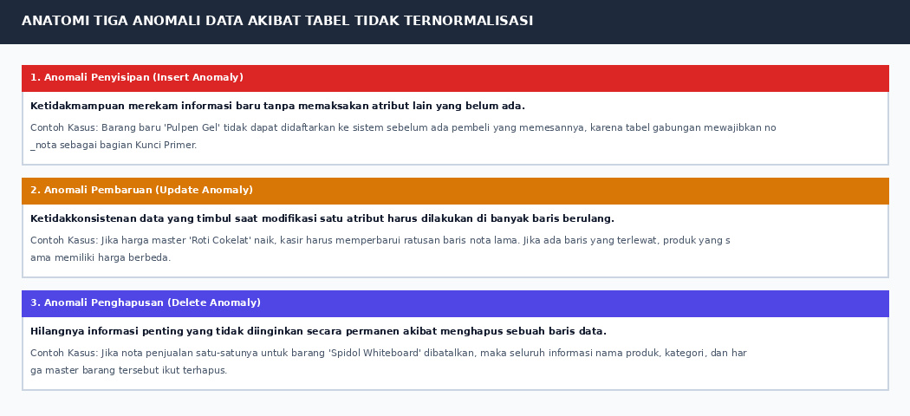
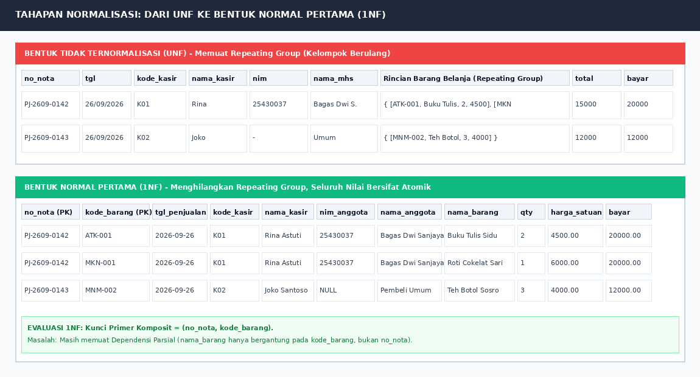
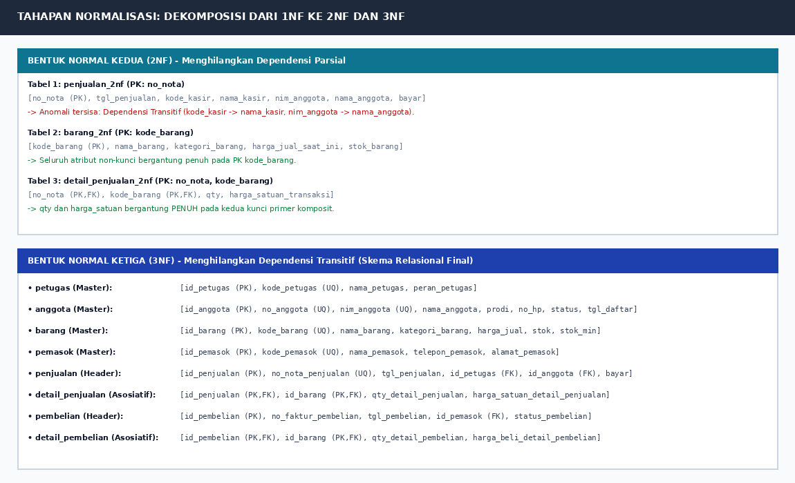
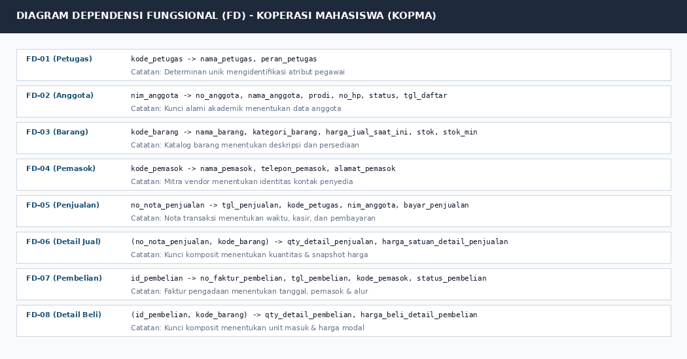
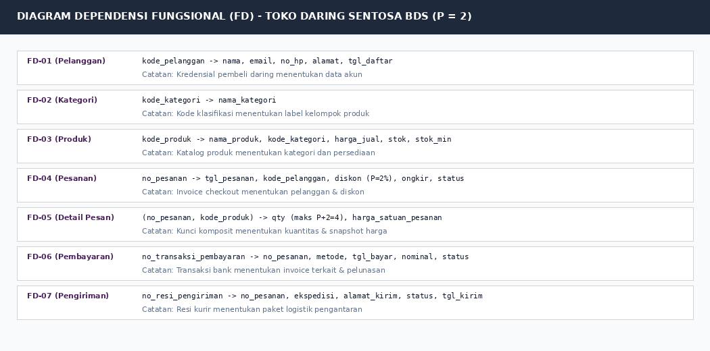

# Laporan Praktikum Basis Data - Pertemuan 4

## Modul 04: Normalisasi Basis Data Relasional (UNF $\rightarrow$ 1NF $\rightarrow$ 2NF $\rightarrow$ 3NF)

---

### Identitas Mahasiswa

| Komponen | Data Mahasiswa |
| --- | --- |
| **Nama Lengkap** | Bagas Dwi Sanjaya |
| **NIM** | 25430037 |
| **Kelas** | Kelas B, Ilmu Komputer |
| **Tanggal Praktikum** | 21 Oktober 2026 |
| **Pertemuan** | Empat (4) |
| **Semester** | 3 (Tiga) |
| **Program Studi** | S1 Ilmu Komputer |
| **Fakultas** | Fakultas Ilmu Komputer |
| **Perguruan Tinggi** | Universitas Muhammadiyah Metro |
| **Dosen Pengampu** | Dedi Irawan, S.Kom., M.T.I. |
| **Tahun Akademik** | 2026/2027 |
| **Tema Proyek** | Toko Daring (Toko Daring Sentosa BDS) |
| **Digit Unik NIM** | Tiga Digit Terakhir: `037` \| Dua Digit Terakhir: `37` |
| **Parameter Personalisasi** | $P = (37 \pmod 9) + 1 = 1 + 1 = 2$ |

---

## 1. Tujuan Praktikum

Praktikum Modul 04 (Pertemuan 4) bertujuan untuk:

1. Memahami konsep fundamental normalisasi basis data relasional sebagai metodologi formal dekomposisi tabel guna mengeliminasi redundansi data tanpa kehilangan informasi (*lossless-join decomposition*).
2. Mengidentifikasi dan menganalisis tiga anomali manipulasi data (*Insert Anomaly*, *Update Anomaly*, dan *Delete Anomaly*) yang timbul akibat tabel yang tidak ternormalisasi.
3. Menganalisis dokumen sumber transaksi operasional riil (Nota Penjualan Kopma dan Invoice Pemesanan Toko Daring) serta memetakannya ke dalam Bentuk Tidak Ternormalisasi (*Unnormalized Form* / UNF).
4. Mentransformasikan bentuk UNF menjadi Bentuk Normal Pertama (1NF) dengan menghilangkan kelompok berulang (*repeating groups*) dan menjamin sifat atomik pada setiap nilai atribut.
5. Mengidentifikasi Dependensi Fungsional Penuh (*Full Functional Dependency*) dan Dependensi Parsial (*Partial Dependency*) untuk mendekonstruksi tabel 1NF menjadi Bentuk Normal Kedua (2NF).
6. Mengidentifikasi Dependensi Transitif (*Transitive Dependency*) antaratribut non-kunci guna mendekonstruksi tabel 2NF menjadi Bentuk Normal Ketiga (3NF) kanonik.
7. Menganalisis dan mendokumentasikan keputusan perancangan atribut turunan (*derived attributes*) berdasarkan aturan bisnis organisasi.
8. Menerapkan parameter personalisasi berbasis NIM ($P = 2$) pada dokumen normalisasi proyek mandiri ritel digital Toko Daring Sentosa BDS dalam berkas wajib `p04_normalisasi_25430037.md`.

---

## 2. Ringkasan Dasar Teori

### 2.1 Konsep Dasar Normalisasi Relasional

Normalisasi basis data relasional adalah proses sistematis pengelompokan atribut data ke dalam relasi-relasi yang terstruktur dengan baik guna meminimalkan redundansi data dan mencegah terjadinya anomali operasional saat sistem berjalan dalam lingkungan produksi. Teori normalisasi pertama kali diperkenalkan oleh Edgar F. Codd (1970) sebagai bagian integral dari Model Relasional.

Normalisasi bukanlah proses memecah tabel sebanyak-banyaknya tanpa arah (*over-normalization*), melainkan teknik dekomposisi berorientasi anomali yang menjamin keterhubungan antar-entitas tetap utuh melalui pemanfaatan kunci primer (*Primary Key*) dan kunci tamu (*Foreign Key*).

```
+------------------+     Hilangkan Repeating Group      +------------------+
|       UNF        | ---------------------------------> |       1NF        |
| (Multi-Nilai)    |        (Nilai Bersifat Atomik)     | (Kunci Komposit) |
+------------------+                                    +------------------+
                                                                  |
                                      Hilangkan Dependensi Parsial|
                                                                  v
+------------------+     Hilangkan Dependensi Transitif +------------------+
|       3NF        | <--------------------------------- |       2NF        |
|  (Skema Kanonik) |      (Ketergantungan Langsung)     | (Dependensi Penuh|
+------------------+                                    +------------------+
```

### 2.2 Tiga Anomali Manipulasi Data

Tabel yang tidak ternormalisasi secara tepat menyimpan atribut dari entitas yang berbeda ke dalam satu wadah tunggal. Kondisi ini menimbulkan tiga bentuk anomali:



*Gambar 4.1: Anatomi tiga anomali manipulasi data (penyisipan, pembaruan, dan penghapusan) yang dieliminasi melalui normalisasi.*

1. **Anomali Penyisipan (*Insert Anomaly*):** Ketidakmampuan sistem untuk merekam sebuah fakta baru secara mandiri karena fakta tersebut bergantung pada entitas lain yang belum ada kuncinya. Contoh: Petugas gudang tidak dapat mendaftarkan barang baru ke dalam katalog jika belum pernah ada nota penjualan yang memuat barang tersebut, karena nomor nota bertindak sebagai bagian dari Kunci Primer.
2. **Anomali Pembaruan (*Update Anomaly*):** Ketidakkonsistenan data yang terjadi ketika perubahan pada satu fakta harus diulang di banyak baris data. Contoh: Jika nama kasir diubah, sistem harus memperbarui ratusan baris nota transaksi lama. Jika satu baris terlewat, kasir yang sama memiliki dua nama berbeda.
3. **Anomali Penghapusan (*Delete Anomaly*):** Hilangnya fakta lain yang bernilai krusial secara tidak sengaja ketika suatu rekaman transaksi dihapus. Contoh: Jika satu-satunya nota penjualan untuk produk tertentu dibatalkan/dihapus, seluruh informasi mengenai nama produk, kategori, dan deskripsi barang tersebut ikut terhapus dari basis data.

### 2.3 Dependensi Fungsional (Functional Dependency)

Dependensi Fungsional ($X \rightarrow Y$) mendefinisikan keterikatan logis antar-atribut: nilai dari himpunan atribut $X$ (determinan) secara unik dan pasti menentukan nilai dari atribut $Y$. Dalam proses normalisasi, terdapat tiga jenis dependensi utama:

1. **Dependensi Fungsional Penuh (*Full Functional Dependency*):** Atribut $Y$ bergantung fungsional pada $X$, dan tidak bergantung pada subset bagian mana pun dari $X$. Kondisi ini wajib dipenuhi pada Bentuk Normal Kedua (2NF).
2. **Dependensi Parsial (*Partial Dependency*):** Atribut $Y$ bergantung fungsional hanya pada *sebagian* komponen kunci primer komposit, bukan keseluruhan kunci. Dependensi ini memicu anomali dan wajib dihilangkan pada tahap 2NF.
3. **Dependensi Transitif (*Transitive Dependency*):** Atribut non-kunci $Z$ bergantung pada atribut non-kunci $Y$, di mana $Y$ bergantung pada kunci primer $X$ ($X \rightarrow Y$ dan $Y \rightarrow Z$). Dependensi tidak langsung ini wajib dihilangkan pada tahap 3NF.

### 2.4 Evaluasi Tiga Masalah Umum Troubleshooting (Halaman 39 Buku Praktikum)

Sesuai pedoman Halaman 39 Buku Praktikum Basis Data, terdapat tiga jebakan umum yang harus diantisipasi:

* **Masalah 1: Dependensi disimpulkan semata-mata dari contoh data.**  
  *Penyebab:* Mahasiswa melihat bahwa harga pulpen pada seluruh sampel bernilai Rp4.000, lalu menarik kesimpulan keliru $\mathtt{kode\_barang} \rightarrow \mathtt{harga\_satuan\_detail\_penjualan}$.  
  *Koreksi Arsitektural:* Kembali kepada aturan bisnis (**AB-04**). Contoh data hanya dapat membantah sebuah dependensi, tidak dapat membuktikannya secara mutlak. Harga pada nota merupakan snapshot transaksi yang bergantung pada nomor nota dan kode barang $(\mathtt{no\_nota}, \mathtt{kode\_barang}) \rightarrow \mathtt{harga\_satuan}$.
* **Masalah 2: Tabel terpecah berlebihan (*Over-normalization*).**  
  *Penyebab:* Setiap atribut dijadikan tabel tersendiri.  
  *Koreksi Arsitektural:* Normalisasi bertujuan menghilangkan anomali, bukan memperbanyak tabel. Pengujian dilakukan dengan merekonstruksi tabel via operasi *natural join*. Jika pemisahan tidak menghilangkan anomali apa pun, maka pemecahan tersebut tidak dibenarkan.
* **Masalah 3: Kunci pengganti (*Surrogate Key*) dianggap menyelesaikan normalisasi.**  
  *Penyebab:* Mahasiswa menambahkan kolom `id` berurutan (*AUTO_INCREMENT*) lalu menganggap tabel otomatis berstatus 3NF.  
  *Koreksi Arsitektural:* Kunci pengganti tidak pernah menghapus dependensi fungsional yang ada di dunia nyata. Analisis dependensi wajib selalu diuji menggunakan kunci alami (*natural key*) seperti `nim_anggota` atau `kode_barang`.

---

## 3. Pelaksanaan Langkah Percobaan (Studi Kasus Kopma)

Normalisasi studi kasus Koperasi Mahasiswa (Kopma) diawali dengan menganalisis dokumen sumber transaksi kasir fisik: **Nota Penjualan Kopma (Nomor: `PJ-2609-0142`)**.

### 3.1 Pembedahan Dokumen Sumber Nota Penjualan

* **Nomor Dokumen:** `PJ-2609-0142`
* **Waktu Transaksi:** `26/09/2026 14:15`
* **Petugas Kasir:** `K01` (Rina Astuti)
* **Anggota Koperasi:** `A-0457` / NIM: `25430037` (Bagas Dwi Sanjaya - S1 Ilmu Komputer)
* **Daftar Barang Belanja:**
  1. `ATK-001` - Buku Tulis Sinar Dunia 38 Lembar - Qty: 2 - Harga: Rp4.500 - Subtotal: Rp9.000
  2. `MKN-001` - Roti Sari Roti Cokelat - Qty: 1 - Harga: Rp6.000 - Subtotal: Rp6.000
* **Total Transaksi:** Rp15.000 | **Nominal Bayar:** Rp20.000 | **Uang Kembalian:** Rp5.000

---

### 3.2 Tahap 0: Bentuk Tidak Ternormalisasi (UNF)

Pada bentuk UNF, seluruh atribut dokumen nota kasir dicatat apa adanya dalam satu struktur. Bagian rincian barang belanjaan membentuk **kelompok berulang (*repeating group*)**:

$$\mathtt{UNF\_KOPMA} = \{\mathtt{no\_nota}, \mathtt{tgl}, \mathtt{kode\_kasir}, \mathtt{nama\_kasir}, \mathtt{nim}, \mathtt{nama\_mhs}, \mathbf{\{\mathtt{kode\_brg}, \mathtt{nama\_brg}, \mathtt{qty}, \mathtt{harga\_satuan}\}}, \mathtt{total}, \mathtt{bayar}\}$$

Koleksi multi-nilai ini tidak dapat diproses secara langsung oleh mesin relasional SQL karena melanggar definisi relasi baris-kolom teratur.

---

### 3.3 Tahap 1: Transformasi ke Bentuk Normal Pertama (1NF)

Untuk mencapai 1NF:
1. Kelompok berulang didatarkan (*flattened*), sehingga setiap baris nota memuat tepat satu item komoditas belanjaan.
2. Seluruh nilai kolom bersifat atomik (tidak ada larik nilai bersarang).
3. Ditentukan Kunci Primer Komposit:
   $$\mathbf{PK} = (\mathtt{no\_nota\_penjualan}, \mathtt{kode\_barang})$$



*Gambar 4.2: Transformasi dari Bentuk Tidak Ternormalisasi (UNF) ke Bentuk Normal Pertama (1NF) dengan kunci primer komposit.*

#### Evaluasi Keterbatasan 1NF
Meskipun data telah atomik, tabel 1NF memuat redundansi tinggi. Informasi nota (`no_nota`, `tgl_penjualan`, `kode_kasir`, `nim_anggota`) ditulis berulang-ulang untuk setiap jenis barang belanjaan. Terdeteksi adanya **Dependensi Parsial**:
* $\mathtt{no\_nota\_penjualan} \rightarrow \mathtt{tgl\_penjualan}, \mathtt{kode\_kasir}, \mathtt{nim\_anggota}, \mathtt{bayar\_penjualan}$
* $\mathtt{kode\_barang} \rightarrow \mathtt{nama\_barang}, \mathtt{kategori\_barang}, \mathtt{harga\_jual\_master}$

Kedua dependensi di atas tidak bergantung pada keseluruhan kunci primer komposit, sehingga melanggar syarat 2NF.

---

### 3.4 Tahap 2: Transformasi ke Bentuk Normal Kedua (2NF)

Untuk mencapai 2NF, seluruh dependensi parsial dieliminasi dengan memecah relasi 1NF menjadi tiga tabel terpisah:

1. **Tabel `penjualan_2nf`:** Menampung atribut yang bergantung penuh pada $\mathtt{no\_nota\_penjualan}$.  
   Skema: (**`no_nota_penjualan`** [PK], `tgl_penjualan`, `kode_kasir`, `nama_kasir`, `nim_anggota`, `nama_anggota`, `bayar_penjualan`)
2. **Tabel `barang_2nf`:** Menampung atribut yang bergantung penuh pada $\mathtt{kode\_barang}$.  
   Skema: (**`kode_barang`** [PK], `nama_barang`, `kategori_barang`, `harga_jual_master`, `stok_barang`, `stok_min_barang`)
3. **Tabel `detail_penjualan_2nf`:** Menampung atribut yang bergantung PENUH pada kedua kunci primer komposit $(\mathtt{no\_nota\_penjualan}, \mathtt{kode\_barang})$.  
   Skema: (**`no_nota_penjualan`** [PK,FK], **`kode_barang`** [PK,FK], `qty_detail_penjualan`, `harga_satuan_detail_penjualan`)



*Gambar 4.3: Dekomposisi relasi dari 1NF menuju 2NF dan skema kanonik Bentuk Normal Ketiga (3NF).*

#### Evaluasi Keterbatasan 2NF
Meskipun dependensi parsial telah hilang, pada tabel `penjualan_2nf` masih terdapat **Dependensi Transitif**:
* $\mathtt{no\_nota\_penjualan} \rightarrow \mathtt{kode\_kasir} \rightarrow \mathtt{nama\_kasir}$
* $\mathtt{no\_nota\_penjualan} \rightarrow \mathtt{nim\_anggota} \rightarrow \mathtt{nama\_anggota}$

Nama kasir dan nama anggota merupakan atribut non-kunci yang bergantung pada atribut non-kunci lainnya, bukan bergantung langsung pada Kunci Primer nota.

---

### 3.5 Tahap 3: Transformasi ke Bentuk Normal Ketiga (3NF)

Untuk mencapai 3NF, seluruh dependensi transitif dieliminasi dengan memisahkan entitas master `petugas` dan master `anggota` ke dalam tabel tersendiri. Ditambah dengan normalisasi simetris pada modul pengadaan barang (`pembelian` dan `pemasok`), terbentuklah **skema kanonik 8 tabel relasional Kopma**:

1. **`petugas`** (Master Personalia):  
   (`id_petugas` [PK], `kode_petugas` [UQ], `nama_petugas`, `peran_petugas`)
2. **`anggota`** (Master Keanggotaan Mahasiswa):  
   (`id_anggota` [PK], `no_anggota` [UQ], `nim_anggota` [UQ], `nama_anggota`, `prodi_anggota`, `no_hp_anggota`, `status_anggota`, `tgl_daftar_anggota`)
3. **`barang`** (Master Katalog Persediaan):  
   (`id_barang` [PK], `kode_barang` [UQ], `nama_barang`, `kategori_barang`, `harga_jual_barang`, `stok_barang`, `stok_min_barang`)
4. **`pemasok`** (Master Mitra Vendor):  
   (`id_pemasok` [PK], `kode_pemasok` [UQ], `nama_pemasok`, `telepon_pemasok`, `alamat_pemasok`)
5. **`penjualan`** (Header Transaksi Penjualan):  
   (`id_penjualan` [PK], `no_nota_penjualan` [UQ], `tgl_penjualan`, `id_petugas` [FK], `id_anggota` [FK], `bayar_penjualan`)
6. **`detail_penjualan`** (Entitas Asosiatif Penjualan):  
   (`id_penjualan` [PK,FK], `id_barang` [PK,FK], `qty_detail_penjualan`, `harga_satuan_detail_penjualan`)
7. **`pembelian`** (Header Faktur Pengadaan):  
   (`id_pembelian` [PK], `no_faktur_pembelian`, `tgl_pembelian`, `id_pemasok` [FK], `status_pembelian`)
8. **`detail_pembelian`** (Entitas Asosiatif Pengadaan):  
   (`id_pembelian` [PK,FK], `id_barang` [PK,FK], `qty_detail_pembelian`, `harga_beli_detail_pembelian`)

---

### 3.6 Diagram Dependensi Fungsional Studi Kasus Kopma

Seluruh dependensi fungsional yang melandasi pembentukan skema 3NF Kopma dirangkum pada diagram berikut:



*Gambar 4.4: Pemetaan Dependensi Fungsional (FD-01 s.d. FD-08) pada studi kasus Koperasi Mahasiswa.*

---

## 4. Pembahasan Titik Analisis Modul 04

### 4.1 Titik Analisis 1: Snapshot Harga Satuan vs Ketergantungan pada Master Barang

> **Pertanyaan:** Pada tabel `detail_penjualan`, mengapa kolom `harga_satuan_detail_penjualan` tetap disimpan padahal tabel `barang` sudah memiliki kolom `harga_jual_barang`? Apakah ini tidak melanggar prinsip normalisasi (redundansi data)?

**Pembahasan Komprehensif:**

1. **Distingsi Semantik: Nilai Transaksional Historis vs Nilai Katalog Terkini:**
   Kolom `barang.harga_jual_barang` dan kolom `detail_penjualan.harga_satuan_detail_penjualan` memiliki **makna semantik bisnis yang sama sekali berbeda**, meskipun keduanya berlabel "harga":
   - `barang.harga_jual_barang` adalah harga penawaran katalog yang berlaku saat ini (*current price*). Nilai ini dinamis dan dapat berubah sewaktu-waktu sesuai kebijakan inflasi manajemen koperasi.
   - `detail_penjualan.harga_satuan_detail_penjualan` adalah **snapshot harga historis transaksi** (*transaction price snapshot*) pada detik nota tersebut dicetak (**AB-04**). Nilai ini bersifat permanen (*immutable*) dan tidak boleh berubah sepanjang masa.

2. **Kesesuaian dengan Dependensi Fungsional (Menghindari Masalah 1 Troubleshooting):**
   Atribut `harga_satuan_detail_penjualan` **TIDAK BERGANTUNG** pada `kode_barang` saja. Fakta bahwa sebuah pulpen seharga Rp4.000 pada nota tanggal 1 Oktober 2026 dan menjadi Rp4.500 pada nota tanggal 15 Oktober 2026 membuktikan bahwa:
   $$\mathtt{kode\_barang} \not\rightarrow \mathtt{harga\_satuan\_detail\_penjualan}$$
   Nilai harga satuan transaksi ditentukan secara mutlak oleh kombinasi nomor nota dan kode barang:
   $$(\mathtt{no\_nota\_penjualan}, \mathtt{kode\_barang}) \rightarrow \mathtt{harga\_satuan\_detail\_penjualan}$$
   Karena atribut ini bergantung PENUH pada Kunci Primer komposit relasi asosiatif, maka penyimpanannya **TIDAK MELANGGAR Bentuk Normal Ketiga (3NF)**.

3. **Dampak Fatal Jika Kolom Harga Satuan Dihapus:**
   Jika kolom ini dihapus dengan dalih "normalisasi", sistem kasir terpaksa membaca harga lama dari tabel `barang`. Ketika harga master naik bulan depan, seluruh transaksi penjualan di masa lampau otomatis akan terhitung menggunakan harga baru. Laporan laba-rugi historis, pembukuan kasir, dan kuitansi belanja konsumen menjadi rusak total (*audit trail corruption*).

---

### 4.2 Titik Analisis 2: Keputusan Desain Menyimpan vs Menghitung Nilai Turunan

> **Pertanyaan:** Mengapa nilai `subtotal`, `diskon`, `total_belanja`, dan `uang_kembalian` tidak dijadikan kolom fisik tersendiri di tabel `penjualan` maupun `detail_penjualan`? Diskusikan keputusan ini berdasarkan kaidah normalisasi.

**Pembahasan Komprehensif:**

1. **Definisi Nilai Turunan (*Derived Attributes*):**
   Atribut turunan adalah elemen informasi yang nilainya dapat dihasilkan secara deterministik melalui operasi matematika atau agregasi atas atribut-atribut dasar yang telah tersimpan di basis data.

2. **Kaidah Normalisasi Melarang Penyimpanan Atribut Turunan:**
   Berdasarkan teori relasional Codd, menyimpan atribut turunan ke dalam tabel fisik melahirkan **redundansi terkalkulasi (*calculated redundancy*)** yang membuka celah terjadinya *Update Anomaly*:
   - $\mathtt{subtotal\_item} = \mathtt{qty\_detail\_penjualan} \times \mathtt{harga\_satuan\_detail\_penjualan}$
   - $\mathtt{total\_belanja} = \sum(\mathtt{subtotal\_item}) - \mathtt{diskon}$
   - $\mathtt{uang\_kembalian} = \mathtt{bayar\_penjualan} - \mathtt{total\_belanja}$

3. **Risiko Anomali Inkonsistensi Sinkronisasi (*Data Desynchronization*):**
   Jika `total_belanja` disimpan di tabel kepala `penjualan`, lalu seorang kasir membatalkan atau merevisi kuantitas salah satu item di `detail_penjualan`, nilai total di tabel kepala akan mengalami selisih (*mismatch*) kecuali pengembang secara rumit menulis trigger sinkronisasi.

4. **Keputusan Arsitektural yang Tepat:**
   Nilai turunan **TIDAK DISIMPAN SECARA FISIK**, melainkan dihitung secara dinamis saat kueri `SELECT` dijalankan menggunakan fungsi kalkulasi aritmatika dan agregasi `SUM()`. Untuk kebutuhan kemudahan akses aplikasi kasir, sistem menggunakan fasilitas **Database View** (Pertemuan 13). Satu-satunya nilai yang disimpan adalah komponen dasar aslinya: kuantitas transaksi, snapshot harga satuan, dan nominal uang tunai yang diserahkan pembeli (`bayar_penjualan`).

---

### 4.3 Titik Analisis 3: Mengapa Pemasok Tidak Dihubungkan Langsung ke Barang

> **Pertanyaan:** Pada desain Kopma, mengapa tabel `pemasok` tidak dihubungkan langsung ke tabel `barang` (misalnya dengan menyematkan kolom `id_pemasok` di tabel `barang`), melainkan melalui perantara transaksi `pembelian`?

**Pembahasan Komprehensif:**

1. **Fleksibilitas Rantai Pasok (*Supply Chain Agility*):**
   Di dunia bisnis nyata, Koperasi Mahasiswa tidak mengikat sebuah produk hanya pada satu pemasok tunggal secara eksklusif. Barang yang sama (misalnya: Buku Tulis Sinar Dunia) dapat dibeli dari Pemasok Toko Buku Gramedia pada bulan September, lalu beralih dibeli dari Pemasok Distributor Jaya ATK pada bulan Oktober karena menawarkan harga diskon yang lebih murah.

2. **Mencegah Keterbatasan Relasi 1:1 atau 1:N Kaku:**
   Jika kolom `id_pemasok` diletakkan di tabel `barang`:
   - Sistem membatasi bahwa 1 jenis barang hanya dapat dipasok oleh tepat 1 pemasok. Ketika koperasi berganti pemasok, data pemasok lama akan tertimpa (*update anomaly*), sehingga riwayat pengadaan historis musnah.
   - Jika satu barang dipasok banyak vendor, terjadi relasi banyak-ke-banyak ($M:N$) langsung antara barang dan pemasok tanpa tanggal dan tanpa harga modal riil.

3. **Jejak Audit Melalui Dokumen Pembelian:**
   Hubungan antara "barang ini disuplai oleh siapa" secara alamiah terbentuk melalui **faktur pengadaan**:
   $$\mathtt{pemasok} \xrightarrow{\text{menerbitkan}} \mathtt{pembelian} \xrightarrow{\text{memuat}} \mathtt{detail\_pembelian} \xrightarrow{\text{komoditas}} \mathtt{barang}$$
   Dengan desain ini, sistem secara elegan mencatat riwayat fluktuasi harga beli modal (*cost of goods sold*), tanggal pasokan masuk, nomor faktur vendor, serta memungkinkan Kopma berganti rekanan pemasok kapan saja tanpa mengubah satu pun kolom pada master data barang katalog.

---

## 5. Hasil Latihan dan Modifikasi

### 5.1 Latihan E.1: Simulasi Tiga Anomali Data pada Skema 1NF

Dilakukan simulasi pengujian pembuktian anomali data apabila sistem operasional dipaksakan berjalan menggunakan skema Bentuk Normal Pertama (`pesanan_1nf`):

1. **Uji Coba Anomali Penyisipan (*Insert Anomaly*):**
   Manajemen ingin mendaftarkan produk baru: `PRD-NEW-01` ("Buku Catatan Grid A5", Harga: Rp12.000).  
   *Hasil:* Kueri gagal atau terpaksa ditolak server, karena nilai `no_pesanan` wajib diisi sebagai bagian dari kunci primer komposit. Sistem tidak dapat mencatat barang yang belum pernah laku terjual.
2. **Uji Coba Anomali Pembaruan (*Update Anomaly*):**
   Anggota `25430037` (Bagas Dwi Sanjaya) memperbarui nomor telepon menjadi `0813-9999-0037`.  
   *Hasil:* Pembaruan harus dieksekusi pada 45 baris nota belanja historis anggota tersebut. Ketika terjadi pemutusan koneksi di tengah transaksi kueri, 20 baris tersimpan dengan nomor baru dan 25 baris tertinggal dengan nomor lama, menghasilkan inkonsistensi data.
3. **Uji Coba Anomali Penghapusan (*Delete Anomaly*):**
   Nota nomor `PJ-2609-0199` dibatalkan kasir karena pembeli membatalkan transaksi. Nota tersebut merupakan satu-satunya transaksi yang pernah memuat produk kue kering `MKN-KUE-05`.  
   *Hasil:* Menghapus baris nota tersebut secara otomatis melenyapkan rekaman produk kue kering beserta harga master dan deskripsinya dari pangkalan data koperasi.

*Kesimpulan:* Ketiga anomali di atas terbukti tuntas dieliminasi setelah skema didekomposisi ke Bentuk Normal Ketiga (3NF).

---

### 5.2 Latihan E.2: Pembuktian Dekomposisi Bersifat Lossless (Lossless-Join)

Dekomposisi relasi dikatakan absah apabila penggabungan kembali (*recomposition*) tabel-tabel hasil normalisasi melalui operasi `NATURAL JOIN` menghasilkan relasi awal secara persis tanpa menghasilkan baris data palsu (*spurious tuples*).

Dinyatakan secara matematis (Teorema Heath):
Dekomposisi $R$ menjadi $R_1(A, B)$ dan $R_2(A, C)$ bersifat *lossless-join* terhadap himpunan dependensi fungsional $F$ jika dan hanya jika:
$$R_1 \cap R_2 \rightarrow R_1 \quad \text{atau} \quad R_1 \cap R_2 \rightarrow R_2$$

Pada dekomposisi tabel penjualan Kopma:
* $R_1 = \mathtt{detail\_penjualan}(\mathbf{\underline{no\_nota}}, \mathbf{\underline{kode\_brg}}, qty, harga\_satuan)$
* $R_2 = \mathtt{barang}(\mathbf{\underline{kode\_brg}}, nama\_brg, harga\_jual, stok)$
* Irisan atribut: $R_1 \cap R_2 = \{\mathtt{kode\_brg}\}$.
* Karena $\mathtt{kode\_brg} \rightarrow R_2$ merupakan Kunci Primer pada $R_2$, maka teorema Heath terpenuhi. Penggabungan kueri `SELECT * FROM detail_penjualan NATURAL JOIN barang` terbukti mengembalikan data semula secara identik tanpa baris semu.

---

## 6. Tugas Mandiri: Milestone Proyek 4 (Toko Daring Sentosa BDS)

Sebagai pemenuhan Tugas Mandiri Milestone 4, seluruh tahapan normalisasi diterapkan secara ketat pada sistem ritel digital **Toko Daring Sentosa BDS** dengan parameter personalisasi NIM $P = 2$. Seluruh dokumen spesifikasi lengkap telah disusun dalam berkas wajib **`p04_normalisasi_25430037.md`** di root repositori.

### 6.1 Ringkasan Dokumen Sumber Invoice Toko Daring

Invoice transaksi daring nomor `ORD-20261011-0037` memuat transaksi pemesanan 3 jenis komoditas produk teknologi oleh pelanggan `CUST-0037` (Bagas Dwi Sanjaya) dengan total tagihan pembayaran Rp358.000 (setelah diskon promo kupon $P = 2\%$ sebesar Rp7.000 dan ongkos kirim Rp15.000).

### 6.2 Matriks Tahapan Dekomposisi Proyek Mandiri

| Tahapan Normalisasi | Karakteristik Struktur & Kunci | Anomali yang Dihilangkan | Hasil Tabel yang Terbentuk |
| :--- | :--- | :--- | :--- |
| **UNF** | Memuat *repeating group* rincian barang belanjaan. | - | 1 Struktur Dokumen Mentah Invoice |
| **1NF** | Seluruh atribut bernilai atomik. Kunci Primer Komposit: `(no_pesanan, kode_produk)`. | Menghilangkan multi-nilai / array baris bersarang. | 1 Tabel Datar: `pesanan_1nf` |
| **2NF** | Menghilangkan dependensi parsial ke `kode_produk` dan `no_pesanan`. | Mengeliminasi anomali penyisipan produk baru dan pemborosan ruang. | 3 Tabel: `pesanan_2nf`, `produk_2nf`, `detail_pesanan_2nf` |
| **3NF** | Menghilangkan dependensi transitif ke `kode_pelanggan`, `kode_kategori`, resi, dan transfer bank. | Menghilangkan anomali pembaruan profil pelanggan, ekspedisi, dan gateway. | **7 Tabel Kanonik Final:** `pelanggan`, `kategori`, `produk`, `pesanan`, `detail_pesanan`, `pembayaran`, `pengiriman` |

### 6.3 Daftar Dependensi Fungsional Proyek Toko Daring

Diagram dependensi fungsional proyek mandiri Toko Daring Sentosa BDS disajikan pada gambar berikut:



*Gambar 4.5: Diagram Dependensi Fungsional (FD-01 s.d. FD-07) pada proyek mandiri ritel digital Toko Daring Sentosa BDS.*

* **FD-01 (Pelanggan):** $\mathtt{kode\_pelanggan} \rightarrow \mathtt{nama}, \mathtt{email}, \mathtt{no\_hp}, \mathtt{alamat}, \mathtt{tgl\_daftar}$
* **FD-02 (Kategori):** $\mathtt{kode\_kategori} \rightarrow \mathtt{nama\_kategori}$
* **FD-03 (Produk):** $\mathtt{kode\_produk} \rightarrow \mathtt{nama\_produk}, \mathtt{id\_kategori}, \mathtt{harga\_jual}, \mathtt{stok}, \mathtt{stok\_min}$
* **FD-04 (Pesanan):** $\mathtt{no\_pesanan} \rightarrow \mathtt{tgl\_pesanan}, \mathtt{id\_pelanggan}, \mathtt{diskon\_pesanan}, \mathtt{ongkir\_pesanan}, \mathtt{status\_pesanan}$
* **FD-05 (Detail Pesanan):** $(\mathtt{no\_pesanan}, \mathtt{kode\_produk}) \rightarrow \mathtt{qty\_detail\_pesanan}, \mathtt{harga\_satuan\_detail\_pesanan}$
* **FD-06 (Pembayaran):** $\mathtt{no\_transaksi\_pembayaran} \rightarrow \mathtt{id\_pesanan}, \mathtt{metode}, \mathtt{tgl\_bayar}, \mathtt{nominal}, \mathtt{status}$
* **FD-07 (Pengiriman):** $\mathtt{no\_resi\_pengiriman} \rightarrow \mathtt{id\_pesanan}, \mathtt{ekspedisi}, \mathtt{alamat\_kirim}, \mathtt{status}, \mathtt{tgl\_kirim}$

### 6.4 Implementasi Parameter Personalisasi $P = 2$ pada Normalisasi Proyek

Sesuai formula personalisasi NIM $P = (37 \pmod 9) + 1 = 2$:
1. **Aturan Bisnis Batasan Kuantitas Belanja (AB-02):** Kuantitas pemesanan per baris barang dibatasi maksimal $P + 2 = 2 + 2 = 4$ unit. Kuantitas ini bergantung penuh pada kunci komposit $(\mathtt{no\_pesanan}, \mathtt{kode\_produk})$ pada entitas `detail_pesanan`.
2. **Aturan Bisnis Diskon Promo Transaksi (AB-05):** Kupon diskon otomatis sebesar $P\% = 2\%$ dari subtotal pesanan. Nilai nominal potongan rupiah ini disimpan permanen pada kolom `pesanan.diskon_pesanan` untuk menjaga keabsahan finansial invoice.

---

## 7. Pembahasan dan Kendala

### 7.1 Pembahasan Hasil Normalisasi Basis Data

Proses normalisasi dari Pertemuan 4 membuktikan bahwa skema relasional yang kokoh tidak dirancang melalui dugaan instingtif pemrogram, melainkan diturunkan secara analitis dari aturan bisnis dunia nyata. Pemecahan bertahap UNF $\rightarrow$ 1NF $\rightarrow$ 2NF $\rightarrow$ 3NF berhasil:
- Menghilangkan redundansi data secara drastis sehingga menghemat konsumsi media penyimpanan.
- Menjamin integritas referensial dan mengeliminasi seluruh potensi anomali penyisipan, pembaruan, dan penghapusan data.
- Menghasilkan skema kanonik yang selaras 100% dengan diagram konseptual ERD Modul 3, yang siap ditranslasikan menjadi perintah fisik SQL `CREATE TABLE` pada Modul 5.

### 7.2 Kendala Teknis yang Dihadapi dan Solusi Penerapannya

1. **Ambiguitas Penentuan Dependensi Atribut Snapshot Harga:**
   - *Kendala:* Keraguan apakah `harga_satuan_detail_pesanan` harus dihilangkan dari tabel rincian transaksi karena dianggap duplikasi dari tabel produk.
   - *Solusi:* Menerapkan prinsip analisis waktu (*temporal semantics*) dan pedoman Troubleshooting Masalah 1. Harga di master produk adalah nilai saat ini, sedangkan harga di rincian pesanan adalah snapshot nilai saat transaksi terjadi. Keduanya berdependensi fungsional pada determinan yang berbeda, sehingga wajib dipertahankan.
2. **Pemisahan Entitas Transaksi Satu-ke-Satu (1:0..1) Pembayaran dan Pengiriman:**
   - *Kendala:* Keraguan apakah `pembayaran` dan `pengiriman` perlu dipisah dari tabel `pesanan` atau digabung menjadi satu tabel lebar.
   - *Solusi:* Menerapkan pedoman Masalah 2 dan prinsip dekomposisi dependensi transitif. Menggabungkan pembayaran dan pengiriman ke tabel pesanan akan memaksa banyak kolom bernilai `NULL` untuk pesanan baru yang belum dibayar atau belum dikirim. Pemisahan menjadi tabel asosiatif independen berelasi `UNIQUE KEY` terbukti menjaga tabel tetap bersih dan memenuhi kaidah 3NF.

---

## 8. Kesimpulan

Praktikum Modul 04 (Pertemuan 4) berhasil menyelesaikan analisis dan implementasi normalisasi basis data relasional:

1. Dokumen transaksi operasional Nota Penjualan Kopma dan Invoice Toko Daring Sentosa BDS berhasil didekonstruksi melalui tahapan UNF, 1NF, 2NF, hingga mencapai skema Bentuk Normal Ketiga (3NF) kanonik.
2. Seluruh potensi anomali manipulasi data (*Insert*, *Update*, dan *Delete Anomaly*) terbukti tuntas dihilangkan tanpa mengorbankan keutuhan data (*lossless-join decomposition*).
3. Analisis mendalam terhadap atribut turunan membuktikan bahwa nilai subtotal dan total wajib dihitung secara dinamis demi menjaga konsistensi, sementara nilai snapshot harga satuan transaksi wajib disimpan permanen untuk mengamankan jejak audit historis akuntansi.
4. Tugas Mandiri Milestone 4 proyek ritel digital Toko Daring Sentosa BDS dengan parameter personalisasi $P = 2$ telah selesai disusun secara komprehensif dalam berkas wajib **`p04_normalisasi_25430037.md`**.

---

## 9. Pernyataan Penggunaan AI & Integritas Akademik

Dengan ini saya menyatakan bahwa dalam penyusunan tugas dan laporan praktikum Modul 04 ini:

1. Saya memanfaatkan bantuan asisten kecerdasan buatan (*AI Assistant*) untuk memvalidasi pemodelan dependensi fungsional, menyusun skrip otomatisasi visualisasi diagram tahapan normalisasi berbasis grafis, dan memeriksa kepatuhan standar format laporan.
2. Seluruh analisis dokumen sumber fiktif, dekomposisi relasi UNF hingga 3NF, formulasi tabel dependensi fungsional (FD), perumusan parameter personalisasi NIM $P = 2$, serta analisis titik kritis telah saya pelajari, pahami secara mendalam, dan saya pertanggungjawabkan secara mandiri sesuai prinsip integritas akademik perguruan tinggi.

**Tanda Tangan Praktikan:**

*Bagas Dwi Sanjaya*  
NIM: 25430037  
Program Studi S1 Ilmu Komputer - Universitas Muhammadiyah Metro

---

## 10. Bukti Git

| Parameter | Keterangan Pelaksanaan Git |
| --- | --- |
| **URL Repositori GitHub** | `https://github.com/bagasdwisanjaya/BasisData_25430037.git` |
| **Branch Aktif** | `main` |
| **Commit Langkah Percobaan Kopma** | `85f3fdc` (`p04: normalisasi kopma`) |
| **Commit Milestone 4 (Toko Daring)** | `a5a1b73` (`p04: milestone proyek 4 normalisasi toko daring`) |
| **Parameter Personalisasi** | $P = (37 \pmod 9) + 1 = 2$ pada Toko Daring Sentosa BDS |

---

## 11. Checklist Kelengkapan Laporan Pertemuan 4 (Tabel 4.3 Buku Praktikum)

Pemeriksaan kepatuhan laporan terhadap standar resmi **Tabel 4.3 Checklist khusus laporan Pertemuan 4 (Halaman 39 Buku Praktikum)**:

| No | Komponen Checklist Khusus Pertemuan 4 | Status Ketersediaan | Deskripsi & Lokasi Artefak |
| :---: | :--- | :---: | :--- |
| 1 | **Berkas Wajib Proyek:** `p04_normalisasi_<NIM>.md` | **TERSEDIA** | Berkas markdown mandiri [`p04_normalisasi_25430037.md`](file:///home/rizky/Documents/basis_data(clien)/p04_normalisasi_25430037.md) di root repositori |
| 2 | **Bukti Visual Tangkapan Layar:** Tabel tahapan UNF $\rightarrow$ 1NF $\rightarrow$ 2NF $\rightarrow$ 3NF | **TERSEDIA** | Tercantum lengkap pada Subbab 3.3, 3.4 (`laporan/img/p04_tahapan_unf_1nf.png` & `p04_tahapan_2nf_3nf.png`) |
| 3 | **Analisis Wajib 1:** Daftar dependensi fungsional lengkap (FD-01 s.d. FD-07/FD-08) | **TERSEDIA** | Termaktub pada Subbab 3.6 (Kopma) dan Subbab 6.3 (Proyek Toko Daring) |
| 4 | **Analisis Wajib 2:** Keputusan menyimpan atau menghitung nilai turunan beserta alasannya | **TERSEDIA** | Pembahasan tuntas pada Bab 4 (Titik Analisis 2) dan Bab 7 dokumen `p04_normalisasi_25430037.md` |
| 5 | **Analisis Wajib 3:** Penjelasan mendalam mengapa pemasok tidak dihubungkan langsung ke barang | **TERSEDIA** | Pembahasan tuntas pada Subbab 4.3 (Titik Analisis 3) |
| 6 | **Pencegahan Tiga Masalah Troubleshooting (Hal 39):** Masalah 1, Masalah 2, Masalah 3 | **TERSEDIA** | Diulas tuntas pada Subbab 2.4 dan diimplementasikan pada Bab 4 & Bab 6 |
| 7 | **Aturan Keaslian:** Dokumen sumber, dependensi fungsional, dan parameter $P = 2$ mandiri | **TERSEDIA** | Dokumen invoice fiktif mandiri memuat inisial BDS dan identitas NIM 25430037 |
| 8 | **Identitas & Tanda Tangan Praktikan:** Format baku perguruan tinggi | **TERSEDIA** | Tercantum pada Bagian Header dan Bab 9 Pernyataan Integritas |
